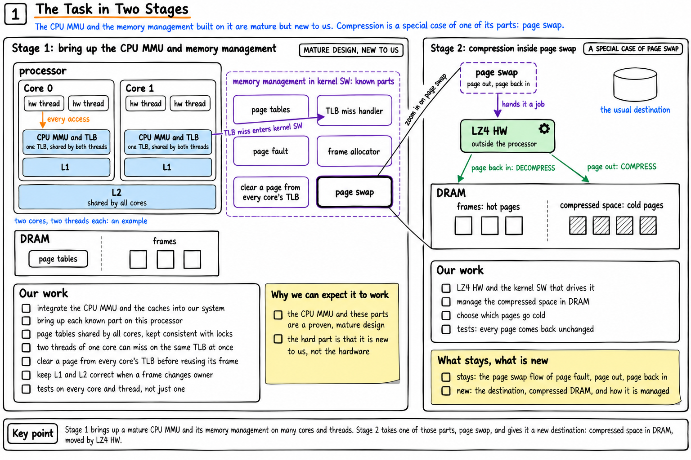
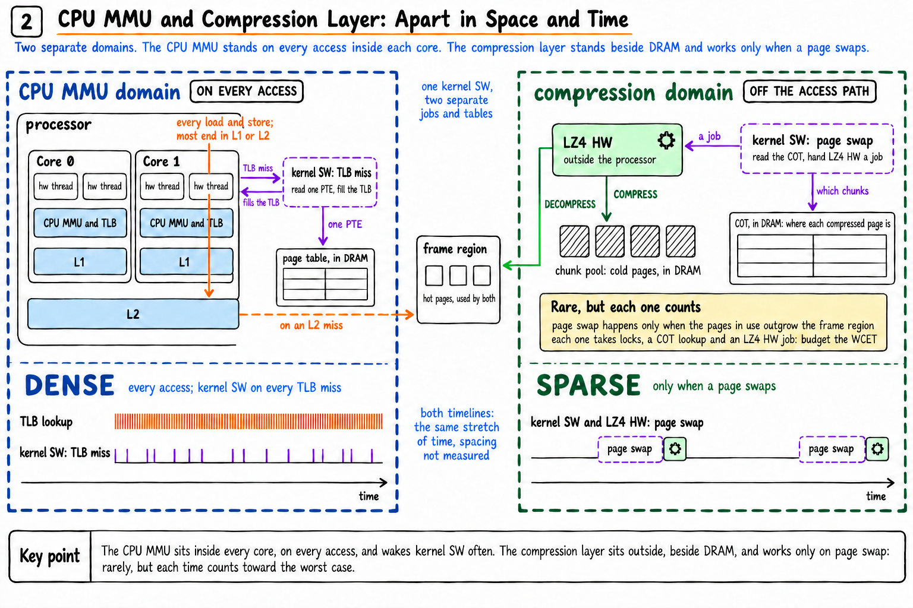
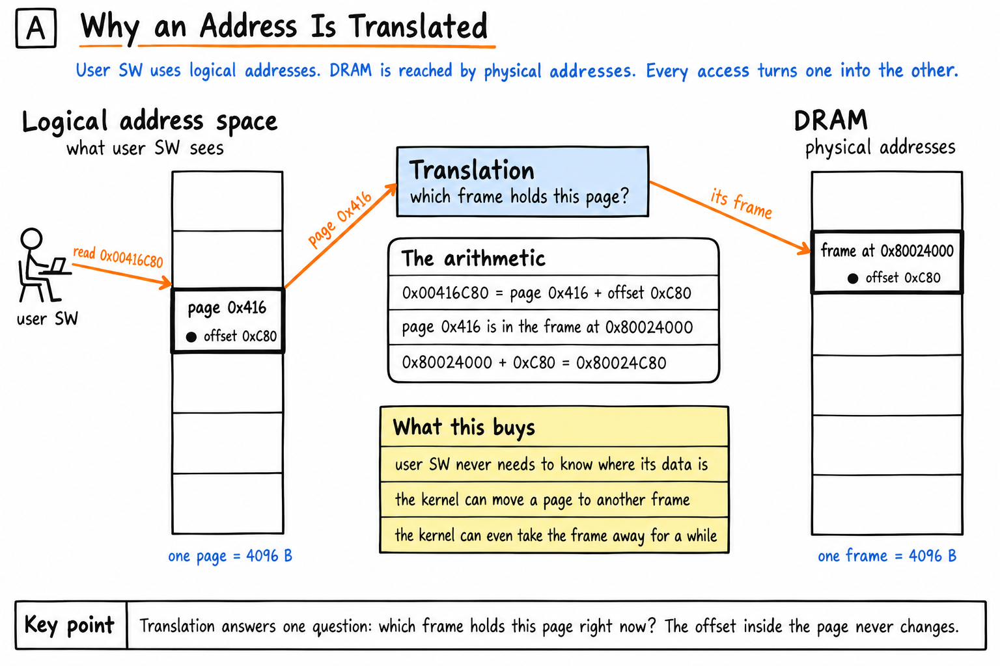
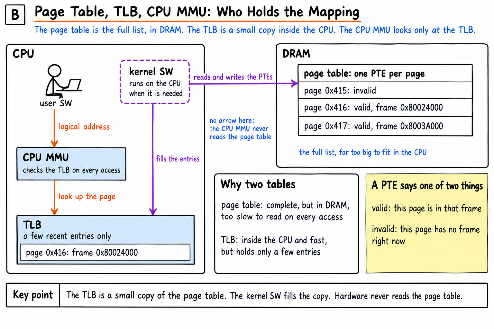
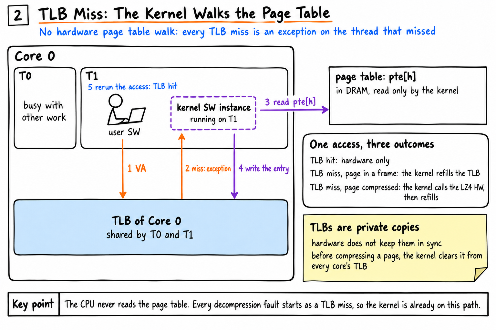
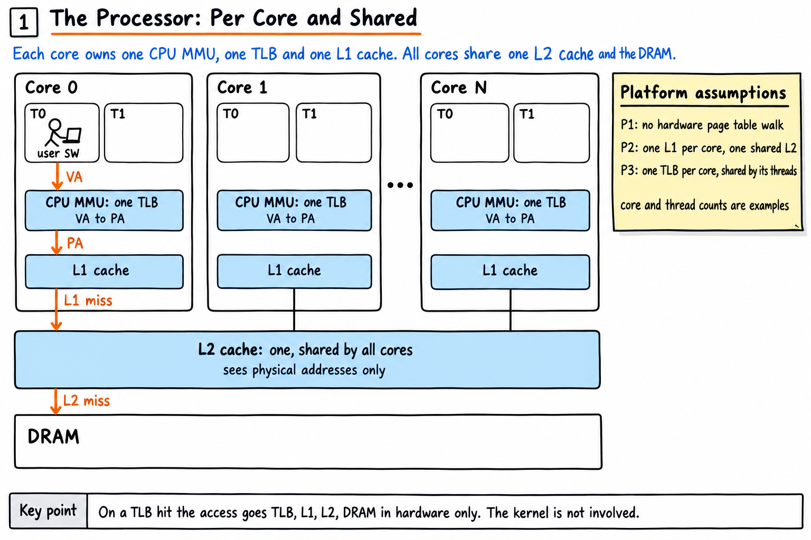
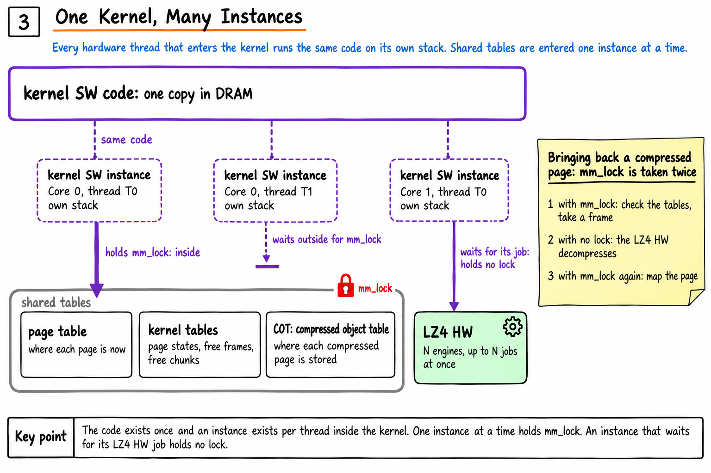
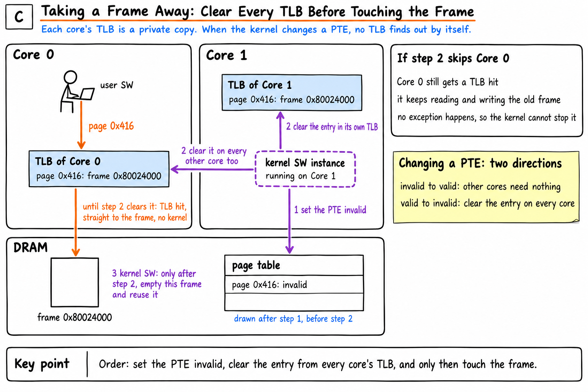
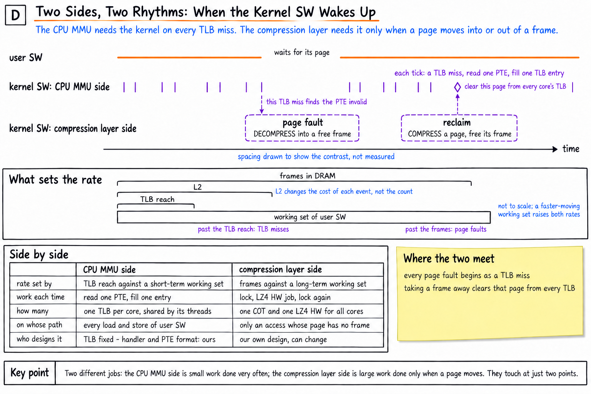

# DRAM compression study

## 先看全貌：這次的工作

這一節給第一次碰這顆 processor 的團隊。兩張圖先說工作的範圍，後面各節再一層一層講 CPU MMU。

### 任務圖 1：工作分兩段

這張圖回答這次的工作是什麼，難在哪裡。第一段在 multi-core、multi-thread 的 processor 上，把 CPU MMU 與 kernel SW 的記憶體管理打通並驗證。CPU MMU 是成熟的設計，難在團隊沒用過，不在硬體。第二段在記憶體管理的 page swap 裡加上 LZ4 HW。一般的 page swap 把 page 送到 disk，這裡改送到 DRAM 裡壓縮過的空間。

### 任務圖 2：CPU MMU 與壓縮層在空間與時間上分開

這張圖回答：第二段既然是第一段的延伸，CPU MMU 與壓縮層會不會綁在一起。答案是不會，兩者是分開的兩個範圍。

| 項目 | CPU MMU | 壓縮層 |
|---|---|---|
| 在哪裡 | 每個 core 裡 | processor 外，DRAM 旁 |
| 什麼時候動作 | 每一次 access 的路上 | 只在 page swap 時 |
| kernel SW 多常起來 | 常常，每次 TLB miss 都起來 | 次數少 |
| kernel SW 起來做什麼 | 讀一筆 PTE，填 TLB | 拿 lock，查 kernel 自己的表，交給 LZ4 HW 一個 job |
| 每一次的分量 | 小工作 | 大工作，每一次都算進 WCET |

時間與頻率的部分和第 8 節的白板圖 D 重疊，這一張多了空間。

兩張圖的主張、依據與生成紀錄在 [figures/two-stage-task/README.md](figures/two-stage-task/README.md)。

## 這份 README 給誰

這個 repo 研究 SoC 上的 DRAM compression，目標是省容量。主要產出有兩個：LZ4 硬體加速器的設計規格，以及控制 LZ4 的 kernel SW 的設計規格與 pseudo code。

這份 README 是入口，給沒有接觸過 CPU MMU 的 team member 與主管。主角是 CPU MMU：user SW 的一次 access 怎麼變成對 DRAM 的存取，kernel SW 什麼時候介入，有多個 core 時多了什麼問題。其他文件都假設讀者已經知道這些。

除了最前面的兩張任務圖，壓縮層只在第 7 層出現，而且只講它接在哪裡。LZ4 HW 的內部、job 的格式、kernel SW 的每一步都在別的文件，第 11 節有清單。repo 裡有哪些東西、怎麼建置，在第 13 節之後。

內容照專案的平台前提 P1 到 P3，前提的全文在 [CLAUDE.md](CLAUDE.md)。前提、從前提推出來的事、還不知道的事，在文中分開說，第 9 節整理成表。文中的 address 都是例子。

**單一檔案的版本**：`python3 figures/build_book.py README.md OUT.html` 會產生一個把圖嵌在裡面的 HTML。

## 1. 怎麼讀

每一層回答一個問題。每一層的結尾留下一個疑問，由下一層回答。不熟的名詞查第 12 節。

| 層 | 回答的問題 | 圖 | 讀到這裡就夠的人 |
|---|---|---|---|
| 1 | address 為什麼要轉換 | 白板圖 A | |
| 2 | 轉換靠哪些東西 | 白板圖 B | |
| 3 | 一次 access 有哪幾種結果，kernel 什麼時候介入 | 白板圖 2 | 想知道「kernel SW 會不會拖慢系統」在問什麼的人 |
| 4 | 有多個 core 時，哪些東西每個 core 一份 | 白板圖 1 | |
| 5 | 好幾個 core 同時進 kernel 會怎樣 | 白板圖 3 | 想知道為什麼需要 lock 的人 |
| 6 | kernel 改了 page table，各個 core 的 TLB 怎麼辦 | 白板圖 C | 要讀壓縮層文件的人 |
| 7 | 壓縮層接在哪裡 | 沒有 | |

白板圖有三組。最前面的任務圖 1 與 2 只講工作的範圍，不屬於上表的任何一層。編號 1 到 3 的那一組先畫，讀者是已經知道 CPU MMU 的工程師。字母 A 到 C 的那一組是為這份文件補的。編號與字母都是畫的順序，不是閱讀的順序。

## 2. 第 1 層：address 為什麼要轉換

### 白板圖 A：address 為什麼要轉換

User SW 用的 address 叫 logical address。DRAM 上的位置叫 physical address。這兩個不是同一個數字，每一次 access 都要把前者換成後者。

兩邊都切成 4096 B 一塊。logical 這一邊的一塊叫 page，DRAM 這一邊的一塊叫 frame。轉換只做一件事：查出這個 page 現在放在哪一個 frame。page 裡面的位置不變。

| 項目 | 例子 | 說明 |
|---|---|---|
| user SW 讀的 logical address | 0x00416C80 | |
| 一個 page 的大小 | 4096 B，也就是 0x1000 | |
| page 的編號 | 0x416 | address 除以 4096 的商 |
| page 裡面的位置 | 0xC80 | address 除以 4096 的餘數 |
| 這個 page 現在放在哪個 frame | 從 physical address 0x80024000 開始的那一個 | 這就是轉換要查的事 |
| 實際存取的 physical address | 0x80024C80 | frame 的起點加上 page 裡面的位置 |

圖上寫的 `page 0x416 + offset 0xC80` 不是把兩個數字相加。它的意思是 address 的前段是 page 的編號，後段是 page 裡面的位置。

多這一道手續換到的是：user SW 不需要知道資料真正放在哪裡。kernel 可以把一個 page 的內容搬到別的 frame，甚至暫時不給它 frame，user SW 的程式一個字都不用改。它只會感覺到某一次 access 比較久。後面每一層都建立在這件事上。

**留下的問題**：每一次 access 都要查，是誰在查，查的是哪一張表？

## 3. 第 2 層：page table、TLB、CPU MMU

### 白板圖 B：page table、TLB、CPU MMU

| 角色 | 是什麼 | 在哪裡 | 誰讀，誰寫 |
|---|---|---|---|
| page table | 完整的對照表。每個 page 一筆，一筆叫一個 PTE | DRAM，整個系統一份 | 只有 kernel SW |
| TLB | 一張很小的表，只放最近用過的幾筆對應 | CPU 裡面 | CPU MMU 每次 access 都查。內容由 kernel SW 填 |
| CPU MMU | 做轉換的硬體。拿 page 的編號去查 TLB | CPU 裡面 | 硬體 |

PTE 只有兩種值。valid 的 PTE 記著這個 page 在哪一個 frame。invalid 的 PTE 表示這個 page 現在沒有 frame。

需要兩張表的原因是速度。page table 很完整，但是它在 DRAM 裡，每次 access 都去讀會太慢。TLB 就在 CPU 裡面，查得很快，但是放不了幾筆。所以 TLB 是 page table 的一小份抄本。

**這個平台和許多 CPU 不一樣的地方**，是平台前提 P1：TLB 裡查不到的時候，CPU 硬體不會自己去讀 page table。許多 CPU 有這個功能，叫 hardware page table walk。我們的沒有，查不到就交給 kernel SW。由此推出兩件事：

- page table 只有 kernel SW 在讀，所以它的格式由 kernel 決定。
- CPU MMU 從頭到尾只認得 TLB。它不知道 page table 的存在。

**留下的問題**：TLB 裡查不到的時候，接下來發生什麼事？

## 4. 第 3 層：一次 access 的三種結果

### 白板圖 2：TLB miss 進 kernel

查得到叫 TLB hit，查不到叫 TLB miss。圖上的五個編號是 TLB miss 的過程：

| 編號 | 誰 | 做什麼 |
|---|---|---|
| 1 | user SW | 做一次 access。圖上寫的 VA 就是 logical address，PA 就是 physical address |
| 2 | CPU MMU | TLB 裡沒有這個 page，發出 exception |
| 3 | kernel SW | 到 page table 讀這個 page 的 PTE |
| 4 | kernel SW | 把這一筆對應寫進 TLB |
| 5 | CPU | 重新執行同一道指令，這一次 TLB hit |

exception 的意思是：CPU 停在這一道指令上，改去執行 kernel SW 裡的一段程式。這一段程式叫 TLB miss handler。它做完之後返回，CPU 把剛才那道指令再執行一次。user SW 不知道中間發生過這些事。

把 PTE 的兩種值放進來，一次 access 就有三種結果：

| 結果 | 條件 | 誰做事 | user SW 的感覺 |
|---|---|---|---|
| TLB hit | TLB 裡有這個 page | 只有硬體 | 沒有感覺 |
| TLB miss，PTE 是 valid | TLB 裡沒有，page table 說它在某個 frame | kernel SW 讀 PTE，填 TLB | 慢一點 |
| TLB miss，PTE 是 invalid | TLB 裡沒有，page table 說它現在沒有 frame | kernel SW 先讓這個 page 有 frame，把 PTE 改成 valid，再填 TLB | 慢更多 |

第三種在這個專案的文件裡叫 page fault。

從 P1 推出來、後面會一直用到的三件事：

- 「page 在 frame 裡」不等於「kernel 不介入」。只有 TLB hit 的時候 kernel 才不介入。
- 每一次 page fault 都先是一次 TLB miss。所以 page fault 的次數不會超過 TLB miss 的次數，而且 kernel 本來就在這條路上。
- 這是平台本來就有的成本，有沒有壓縮層都一樣。

TLB miss handler 跑一次要多久，目前不知道。

**留下的問題**：processor 有好幾個 core。TLB 是大家共用一張，還是各有各的？

## 5. 第 4 層：多個 core 時，哪些每個 core 一份

### 白板圖 1：每個 core 自己的，與共用的

| 東西 | 幾份 | 依據 |
|---|---|---|
| CPU MMU | 每個 core 一個 | 轉換發生在每個 core 自己的 access 路上 |
| TLB | 每個 core 一張，由該 core 的 hardware thread 共用 | 平台前提 P3。這一條是假設，還沒對過 CPU 手冊 |
| L1 cache | 每個 core 一個 | 平台前提 P2 |
| L2 cache | 一個，所有 core 共用 | 平台前提 P2 |
| DRAM | 一份 | |
| page table | 一份，放在 DRAM | |

TLB hit 的時候，一次 access 依序經過 TLB、L1、L2、DRAM，全部是硬體。L2 只看得到 physical address。

圖上 core 與 hardware thread 的數目是例子。

這一層要帶走的是兩件事：

- **每個 core 的 TLB 是各自的抄本。** Core 0 的 TLB 裡有 page 0x416，不代表 Core 1 的也有。Core 1 第一次碰這個 page 時，會在 Core 1 上發生自己的 TLB miss。
- **硬體不會幫忙對帳。** 照 P1，硬體根本不讀 page table。kernel 改了某個 PTE，沒有任何一張 TLB 會自己知道。

**留下的問題**：兩個 core 可以同時發生 TLB miss。那 kernel SW 是不是同時有兩個在跑？

## 6. 第 5 層：kernel SW 一份程式，多個 instance

### 白板圖 3：一個 kernel，多個 instance

是的，會同時有好幾個。kernel SW 的程式碼在 DRAM 裡只有一份。每一個進入 kernel 的 hardware thread 都執行這同一份程式，用的是自己的 stack。這樣的一次執行叫一個 kernel SW instance。同一時間可以有好幾個 instance。

問題出在它們要讀寫同一批表：page table，以及 kernel 自己記帳用的表。圖上第三張表 COT 是壓縮層的表，這裡不展開。兩個 instance 同時改同一筆，表就會壞掉。所以進去改這些表之前要先拿一把 lock，叫 `mm_lock`。同一時間只有一個 instance 拿得到，其他的在外面等。

圖的右邊有一個 instance 在等 LZ4 HW，手上沒有 lock。意思是：會等很久的事不握著 lock 做，免得其他 core 全部卡住。圖上的 N 是 LZ4 HW 同時能做的工作數，目前暫定 4。這一部分屬於壓縮層，這裡不展開。

lock 保護的是共用的表，不是硬體。core 再多、硬體再快，只要表是共用的，lock 就在。

還沒設計的一件事：第 3 層的第二種結果，也就是只需要填 TLB 的 TLB miss，handler 讀 PTE 的時候要不要拿 `mm_lock`。現有的 kernel model 是在 P1 指定之前寫的，它把這一步當成硬體做的。

**留下的問題**：kernel 握著 lock 改了一個 PTE。別的 core 的 TLB 裡還留著舊的那一筆，怎麼辦？

## 7. 第 6 層：kernel 改 PTE 的時候，TLB 怎麼辦

### 白板圖 C：拿走 frame 之前，先清每個 core 的 TLB

圖畫的是第 1 步做完、第 2 步還沒做的那一刻。這時 frame 裡還有 page 0x416 的資料，兩個 core 的 TLB 都還留著舊的那一筆。圖上 Core 1 的 kernel 怎麼清到 Core 0 的 TLB，沒有畫，因為這個平台用什麼機制還不知道。

改的方向有兩種，要做的事不一樣。

| kernel 改了什麼 | 別的 core 的 TLB 要不要處理 | 原因 |
|---|---|---|
| invalid 改成 valid，也就是給 page 一個 frame | 不用 | 別的 core 的 TLB 裡本來就沒有這一筆。它下次碰這個 page 會 TLB miss，自然讀到新的 PTE |
| valid 改成 invalid，也就是把 page 的 frame 拿走 | 要。把這一筆從每一個 core 的 TLB 清掉，全部清完才能往下做 | 別的 core 的 TLB 裡可能還有舊的那一筆。TLB hit 時 kernel 不介入，那個 core 會繼續讀寫那個 frame |

拿走 frame 的順序是固定的：

| 順序 | 做什麼 | 順序反過來會怎樣 |
|---|---|---|
| 1 | 把 PTE 改成 invalid | 先清 TLB 的話，某個 core 可能立刻又 TLB miss，從還是 valid 的 PTE 把舊的對應填回去 |
| 2 | 把這一筆從所有 core 的 TLB 清掉 | |
| 3 | 這之後才能動那個 frame：給別的 page，或讓別的硬體去讀它 | 還沒清完就動，別的 core 還在寫那個 frame。資料會丟掉，或兩個 page 的內容混在一起 |

這不是推測。kernel model 的測試裡有一個故意改壞的版本，只清自己這個 core 的 TLB。測試在第一個檢查就抓到，訊息是：

- `StaleTlb: core 0 still translates page 0x16 to 0x80024000, the PTE says 0x0`

意思是 page 0x16 的 PTE 已經是 invalid，Core 0 的 TLB 卻還把它對到 0x80024000 的 frame。

附帶的一件事：沒有 hardware page table walk，也就沒有硬體替 kernel 記「這個 page 最近有沒有被用過」。kernel 要自己記，最自然的地方是 TLB miss handler。這是推論。

這一層有三件事還不知道，都要看 CPU：

- 清掉其他 core 的 TLB entry 用什麼機制，要多久。現有文件裡的 500 ns 是假設的數字，沒有量過。
- 同一個 core 的兩個 hardware thread 同時改 TLB，CPU 有什麼限制。
- TLB 會不會把 invalid 的結果也記起來。會的話，上表第一列也要清。

**留下的問題**：這些和 DRAM compression 有什麼關係？

## 8. 第 7 層：壓縮層接在哪裡

壓縮層沒有替 CPU MMU 增加任何新的機制。它用的全部是前面六層已經有的東西。

| 前面講過的機制 | 壓縮層怎麼用 |
|---|---|
| kernel 可以把 PTE 從 valid 改成 invalid | frame 不夠時，kernel 挑一個 page，照第 6 層的順序拿走它的 frame。內容壓縮之後收在 DRAM 的另一區 |
| PTE 是 invalid 的 access 一定進 kernel | 有人再碰這個 page 時，kernel 請 LZ4 HW 把內容解壓縮到一個 frame，把 PTE 改回 valid，再填 TLB |
| user SW 只感覺到時間 | user SW 不用改。代價是那一次 access 變慢 |
| kernel 自己記哪些 page 最近用過 | 用來挑要收起來的 page |
| 會等很久的事不握著 lock 做 | 等 LZ4 HW 的那一段不握 `mm_lock` |

所以從 CPU MMU 這一邊看，加了壓縮層之後只有兩件事不同。第 3 層的第三種結果有時候要更久，因為要等解壓縮。kernel 把 PTE 改成 invalid 的次數變多，因為它要騰出 frame。

CPU MMU 自己看到的仍然只有 TLB 裡有或沒有。kernel 的 TLB miss handler 看到的是 PTE 是 valid 或 invalid。「invalid 的 page 內容現在在哪裡」完全記在 kernel 自己的表裡，CPU 不知道。這是壓縮層文件的起點，見第 11 節的「page 的六種狀態」。

### 白板圖 D：兩邊各多常叫醒 kernel SW，由什麼決定

CPU MMU 與壓縮層都在管 page，但它們是兩件事。CPU MMU 這邊是小工作、很常做；壓縮層這邊是大工作，只在 page 進出 frame 時做。兩者只在兩個地方碰到。

| 圖上的東西 | 意思 |
|---|---|
| 時間軸 | 上面一條是 user SW，中間是 CPU MMU 這邊的 kernel SW，下面是壓縮層這邊的 kernel SW。間距只用來對照，沒有量過。這個平台的 fault 率還沒有實際資料 |
| 兩條虛線箭頭 | 兩邊碰到的兩個地方。往下的那條：一次 TLB miss 發現 PTE 是 invalid，變成 page fault。往上的那條：reclaim 拿走 frame 時，要把那個 page 從每個 core 的 TLB 清掉 |
| What sets the rate | 兩邊的頻率都由 working set 和一個容量相比決定。CPU MMU 這邊是 TLB reach，也就是 TLB 格數乘以 4 KB，對上短時間內碰到的 page。壓縮層這邊是 frame 區，對上長時間內碰到的 page。frame 區比 TLB reach 大好幾個數量級，所以 TLB miss 遠比 page fault 多 |
| L2 的括號 | L2 不改變兩邊的次數，只改變每一次的代價。refill handler 讀的 PTE 在 L2 裡就快。LZ4 HW 寫進 DRAM 的 page 不在任何 cache 裡，fault 回來之後的頭幾次存取一定 miss L2 |
| COT | kernel 的表，每個 page 一筆，記壓縮後的資料放在哪些 chunk。LZ4 HW 不讀它 |
| who designs it | CPU MMU 這邊固定的只有 TLB。照平台前提 P1，refill handler 與 PTE 的格式由 kernel 決定 |

working set 一旦超過 frame 區，轉換的頻率不是慢慢增加，而是突然跳上去。這是壓縮層最壞情況的來源。

同一件事有一個會動的版本：[兩種節奏動畫](https://datochuang.github.io/dram-compression-tutorial/rhythm/)。時間沿著軌道連續往前跑，可以拉遠時間鏡頭，也可以拖動 TLB、L2、frame 區與 working set 的大小。L2 以 cache line 計，另一個控制是每個 page 用到幾行：page 用得越稀疏，L2 放得下的 page 越多，TLB miss 時資料已經在 L2 的比例就越高，但 TLB miss 的次數不變。舞台下方是簡化的架構圖，表現兩個 MMU 在空間上的差別：CPU MMU 與它的 TLB 在每個 core 裡，每一次 access 都經過；LZ4 HW 在 processor 外面，只在 page 冷熱轉換時動作。正在動作的部分會亮，拉遠時亮度代表忙的比例。圖裡的格子同步顯示 TLB、page table 與 COT、frame、chunk pool 在每一步被誰讀、被誰寫。模型的大小與時間都是範例。

有一個相關的推論沒有上圖。照 P1，page 有沒有被用過只能在 TLB miss handler 裡記。一個 page 一直 TLB hit，kernel 就看不到它被用過，挑要收起來的 page 時可能挑錯。這是控制程序文件的 D5，還沒有設計。

所以兩者的 co-design 發生在 kernel 改表的順序與 lock，不在硬體。

## 9. 前提、推論、還不知道的

| 類別 | 內容 | 用在哪一層 |
|---|---|---|
| 平台前提 P1 | CPU MMU 沒有 hardware page table walk。TLB miss 一律進 exception，由 kernel SW 查 page table 並填 TLB | 2、3 |
| 平台前提 P2 | 每個 core 有自己的 L1 cache，所有 core 共用一個 L2 cache | 4 |
| 平台前提 P3 | 每個 core 一個 TLB，由該 core 的 hardware thread 共用。這一條是假設 | 4 |
| 推論 | page table 的格式由 kernel 決定 | 2 |
| 推論 | 只有 TLB hit 時 kernel 才不介入 | 3 |
| 推論 | page fault 的次數不超過 TLB miss 的次數 | 3 |
| 推論 | 「最近有沒有用過」只能由 kernel 自己記 | 6 |
| 還不知道 | CPU 的指令集與型號 | 全部 |
| 還不知道 | TLB 有幾格。滿了之後換掉哪一筆 | 2 |
| 還不知道 | TLB 有沒有 ASID，也就是能不能分辨不同程式的對應 | 2 |
| 還不知道 | TLB miss handler 一次要多久 | 3 |
| 還不知道 | 清掉其他 core 的 TLB entry 的機制與時間 | 6 |
| 還不知道 | 同一個 core 的兩個 hardware thread 同時改 TLB 的限制 | 6 |
| 還不知道 | L1 與 L2 的大小 | 4 |
| 還沒設計 | 只填 TLB 的 TLB miss handler 要不要拿 `mm_lock` | 5 |

## 10. 和先前的文件、動畫不一樣的地方

下面這些是在 P1 指定之前做的。和這份文件衝突的地方，以這份為準。

| 哪裡 | 它的說法 | 照平台前提應該是 |
|---|---|---|
| 白板圖「page 的六種狀態」 | present 的 page 是直接存取 | 只有 TLB hit 時成立 |
| `spec/kernel-step-detail-v0.md` 的 `access` 與 `rerun` | 硬體走 page table，成本記 0 | TLB miss 時由 kernel SW 做，成本還不知道 |
| 白板圖 3 | N engines | N 目前暫定 4 |

address 動畫原本有三句話和平台前提衝突：CPU MMU 查 PTE、PTE 是 valid 時 kernel 沒有參與、PTE 改成 invalid 之後任何 access 都會被擋下。2026-11-13 已經在 `addrspace/` 的原始檔改掉，`docs/addrspace/` 也重建了。這個動畫仍然沒有畫 TLB 與 core，它用文字說明。TLB、core、hardware thread、L1 與 L2 cache、`mm_lock` 畫在另一頁，CPU MMU 動畫，見第 11 節。

## 11. 接下來讀什麼

表格的第一列和這份文件講同一件事，主角是 CPU MMU。其餘各列是以壓縮層為主角的文件，這份文件讀完之後再讀。

| 想知道 | 讀 |
|---|---|
| 一次 access 的三種結果、同一個 core 的兩個 hardware thread 共用 TLB、L1 與 L2 cache、兩個 core 的 TLB 怎麼變得不一致、兩個 core 同時 page fault 時的 `mm_lock`、兩個 core 同時碰同一個 page，一步一步看 | [CPU MMU 動畫](https://datochuang.github.io/dram-compression-tutorial/mmu/)，十個場景。原始檔是 `addrspace/mmu3d.src.html`，建置結果在 `docs/mmu/`，建置命令在第 15 節 |
| 白板圖 D 會動的版本：兩邊多常叫醒 kernel SW，頻率由什麼決定，兩邊在哪裡碰到，每一步動到哪些表 | [兩種節奏動畫](https://datochuang.github.io/dram-compression-tutorial/rhythm/)，四幕。原始檔是 `addrspace/rhythm3d.src.html`，建置結果在 `docs/rhythm/`，建置命令在第 15 節 |
| 加了壓縮層之後，一個 page 有哪些狀態 | [figures/README.md](figures/README.md) 的圖 0 |
| 資料在 logical 與 physical 兩邊各長什麼樣子 | address 動畫，`docs/addrspace/` |
| kernel SW 在每個場景的每一步 | [figures/README.md](figures/README.md) 的圖 1 到圖 11 |
| LZ4 HW 怎麼接到每個 core | [figures/system-overview/04-one-lz4-hw-for-every-core.png](figures/system-overview/04-one-lz4-hw-for-every-core.png) |
| kernel SW 的效率該怎麼看 | [spec/kernel-sw-efficiency-in-perspective.md](spec/kernel-sw-efficiency-in-perspective.md) |
| kernel SW 的控制程序與 pseudo code | [spec/control-procedures-v0.md](spec/control-procedures-v0.md) |
| LZ4 HW 的設計規格 | [spec/lz4-hw-design-spec-v0.md](spec/lz4-hw-design-spec-v0.md) |

## 12. 名詞

| 名詞 | 意思 |
|---|---|
| logical address | user SW 用的 address。白板圖上寫成 VA |
| physical address | DRAM 上的位置。白板圖上寫成 PA |
| page | logical 這一邊的一塊，4096 B |
| frame | DRAM 這一邊的一塊，4096 B，用來放一個 page 的內容 |
| page table | 完整的對照表，在 DRAM，只有 kernel SW 讀寫 |
| PTE | page table 裡的一筆。valid 加上 frame 的位置，或 invalid |
| TLB | CPU 裡的小表，放最近用過的對應。每個 core 一張 |
| CPU MMU | 每次 access 查 TLB、做轉換的硬體 |
| TLB hit、TLB miss | TLB 裡查得到、查不到 |
| exception | CPU 停在目前的指令，改去執行 kernel SW 的一段程式，做完再回來 |
| TLB miss handler | TLB miss 時執行的那一段 kernel SW |
| page fault | TLB miss 之後，kernel 發現 PTE 是 invalid 的那一種情況 |
| core、hardware thread | 一個 processor 有好幾個 core，一個 core 可以同時跑好幾個 hardware thread |
| kernel SW instance | 某個 hardware thread 正在執行 kernel SW 的那一次執行 |
| `mm_lock` | 改共用的表之前要拿的 lock |
| hardware page table walk | TLB miss 時由硬體自己讀 page table。這個平台沒有 |

## 13. 這個 repo 裡有什麼

| 位置 | 內容 |
|---|---|
| `README.md` | 這份文件 |
| `CLAUDE.md` | 平台前提 P1 到 P4、從前提推出來的事、還不知道的事、還沒照前提改的舊內容 |
| `spec/` | 規格與分析。兩份主要產出是 `spec/lz4-hw-design-spec-v0.md` 與 `spec/control-procedures-v0.md`。兩者之間的介面在 `spec/hw-fw-interface.md` |
| `sim/` | 模擬器與測試。`sim/ifsim` 是介面與時間的模型，`sim/hostsim` 是 kernel SW 的模型，`sim/hwref` 是 LZ4 HW 的 cycle 等級 reference，`sim/lz4sim` 是最早的系統模擬器 |
| `figures/` | 白板工程圖與分析圖。`figures/two-stage-task/`、`figures/cpu-mmu-basics/` 與 `figures/system-overview/` 是這份文件用的圖，`figures/README.md` 是 kernel SW 的十三張圖 |
| `addrspace/` | address 動畫與 CPU MMU 動畫的原始檔。address 動畫的建置結果在 `docs/addrspace/`，CPU MMU 動畫的在 `docs/mmu/` |
| `src/` | 圖解說明文件的原始檔與建置工具，見第 15 節 |
| `docs/` | GitHub Pages 發佈的頁面，從 `main` 的 `/docs` 發佈。草稿不要放在這裡 |
| `reference/` | Linux zram 的原始碼與研讀筆記，只用來對照，不複製進 `sim/` 與 `spec/`。只放在本機，不 commit |

`spec/` 裡大部分的文件是模擬器照 template 產生的，數字來自實際執行，不要直接改。手寫的只有 `spec/kernel-sw-efficiency-in-perspective.md` 與 `spec/failure-detection-options.md`。

| 文件 | 產生的命令 |
|---|---|
| `spec/hw-fw-interface.md` | `python3 sim/run_if.py gen-spec` |
| `spec/sim-results-v0.md` | `python3 sim/run_if.py results --reuse` |
| `spec/lz4-hw-design-spec-v0.md` | `python3 sim/run_hwref.py gen-doc --reuse` |
| `spec/control-procedures-v0.md` | `python3 sim/run_host.py gen-doc --reuse` |
| `spec/kernel-sw-dependency-v0.md` | `python3 sim/run_host.py gen-deps --reuse` |
| `spec/kernel-step-detail-v0.md` | `python3 sim/run_host.py gen-steps --reuse` |

測試：`cd sim && python3 -m pytest tests -q`。

## 14. 已經發佈的互動頁面

這些頁面從 `docs/` 發佈到 GitHub Pages。它們以壓縮層為主角，讀之前先讀完上面的七層。

- [中文版圖解說明](https://datochuang.github.io/dram-compression-tutorial/)：LZ4 的圖解，加上一個假想的 SoC，有硬體 LZ4 加速器、CPU MMU 與 LZ4 MMU。所有 client 經過同一層壓縮，HRT 的記憶體不壓縮。
- [English edition](https://datochuang.github.io/dram-compression-tutorial/en/)
- [English, Part C only](https://datochuang.github.io/dram-compression-tutorial/en/soc/)：the whole SoC, Sections 9 to 15 and the appendix.
- [3D replay](https://datochuang.github.io/dram-compression-tutorial/replay/)：一次模擬的重播，小機器，兩種設計。
- [3D replay，SW-leaning 設計](https://datochuang.github.io/dram-compression-tutorial/replay/software/)
- [3D replay，HW-leaning 設計](https://datochuang.github.io/dram-compression-tutorial/replay/hardware/)
- [3D 課程](https://datochuang.github.io/dram-compression-tutorial/lesson/)：逐 byte 的壓縮與解壓縮，四課。
- [address 動畫](https://datochuang.github.io/dram-compression-tutorial/addrspace/)：一個 symbol 在 logical 與 physical 兩邊的樣子。
- [CPU MMU 動畫](https://datochuang.github.io/dram-compression-tutorial/mmu/)：TLB、core、hardware thread、L1 與 L2 cache、`mm_lock`，十個場景。這一頁以 CPU MMU 為主角，可以和這份文件一起讀。

## 15. 圖解說明文件的原始檔與建置

- `src/page.html`：說明文件的原始檔，中文，含 `/*__CORE__*/` 佔位符，建置時嵌入 LZ4 程式。兩個語言版本都從這一份產生。
- `src/en.json`：逐行的英文翻譯表。key 是 `page.html` 裡的整行原文，value 是英文整行。標籤、id、程式碼都和原文一致，只有文字不同。
- `src/i18n.js`：維護 `en.json` 的小工具。`missing` 列出還沒翻譯的行，`set <行號> <英文>` 設定一行，`prune` 刪掉原文已不存在的項目。
- `src/build.js`：把 `docs/lz4-verify/lz4core.js` 嵌進頁面，替每張有壓縮資料的 SVG 加 hatch pattern，在 DOM stub 裡跑完所有互動示範檢查錯誤。先建中文版，再用 `en.json` 逐行替換建英文版，並回報還沒翻譯的行 MISSING 與已過期的行 STALE。
- `src/extract.js`：從建好的英文版擷取 Part C 成獨立頁面。不重寫內容，只修剪頁首、章節列表、示範索引。每一處修剪都必須剛好命中一次，原文改了就會在這裡報錯。`build.js` 建完英文版後會自動執行。
- `src/figs9.py`：第 9 節五張 DRAM 圖的產生器，直接改寫 `src/page.html` 裡 `<!--fig9X-->` 標記後的圖。
- `src/shoot.sh`：用 headless Chrome 截圖或 dump DOM。
- `docs/lz4-soc-explainer.html`、`docs/lz4-soc-explainer-en.html`、`docs/lz4-soc-partc-en.html`：建置結果，沒有 `<html>` 外殼，是發佈到 claude.ai artifact 的版本。
- `docs/index.html`、`docs/en/index.html`、`docs/en/soc/index.html`：同一份內容加上完整的 HTML 外殼，給 GitHub Pages 用。
- `docs/lz4-verify/`：LZ4 程式 `lz4core.js`、與 `lz4` v1.10.0 的比對 `verify.js`、量測腳本，以及 512 MiB 設計的所有數字 `plan512.py`。
- `figures/capacity-approaches/`：sketchnote 圖的 prompts、產生紀錄與審查。

命令都在 `src/` 底下執行：

| 命令 | 做什麼 |
|---|---|
| `node build.js` | 寫出 `docs/` 底下的中英文四個檔案和 Part C 獨立頁兩個檔案，並走完所有示範。輸出裡的 MISSING 表示有中文行還沒翻譯 |
| `node extract.js` | 只重做 Part C 獨立頁。`build.js` 已包含這一步 |
| `node i18n.js missing` | 列出還沒翻譯的行。改了 `page.html` 的文字後用 `set <行號> <英文>` 補上 |
| `python3 figs9.py` | 只有改第 9 節的數字或圖時才需要，之後再 `node build.js` |
| `python3 ../docs/lz4-verify/plan512.py` | 印出第 9 節到第 12 節用到的每個數字 |
| `python3 ../addrspace/build.py ../docs/addrspace/index.html --3d` | 重建 address 動畫 |
| `python3 ../addrspace/build.py ../docs/mmu/index.html --mmu` | 重建 CPU MMU 動畫 |
| `python3 ../addrspace/build.py ../docs/rhythm/index.html --rhythm` | 重建兩種節奏動畫 |

改中文內容的流程：改 `src/page.html`，執行 `node build.js` 看 MISSING，用 `node i18n.js set` 補英文，再執行 `node build.js` 確認兩版都走完。
