# Kernel SW 白板工程圖：page 的狀態與八個場景的每一步

**對象**：要寫或審 LZ4 控制相關 kernel SW 的工程師。

**用途**：先看一個 page 有哪些狀態，再看八個場景裡 kernel 的每一步：讀寫哪個資料結構、資料結構在哪、做什麼運算、要幾道指令與幾個 cycle，以及哪些步驟真的要等別的步驟。十三張圖照閱讀順序排在這一份文件裡，每張圖後面附讀圖時要知道的事。

**數字的來源**：圖 1 到圖 11 的每一個數字都抄自 [spec/kernel-step-detail-v0.md](../spec/kernel-step-detail-v0.md)，下面稱為文字版。箭頭來自 `sim/hostsim/deps.py` 的 `reduced()`。文字版重新產生後數字有變，圖要跟著重畫。

**單一檔案的版本**：跑 `python3 figures/build_book.py` 會從這份 README 產生 `figures/kernel-sw-figures.html`。圖嵌在檔案裡，單獨一個檔就能看。它是產生出來的，不放進 repo。

**日期**：2026-11-12。

## 1. 閱讀順序

| 圖 | 場景與步驟 | 讀者的問題 | 主張 |
|---|------|------|------|
| 0 | 全部 | 沒有 LZ4 時 page 只有 valid 與 invalid，加了 LZ4 之後有哪些狀態？ | 狀態多在 kernel 這一邊。CPU 的 MMU 仍然只看到兩種值，只有 present 是 valid，其餘五種靠 kernel 的 page state table 分辨 |
| 1 | 全部 | kernel 的表放在 DRAM 的哪裡？一筆多大？ | 每個 page 的資訊分在七張以 h 為索引的表，各在自己的 cache line 上 |
| 2 | `fault_ro`、`fault_rw` 的 1 到 6 | page fault 進來後，第一次握 lock 做了什麼？ | 四個步驟，39 道指令與 4 條 line；`check_state` 之後的三步互不相依 |
| 3 | `fault_ro` 的 7 到 12 | 不握 lock 的那一段怎麼把工作交給 LZ4 HW？ | 一條直鏈；kernel 的三步 251 到 351 cycle，等待是 4403 ns |
| 4 | `fault_ro` 的 13 到 20，`fault_rw` 多兩步 | 第二次握 lock 做了什麼？RW page 多做什麼？ | 都只等 completion；RO 是 35 道指令，RW 多還 chunk 變成 119 道 |
| 5 | `first_touch` | 第一次碰一個 page 要多少？ | 一次握 lock、沒有 LZ4 job；397 道指令裡 341 道在填 0 |
| 6A | `fault_rescue` 的 12 到 23 | LZ4 HW 說失敗而 stream 其實是好的，kernel 多做什麼？ | 不握 lock 做軟體解壓縮、複製 4096 B（791 道指令）、清 cache；整個場景 1012 道 |
| 6B | `fault_lost` 的 13 到 18 | stream 真的壞了呢？ | 還 frame、標成 LOST、結束 user SW；握 lock 21 道指令，LZ4 HW 不記 strike |
| 7 | `evict_ro` | 選要趕出的 page 要看哪些表？趕出 RO page 要多少？ | 每看一個 frame 最多 4 條新的 line；RO page 一次握 lock 53 道指令 |
| 8 | `evict_rw` 的 1 到 7 | 趕出 RW page 的第一次握 lock 做了什麼？bitmap 怎麼找空位？ | 取反、bit reverse、count leading zeros；保留 7 個 chunk 是 111 道指令與 1 條 line |
| 9 | `evict_rw` 的 8 到 13 | COMPRESS job 怎麼交出去？ | 送出之前要等三件事；LZ4 HW 的 4260 ns 是最長的一段 |
| 10 | `evict_rw`、`evict_rw_incompressible` 的 14 到 19 | 壓完之後記什麼帳？壓不進去呢？ | 壓得進去：寫 COT、還多的 chunk、還 frame，83 道指令。壓不進去：全部還原，73 道 |
| 11 | 全部 | 八個場景各要多少？ | kernel 自己的步驟是 59 到 2112 cycle，等待是 500 到 7910 ns |

圖 0 回答「有哪些狀態、怎麼變」。圖 1 是後面每一張的地圖。圖 2 到圖 6B 是 page fault 這一邊，圖 7 到圖 10 是 reclaim 這一邊，圖 11 是總表。

## 2. 先看一個 page 有哪些狀態

### 圖 0：一個 page 的六種狀態

**問題**：沒有 LZ4 時 page 只有 valid 與 invalid，加了 LZ4 之後有哪些狀態？

**主張**：狀態多在 kernel 這一邊。CPU 的 MMU 仍然只看到兩種值，只有 present 是 valid，其餘五種靠 kernel 的 page state table 分辨。

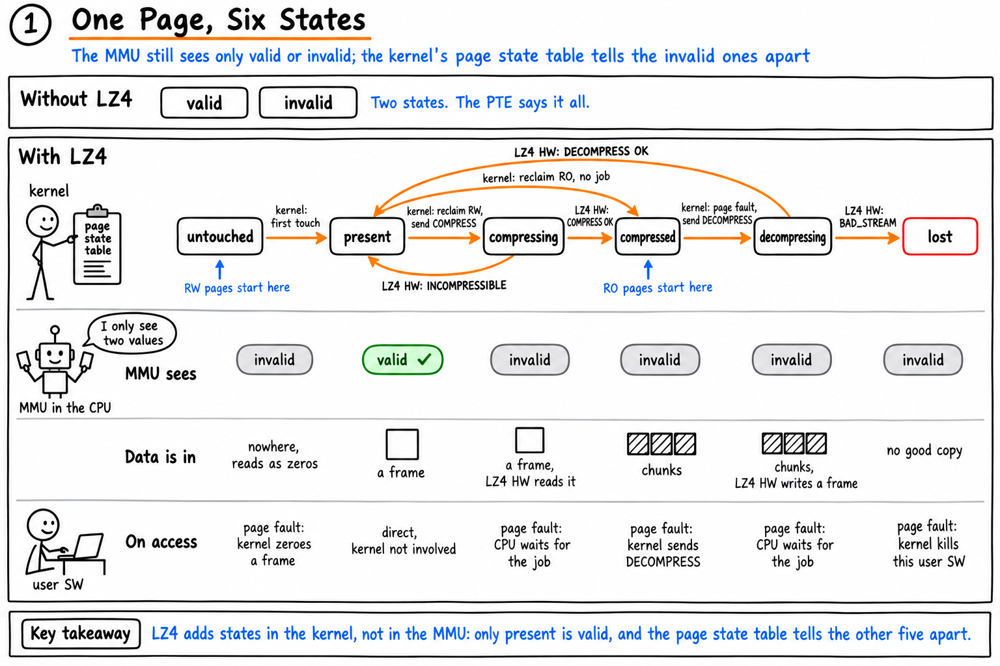

- 這張的畫法和後面十二張不同。這裡的橘色箭頭是狀態的變化，不是資料相依。圖上的徽章寫 1，因為它在 2026-11-11 是單獨畫的一張。
- 圖上的 MMU 是 CPU 的 MMU。page state table 就是圖 1 的 `state[h]`，每個 page 1 B，放在 kernel mem。
- 標「LZ4 HW:」的箭頭，意思是 LZ4 HW 的回答決定走哪一條。寫 `state[h]` 的永遠是 kernel。
- 八個變化和 `spec/control-procedures-v0.md` 第 2.2 節列的八個相同。每一個變化在後面哪一張、哪一步寫進 `state[h]`，見下表。

| 變化 | 圖 0 上的標籤 | 寫 `state[h]` 的步驟 |
|------|------|------|
| untouched 到 present | kernel: first touch | 圖 5 步驟 6 `set_present` |
| compressed 到 decompressing | kernel: page fault, send DECOMPRESS | 圖 2 步驟 6 `mark_decompressing` |
| decompressing 到 present | LZ4 HW: DECOMPRESS OK | 圖 4 步驟 14 `set_present`；軟體救回時是圖 6A 步驟 19 |
| decompressing 到 lost | LZ4 HW: BAD_STREAM | 圖 6B 步驟 16 `set_lost` |
| present 到 compressed | kernel: reclaim RO, no job | 圖 7 步驟 6 `set_compressed` |
| present 到 compressing | kernel: reclaim RW, send COMPRESS | 圖 8 步驟 7 `mark_compressing` |
| compressing 到 compressed | LZ4 HW: COMPRESS OK | 圖 10 步驟 18 `set_compressed` |
| compressing 到 present | LZ4 HW: INCOMPRESSIBLE | 圖 10 步驟 17 `set_present` |

圖 0 比後面的圖早一天畫，有兩個標籤比現在的設計粗。狀態與箭頭的數量沒有錯，圖沒有重畫。

- **decompressing 到 lost** 只標「LZ4 HW: BAD_STREAM」。實際上 kernel 會先用自己的解碼器再解一次，也解不開才寫 LOST，見圖 6B。LZ4 HW 回 bus error 而軟體也解不開，同樣是 LOST。
- **decompressing 到 present** 只標「LZ4 HW: DECOMPRESS OK」。LZ4 HW 回 bus error 或 bad stream 而軟體解得開，也回到 present，見圖 6A。

## 3. 怎麼讀圖 1 到圖 11

**步驟編號是每個場景各自編的。** 編號等於文字版第 4 節該場景的編號，所以不同場景的圖會出現相同的號碼。藍色旗標寫「from step N」「to step N」時，指的是同一個場景的步驟，畫在旗標所說的那張圖上。

**方塊的顏色是誰做的。** 白色是 kernel，淺藍是 CPU 硬體，淺綠帶齒輪是 LZ4 HW。`tlb_inval`、`notify`、`wake_page`、`kill` 是 kernel 發起、由 CPU 或 OS 完成的動作，畫成白色，成本寫「assumed」或「OS call」。

**箭頭只有兩種，沒有箭頭就是沒有先後。** 橘色實線是資料相依：後一步要用前一步算出來的值。黑色虛線是規則要求的順序：資料上不相依，但順序錯了會出事。握 lock 的那一段裡方塊擺在哪裡沒有意義，只有箭頭有意義。

**箭頭是化簡過的。** 一條相依如果已經被別的路徑保證，就不畫。例子：`pte_map` 需要 `take_frame` 拿到的 `f`，這條資料相依在 `deps.edges()` 裡有，但 `pte_map` 本來就要等在 `take_frame` 之後的步驟，所以圖上只剩那條規則箭頭。

**同一個前提，有的畫成資料、有的畫成規則。** 箭頭的種類照 `deps.py` 的宣告。一步如果宣告它讀了某個值，就是資料箭頭；順序是另外寫成一條規則的，就是規則箭頭。種類不同不影響先後。

**黃色便條是那一步的成本。** 四種數字的可信度不同。

| 數字 | 怎麼來的 |
|------|------|
| instr | 量測。每一步是 `sim/kstep/kstep.h` 的一個 C 函式，在 Apple M1 上用 `proc_pid_rusage` 的 `ri_instructions` 數 |
| lines | 計數。這個場景第一次碰到的 cache line 才算一條 |
| cycles | 模型。1 instr 算 1 cycle；一條新的 line 最多 100 cycle；LZ4 HW 剛寫的 completion 那條 line 一定是 100 cycle；寫一次 LZ4 HW register 是 50 cycle |
| ns | 假設（exception 進出、interrupt 與 wake-up、TLB invalidate）或 LZ4 HW 模型（解壓 1253、壓縮 4260） |

**同一步在不同圖上 line 數不同是正常的。** line 只在第一次碰到時算。例子：`put_frame` 在 `evict_ro` 是 1 條，在 `evict_rw` 是 0 條，因為 `frame_of[h]` 已經在 `find_frame` 讀過。

**line 數不能從方塊上的行數推出來。** 一個步驟讀寫兩樣東西，如果兩樣在同一條 cache line 上，或其中一樣前面的步驟已經碰過，就只算一條或零條。哪一步碰哪一條 line，要查文字版第 4 節。

**握一次 lock 另外加 6 道指令。** lock 4 道、unlock 2 道。各張圖底部的握 lock 小計不含這 6 道，圖 11 的場景總和含。

**cycle 換成時間用 1 cycle = 1 ns。** CPU 以 1 GHz 計。這句話只寫在圖 11。

**lock 有三種畫法，意思相同。** 步驟排成一排時只畫灰色括號；排成兩排或旁邊有不握 lock 的步驟時，再加一個灰框把握 lock 的步驟圈起來。圖 6A 只有灰框，鎖頭與說明放在框內左下角，因為框的上緣有四支箭頭穿過。圖 3 與圖 9 整張不握 lock，寫在標題。

**kernel 與 OS。** kernel 指這個專案要寫的 LZ4 控制程式；OS 指它呼叫的排程服務，叫醒 thread 與結束 user SW 都算 OS。

## 4. 八個場景的每一步

### 圖 1：表放在哪裡

**問題**：kernel 的表放在 DRAM 的哪裡？一筆多大？

**主張**：每個 page 的資訊分在七張以 h 為索引的表，各在自己的 cache line 上。

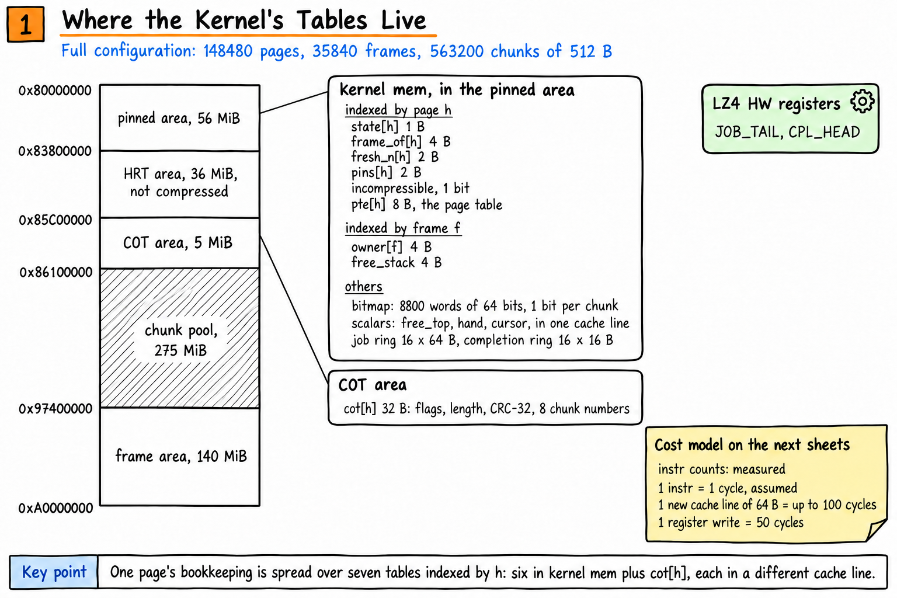

- 後面每一張圖的方塊都用這張的區域名稱：kernel mem、page table、COT area、chunk pool、frame area、ring、HW register。
- 這張沒有列的名字都是 kernel mem 裡的單一變數或小表。`strikes`、`lz4_off`、`pool_full`、`free_chunks`、`free_top`、`tag`、low mark、high mark 是單一變數。
- `fresh[t]` 是 thread t 自己的小環狀表，記它最近 fault 進來的幾個 page。`fresh_n[h]` 是 page h 出現在幾個 thread 的表裡，不是 0 就不會被選去趕出。
- 文字版：第 2 節「資料結構放在哪」。

### 圖 2：page fault，第一次握 lock

**問題**：page fault 進來後，第一次握 lock 做了什麼？

**主張**：四個步驟，39 道指令與 4 條 line；`check_state` 之後的三步互不相依。

**場景與步驟**：`fault_ro`、`fault_rw` 的 1 到 6。

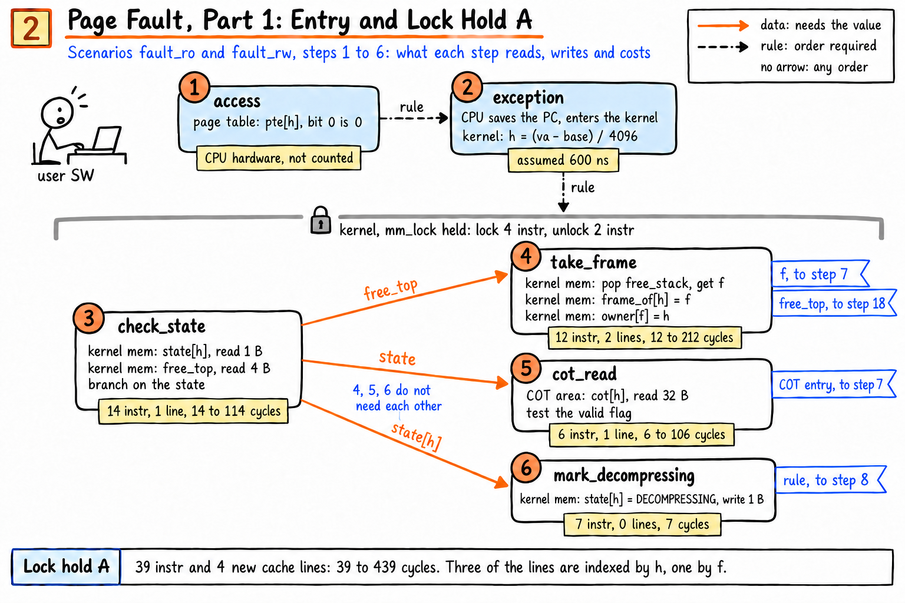

- 39 道不含 lock 與 unlock 的 6 道。
- 步驟 5 `cot_read` 把 32 B 的 COT entry 讀進 thread 自己的變數。圖 3 的步驟 7 用這一份準備 job，圖 4 的 `release_chunks` 也用這一份。
- 步驟 6 把 `state[h]` 寫成 DECOMPRESSING，就是圖 0 的 compressed 到 decompressing。
- 旗標「free_top, to step 18」用的是 `fault_ro` 的編號。
- 文字版：第 4.2、4.3 節。

### 圖 3：DECOMPRESS job，不握 lock

**問題**：不握 lock 的那一段怎麼把工作交給 LZ4 HW？

**主張**：一條直鏈；kernel 的三步 251 到 351 cycle，等待是 4403 ns。

**場景與步驟**：`fault_ro` 的 7 到 12。`fault_rw` 的這一段完全相同，副標題只寫了 `fault_ro`。

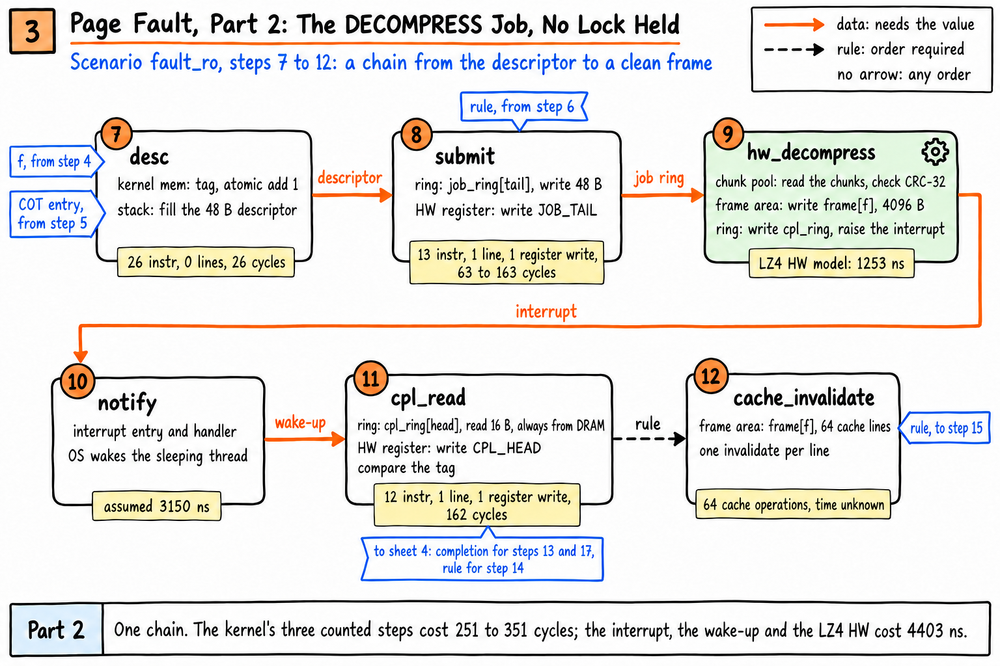

- `job_ring` 一格 64 B，`submit` 只寫 48 B。descriptor 是 48 B，放在格子前段，一格剛好一條 cache line。
- `cpl_read` 是 162 cycle，沒有下限。completion 那條 line 是 LZ4 HW 剛寫的，一定要從 DRAM 讀。
- 步驟 11 的旗標沒有列到圖 4 的步驟 a，步驟 a 同樣等 completion。
- 那個旗標也沒有列圖 6A 與圖 6B。LZ4 HW 沒有答 OK 時，步驟 11 之後接的是 6A 或 6B，不是圖 4。
- `cache_invalidate` 沒有量。
- 文字版：第 4.2 節。

### 圖 4：page fault，第二次握 lock 與返回

**問題**：第二次握 lock 做了什麼？RW page 多做什麼？

**主張**：都只等 completion；RO 是 35 道指令，RW 多還 chunk 變成 119 道。

**場景與步驟**：`fault_ro` 的 13 到 20。`fault_rw` 多的兩步在圖上標成 a 與 b。

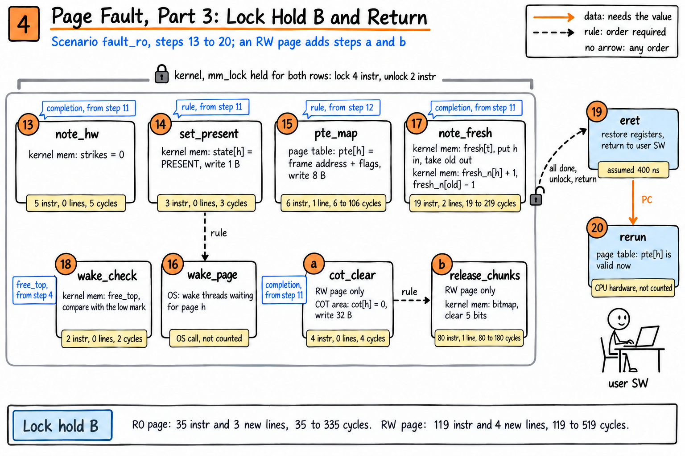

- 這張的 `note_hw` 等的是 `cpl_read`。LZ4 HW 答 OK，`strikes` 歸零。
- `release_chunks` 清 5 個 bit 要 80 道。chunk 編號要從 32 B 的 COT entry 一個一個解出來，每個約 16 道。
- `cot[h]` 先清成 0 再還 chunk 是安全的。`release_chunks` 用的是握 lock A 時 `cot_read` 讀進來的那一份，不是剛被清成 0 的 `cot[h]`。
- 文字版：第 4.2、4.3 節。

### 圖 5：第一次碰一個 page

**問題**：第一次碰一個 page 要多少？

**主張**：一次握 lock、沒有 LZ4 job；397 道指令裡 341 道在填 0。

**場景與步驟**：`first_touch`，全部。

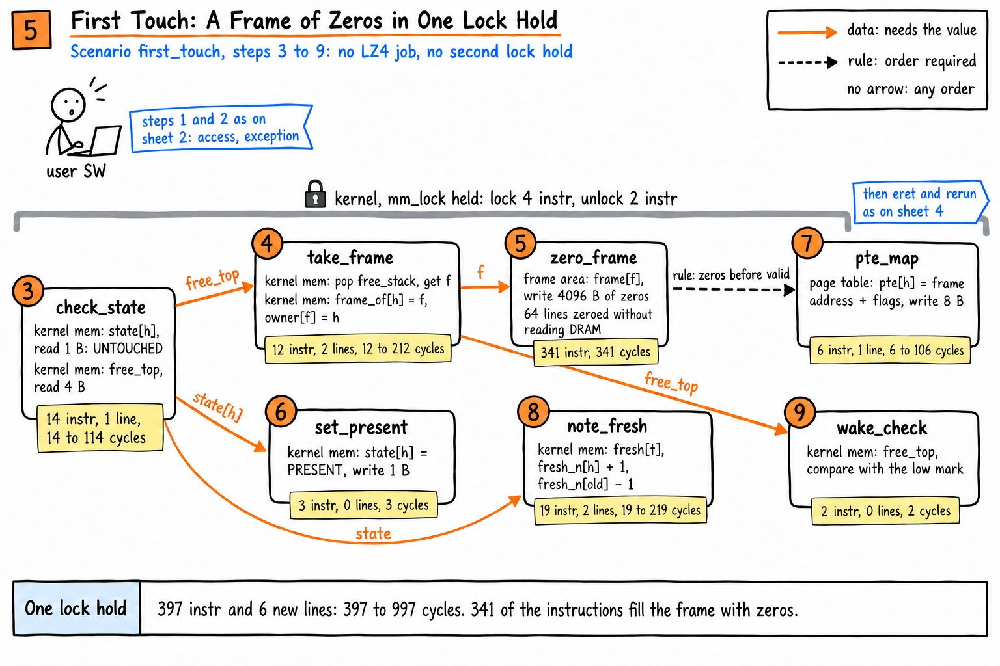

- 397 道加上握一次 lock 的 6 道，就是圖 11 的 403 道。
- `zero_frame` 的 341 道在握 `mm_lock` 的時候做。它用 `DC ZVA`，不必先把 line 從 DRAM 讀進來。
- 它寫的 64 條 line 只記成「寫了 64 條」，沒有算進 cycle 模型的 miss。
- 文字版：第 4.1 節。

### 圖 6A：LZ4 HW 沒交出 page，軟體救回

**問題**：LZ4 HW 說失敗而 stream 其實是好的，kernel 多做什麼？

**主張**：不握 lock 做軟體解壓縮、複製 4096 B（791 道指令）、清 cache；整個場景 1012 道。

**場景與步驟**：`fault_rescue` 的 12 到 23。步驟 1 到 11 同圖 2 與圖 3，差別是步驟 11 的回答是 bus error 或 bad stream。

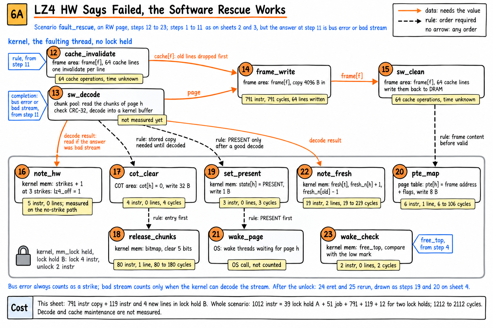

- 兩種回答都走這張。模擬跑的那一次是 bus error。
- `sw_decode` 往下四支箭頭有兩種。`note_hw` 與 `note_fresh` 宣告讀解碼結果，是資料箭頭。`cot_clear` 與 `set_present` 的順序寫成規則，是規則箭頭。
- 步驟 12 到 14 的箭頭是資料箭頭，因為兩步都寫 `cache[f]`。同時有一條「先丟舊 line 再寫」的規則，標籤把兩件事都寫了。
- `note_hw` 等 `sw_decode` 的那條線：bad stream 算不算答錯，要看軟體解不解得開。相依的宣告是照步驟寫的，不分 status，所以 bus error 那一次嚴格說不必等，圖上仍然畫了，標籤寫明「read if the answer was bad stream」，灰框下方的藍字寫了算 strike 的規則。
- `note_hw` 量到的 5 道指令是答對的那條路，便條照實寫「measured on the no-strike path」。
- 解碼與 cache 維護沒有量。
- 步驟 24 `eret` 與 25 rerun 沒有重畫，同圖 4 的步驟 19 與 20。
- 文字版：第 4.4 節。

### 圖 6B：stream 壞了，page 遺失

**問題**：stream 真的壞了呢？

**主張**：還 frame、標成 LOST、結束 user SW；握 lock 21 道指令，LZ4 HW 不記 strike。

**場景與步驟**：`fault_lost` 的 13 到 18。

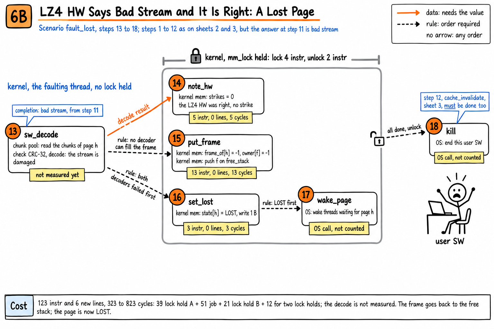

- LZ4 HW 回 bad stream，軟體也解不開，代表 LZ4 HW 答對了，所以 `strikes = 0`。
- `kill` 除了等 unlock，還要等圖 3 的步驟 12 `cache_invalidate` 做完才能離開 exception。
- 整個場景 123 道指令與 6 條新的 line，323 到 823 cycle。解碼沒有量。
- 文字版：第 4.5 節。

### 圖 7：clock 掃描，趕出 RO page

**問題**：選要趕出的 page 要看哪些表？趕出 RO page 要多少？

**主張**：每看一個 frame 最多 4 條新的 line；RO page 一次握 lock 53 道指令。

**場景與步驟**：`evict_ro`，全部。

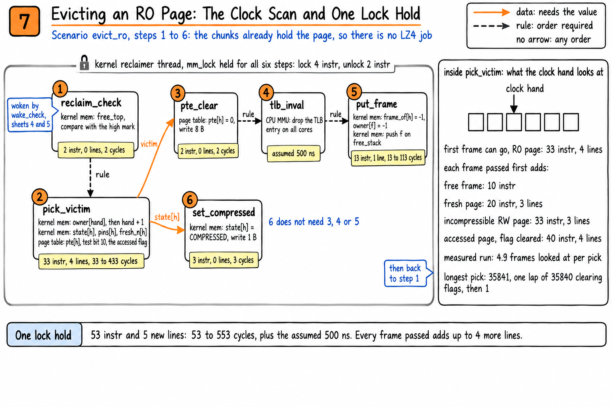

- 53 道加上握一次 lock 的 6 道，就是圖 11 的 59 道。
- `pick_victim` 的 33 道是「指針碰到的第一個 frame 就可以趕」的情況。
- 全尺寸的執行裡每選一個 page 平均看 4.9 個 frame，照模型是 83 到 2299 cycle。
- 最長一次掃描是 35841 個 frame，frame 只有 35840 個。第一次 reclaim 時每個 page 的 accessed flag 都是 1。指針繞完整圈把 flag 清掉，回到第一個 frame 才選到。這一段整段握著 `mm_lock`，照模型約 1.4 到 15.8 ms。
- RO page 不送 job。stream 開機時就在 chunk pool 裡，所以只改帳。
- 文字版：第 4.6 節與第 3.3 節。

### 圖 8：趕出 RW page，第一次握 lock

**問題**：趕出 RW page 的第一次握 lock 做了什麼？bitmap 怎麼找空位？

**主張**：取反、bit reverse、count leading zeros；保留 7 個 chunk 是 111 道指令與 1 條 line。

**場景與步驟**：`evict_rw` 的 1 到 7。

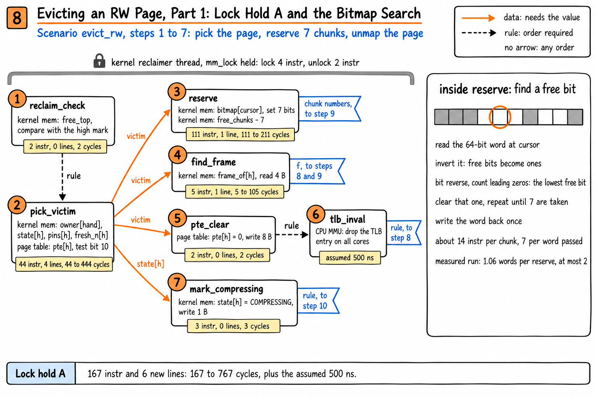

- `pick_victim` 在這張是 44 道，比圖 7 多 11 道。RW page 多三個檢查：`pool_full`、`lz4_off`、`incompressible` 的那個 bit。
- 找一個 0 是 `MVN`、`RBIT`、`CLZ` 三道指令。全尺寸的執行裡每次平均掃 1.06 個 word，最多 2 個。
- 這一段握 lock 合計 167 道指令與 6 條 line，另外加上假設 500 ns 的 TLB invalidate。
- 文字版：第 4.7 節。

### 圖 9：COMPRESS job，不握 lock

**問題**：COMPRESS job 怎麼交出去？

**主張**：送出之前要等三件事；LZ4 HW 的 4260 ns 是最長的一段。

**場景與步驟**：`evict_rw` 的 8 到 13。

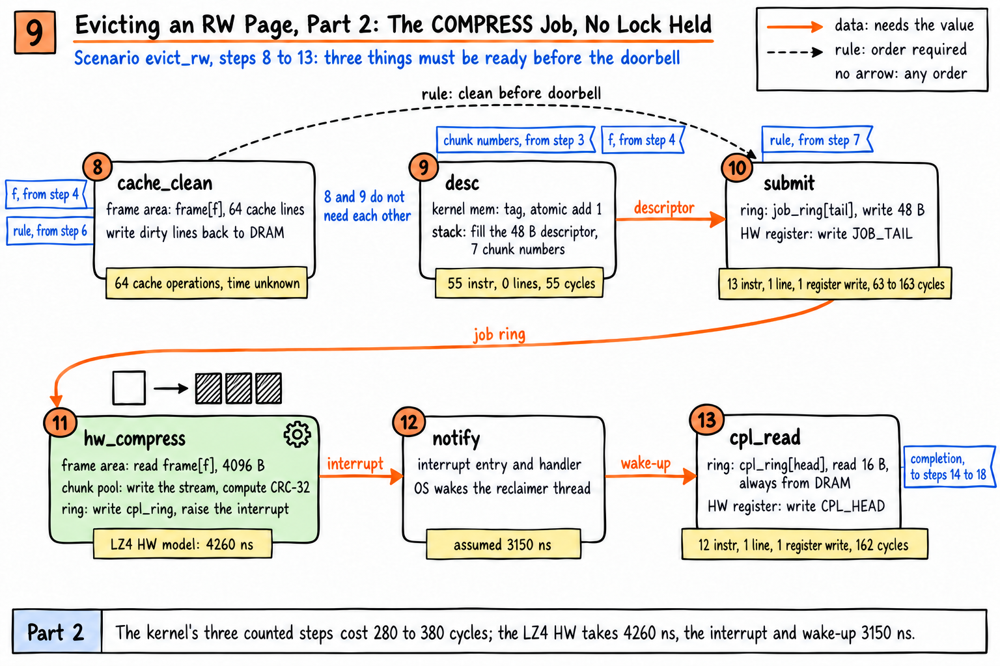

- kernel 有數字的三步合計 280 到 380 cycle。LZ4 HW 是 4260 ns，interrupt 與 wake-up 是 3150 ns。
- `cpl_read` 同圖 3，162 cycle。
- `cache_clean` 沒有量。
- 文字版：第 4.7 節。

### 圖 10：趕出 RW page，第二次握 lock 的兩種結局

**問題**：壓完之後記什麼帳？壓不進去呢？

**主張**：壓得進去：寫 COT、還多的 chunk、還 frame，83 道指令。壓不進去：全部還原，73 道。

**場景與步驟**：`evict_rw`、`evict_rw_incompressible` 的 14 到 19。

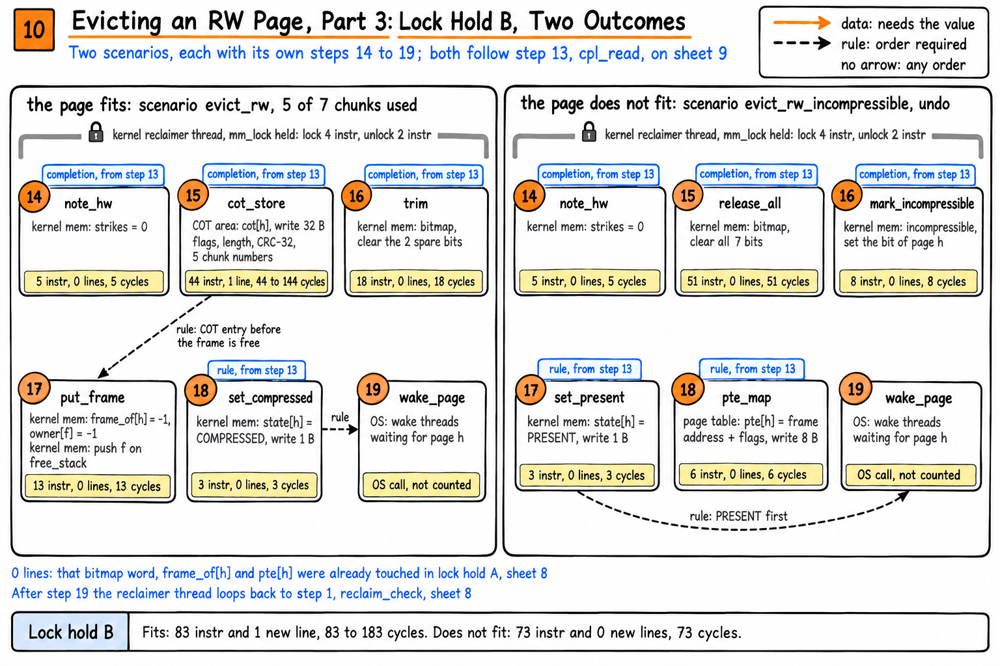

- `trim` 清 2 個 bit 是 18 道，`release_all` 清 7 個是 51 道。chunk 編號是剛保留時留在 stack 上的陣列，每個約 7 道，所以比圖 4 的 `release_chunks` 便宜。
- `put_frame` 在 `evict_rw` 是 0 條 line，因為 `frame_of[h]` 已經在 `find_frame` 讀過。
- `pte_map` 在 `evict_rw_incompressible` 是 0 條 line，因為 `pte[h]` 在握 lock A 時已經寫過。
- 文字版：第 4.7、4.8 節。

### 圖 11：八個場景的總表

**問題**：八個場景各要多少？

**主張**：kernel 自己的步驟是 59 到 2112 cycle，等待是 500 到 7910 ns。

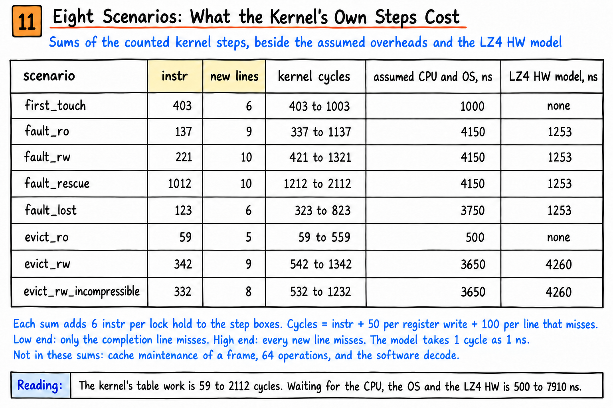

- 這張的指令數含每次握 lock 的 6 道。
- 同一張表的文字版在下一節。

## 5. 八個場景的合計

抄自文字版第 4 節。指令數是量測，line 是計數，cycle 是模型，ns 是假設或 LZ4 HW 模型。

| 場景 | 指令數 | 新的 line | register 寫入 | 模型 cycle | CPU 與 OS 的假設 ns | LZ4 HW 模型 ns | 沒有數字的步驟 |
|---|---|---|---|---|---|---|---|
| `first_touch` | 403 | 6 | 0 | 403 到 1003 | 1000 | | |
| `fault_ro` | 137 | 9 | 2 | 337 到 1137 | 4150 | 1253 | `cache_invalidate` |
| `fault_rw` | 221 | 10 | 2 | 421 到 1321 | 4150 | 1253 | `cache_invalidate` |
| `fault_rescue` | 1012 | 10 | 2 | 1212 到 2112 | 4150 | 1253 | `cache_invalidate`、`sw_decode`、`sw_clean` |
| `fault_lost` | 123 | 6 | 2 | 323 到 823 | 3750 | 1253 | `cache_invalidate`、`sw_decode` |
| `evict_ro` | 59 | 5 | 0 | 59 到 559 | 500 | | |
| `evict_rw` | 342 | 9 | 2 | 542 到 1342 | 3650 | 4260 | `cache_clean` |
| `evict_rw_incompressible` | 332 | 8 | 2 | 532 到 1232 | 3650 | 4260 | `cache_clean` |

## 6. 幾個數字為什麼不一樣

| 問題 | 原因 |
|------|------|
| `pick_victim` 在圖 7 是 33 道，在圖 8 是 44 道 | RW page 多三個檢查：`pool_full`、`lz4_off`、`incompressible` 的那個 bit。兩個數字都是「指針碰到的第一個 frame 就可以趕」的情況 |
| 清 bitmap：5 個 bit 要 80 道，7 個只要 51 道，2 個 18 道 | `release_chunks` 的 chunk 編號要從 32 B 的 COT entry 一個一個解出來，每個約 16 道。`release_all` 與 `trim` 的編號是剛保留時留在 stack 上的陣列，每個約 7 道。圖 4 與圖 6A 是前者，圖 10 是後者 |
| 最長一次掃描是 35841 個 frame，但 frame 只有 35840 個 | 第一次 reclaim 時每個 page 的 accessed flag 都是 1。指針繞完整圈 35840 個把 flag 清掉，回到第一個 frame 才選到 |
| `job_ring` 一格 64 B，`submit` 只寫 48 B | descriptor 是 48 B，放在 64 B 的格子前段，一格剛好一條 cache line |
| `note_hw` 有時是 `strikes = 0`，有時是 `strikes + 1` | 答對歸零，答錯加 1，沒回答直接算 3 次，滿 3 次就把 `lz4_off` 設成 1。算答錯的有兩種：LZ4 HW 回 bus error；LZ4 HW 回 bad stream 而軟體解得開。回 bad stream 而軟體也解不開，是 LZ4 HW 答對了，不算 strike。圖 6A 模擬的那一次是 bus error，圖 6B 是 bad stream 而軟體也解不開 |
| 圖 6A 與圖 6B 的 `note_hw` 等的是 `sw_decode`，圖 4 與圖 10 的 `note_hw` 等的是 `cpl_read` | LZ4 HW 回 bad stream 時，答對或答錯要看軟體解不解得開，所以 `note_hw` 讀了 `sw_decode` 的結果。這條相依原本在 `sim/hostsim/deps.py` 漏宣告，是冷讀的人問出來的，對過 `kernel.py` 之後補上 |

## 7. LZ4 HW 的回答與軟體解碼的組合

來源是 `sim/hostsim/kernel.py` 的 `fault_in`。圖只畫了模擬跑過的組合，其餘的步驟相同，只差 `note_hw` 寫什麼。

| LZ4 HW 的回答 | 軟體解碼 | page 的結局 | `strikes` | 畫在哪 |
|------|------|------|------|------|
| OK | 不做 | PRESENT | 歸零 | 圖 4 |
| bus error | 解得開 | PRESENT | 加 1 | 圖 6A，模擬跑的是這一種 |
| bad stream | 解得開 | PRESENT | 加 1 | 圖 6A |
| bad stream | 解不開 | LOST | 歸零 | 圖 6B，模擬跑的是這一種 |
| bus error | 解不開 | LOST | 加 1 | 沒有畫。步驟同圖 6B，`note_hw` 改成加 1 |
| 沒有回答 | 做，結局看解不解得開 | PRESENT 或 LOST | 直接變 3，停用 LZ4 HW | 沒有畫 |

`lz4_off` 已經是 1 的時候不送 job，直接軟體解碼，也不跑 `note_hw`。這條路沒有畫。

## 8. 還沒量的

- 一個 frame 64 條 line 的 cache 維護：`cache_invalidate`、`cache_clean`、`sw_clean`。
- `frame_write` 與 `zero_frame` 寫的 64 條 line 只記成「寫了 64 條」，沒有算進 cycle 模型的 miss。`zero_frame` 用 `DC ZVA` 不必先讀 DRAM；`frame_write` 是 memcpy，寫之前要不要先把 line 讀進來，模型沒有處理。
- 軟體解碼 `sw_decode`。
- `note_hw` 加 strike 的那條路。
- OS 的動作：`wake_page`、`kill`、`notify` 裡的 wake-up。

## 9. 檔案

| 檔案 | 內容 |
|------|------|
| `figures/page-states/` | 圖 0，以及它的提示詞、驗收與冷讀紀錄 |
| `figures/kernel-actions/` | 圖 1 到圖 11，以及第八版提示詞、每一次生成、逐張驗收與七次冷讀的紀錄 |
| `figures/kernel-deps/` | 八個場景的相依圖，由程式畫的 SVG，嵌在 `spec/kernel-sw-dependency-v0.md` 裡。這份文件沒有收 |
| `figures/capacity-approaches/` | 說明文件用的另一組圖，和 kernel SW 無關 |
| `spec/kernel-step-detail-v0.md` | 文字版。每個步驟與每個場景的表，圖 1 到圖 11 數字的唯一來源 |
| `spec/kernel-sw-dependency-v0.md` | 相依圖的推導 |
| `spec/control-procedures-v0.md` | kernel 的控制程序，第 2.2 節是 state 的變化 |
| `sim/hostsim/deps.py` | 每一步讀寫什麼、規則有哪些，箭頭的來源 |
| `sim/kstep/kstep.h` | 每一步的 C 參考實作，指令數是量這個 |
| `figures/build_book.py` | 把這份 README 轉成 `figures/kernel-sw-figures.html` |

圖都用 `sketchnote-gen` skill 生成，風格 `whiteboard`，1536x1024。
