# 白板圖由淺到深：從一次 access 到 kernel SW 的每一步

這份文件把 repo 裡所有驗收過的白板圖排成一條線，由淺到深。沒有 CPU MMU 背景的人可以從第 1 層一路讀下去。要寫或審 kernel SW 的工程師可以一直讀到每一步的成本。

每一層回答一個問題。每一層開頭寫上一層留下的問題，結尾寫留給下一層的問題。前 6 層是 [README.md](../README.md) 七層的摘要，全文在那裡。第 8 層以後的讀圖說明取自 [figures/README.md](README.md)，數字都來自產生出來的文件，這裡沒有新算任何數字。

內容照專案負責人指定的平台前提 P1 到 P4，第一次用到時解釋，全文在 [CLAUDE.md](../CLAUDE.md)。和前提衝突的圖沒有重畫，在圖的旁邊標出來。標記只有兩種：「**和平台前提衝突**」是圖上的說法照前提不成立；「**還沒照平台前提改**」是圖背後的數字或步驟是在前提指定之前做的。

**單一檔案的版本**：`python3 figures/build_book.py figures/whiteboard-top-down.md OUT.html` 會產生一個把圖嵌在裡面的 HTML。

**日期**：2026-11-13。

## 0. 第 0 層：地圖

**為什麼要壓縮。** 目標是省 DRAM 的容量。一個 page 暫時沒人用時，kernel 把它的內容壓小，收在 DRAM 的另一區。它原本佔的那一塊 DRAM 就空出來，給別的 page 用。有人再碰它時，再解壓縮回來。要準時拿到資料的硬體，例如 display 與 modem，叫 HRT，它們的記憶體不壓縮。所有讀寫 DRAM 的硬體都經過同一層壓縮。三種省容量做法的比較圖在附錄 A，理由寫在那裡。

**每一層回答什麼**

| 層 | 回答的問題 | 圖 | 讀到這裡就夠的人 |
|---|---|---|---|
| 0 | 怎麼讀，為什麼要壓縮 | 沒有 | |
| 1 | address 為什麼要轉換 | 白板圖 A | |
| 2 | 轉換靠哪些東西 | 白板圖 B | |
| 3 | 一次 access 有哪幾種結果，kernel 什麼時候介入 | 白板圖 2 | |
| 4 | 有多個 core 時，哪些東西每個 core 一份 | 白板圖 1 | |
| 5 | 好幾個 core 同時進 kernel 會怎樣 | 白板圖 3 | |
| 6 | kernel 拿走一個 page 的 frame 時，各個 core 的 TLB 怎麼辦 | 白板圖 C | |
| 7 | 壓縮層接在哪裡，LZ4 HW 怎麼服務每個 core；兩邊多常叫醒 kernel SW | 白板圖 4、白板圖 D | |
| 8 | 加了壓縮層之後，一個 page 有哪些狀態 | 圖 0 | 主管與新手 |
| 9 | kernel 的表放在哪裡，每個場景大約要多少 | 圖 1、圖 11 | 需要設計的工程師 |
| 10 | 常見的 page fault 拆開來，每一步做什麼 | 圖 2、圖 3、圖 4 | |
| 11 | 第一次碰一個 page 呢 | 圖 5 | |
| 12 | LZ4 HW 沒把 page 交出來呢 | 圖 6A、圖 6B | |
| 13 | 騰出 frame：趕出一個 RO page 要做什麼 | 圖 7 | |
| 14 | 趕出一個 RW page 要做什麼 | 圖 8、圖 9、圖 10 | 寫或審 kernel SW 的人 |
| 附錄 A | 省容量有哪幾種做法 | 附錄圖 1、附錄圖 2 | |
| 附錄 B | 這份文件標出的衝突、缺口與還不知道的事 | 沒有 | 寫或審 kernel SW 的人 |

三種讀者各讀到哪裡：

| 讀者 | 讀到 | 讀完知道的事 |
|---|---|---|
| 主管與新手 | 第 8 層 | 一次 access 怎麼走，kernel 什麼時候介入，為什麼要 lock，壓縮層接在哪裡，一個 page 有哪幾種狀態 |
| 需要設計的工程師，例如做 LZ4 HW 或 SoC 的人 | 第 9 層 | kernel 的表放在 DRAM 的哪裡，八個場景的成本各是多少，哪些數字是量的、哪些是假設 |
| 寫或審 kernel SW 的人 | 第 14 層與附錄 B | 每個場景的每一步讀寫什麼、要等誰、成本多少，以及還沒照平台前提改的地方 |

**圖的名字**

圖分成五組，是不同時間為不同讀者畫的。圖上的 badge 會重複，例如有四張圖的 badge 都是 1。這份文件用下表的名字，和 [README.md](../README.md) 與 [figures/README.md](README.md) 一致。看圖時以這裡的名字為準，不要看 badge。

| 這份文件的名字 | 圖上的 badge | 資料夾 | 原本的讀者 |
|---|---|---|---|
| 白板圖 A、B、C | A、B、C | `figures/cpu-mmu-basics/` | 沒接觸過 CPU MMU 的人 |
| 白板圖 1 到 4 | 1 到 4，方框 | `figures/system-overview/` | 知道 CPU MMU、沒讀過壓縮層的工程師 |
| 圖 0 | 1，圓圈 | `figures/page-states/` | 寫或審 kernel SW 的人 |
| 圖 1 到圖 11 | 1 到 11，橘底 | `figures/kernel-actions/` | 寫或審 kernel SW 的人 |
| 附錄圖 1、2 | 1、2，綠色圓圈 | `figures/capacity-approaches/` | SoC 架構師 |

文中的 address 都是例子。圖上的字是英文，這份文件解釋每一個標籤。不熟的名詞查附錄 C。

## 1. 第 1 層：address 為什麼要轉換

**上一層留下的問題**：kernel 要把一個 page 收起來、之後再放回去，user SW 怎麼會不知道？

### 白板圖 A：address 為什麼要轉換

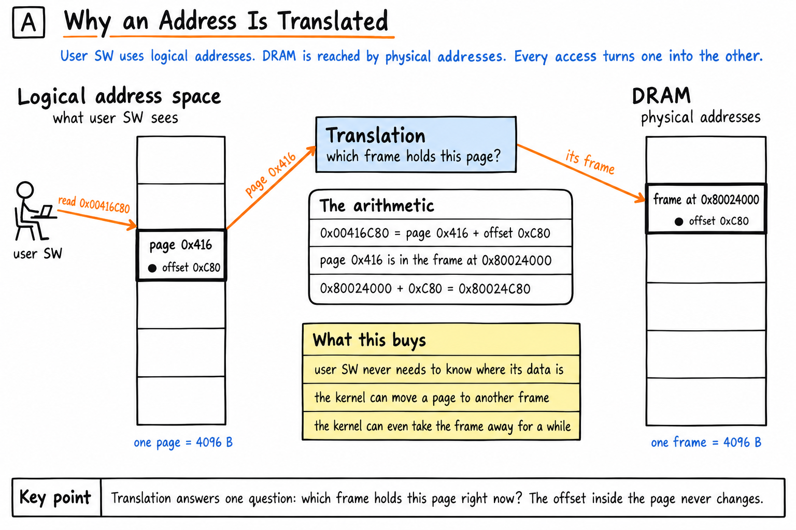

User SW 用的 address 叫 logical address，圖上寫成 VA。DRAM 上的位置叫 physical address，圖上寫成 PA。兩邊都切成 4096 B 一塊。logical 這一邊的一塊叫 page，DRAM 這一邊的一塊叫 frame。轉換只做一件事：查出這個 page 現在在哪一個 frame。page 裡面的位置不變。

| 項目 | 例子 |
|---|---|
| user SW 讀的 logical address | 0x00416C80 |
| page 的編號 | 0x416 |
| page 裡面的位置 | 0xC80 |
| 這個 page 現在在的 frame | 從 0x80024000 開始的那一個 |
| 實際存取的 physical address | 0x80024C80 |

多這一道手續換到的是：kernel 可以把 page 搬到別的 frame，甚至暫時不給它 frame，user SW 一個字都不用改。壓縮層就建立在這件事上。全文在 README 第 2 節。

**留給下一層的問題**：每一次 access 都要查，是誰在查，查的是哪一張表？

## 2. 第 2 層：page table、TLB、CPU MMU

**上一層留下的問題**：每一次 access 都要查，是誰在查，查的是哪一張表？

### 白板圖 B：page table、TLB、CPU MMU

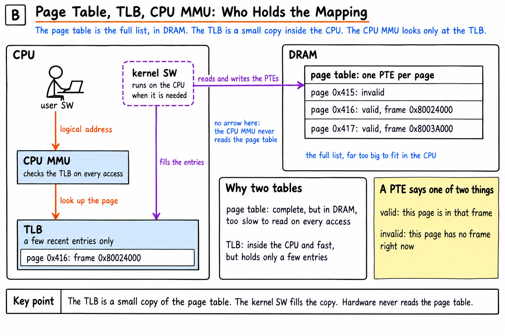

| 角色 | 是什麼 | 在哪裡 | 誰讀，誰寫 |
|---|---|---|---|
| page table | 完整的對照表，每個 page 一筆。一筆叫一個 PTE | DRAM | 只有 kernel SW |
| TLB | 很小的表，只放最近用過的幾筆 | CPU 裡面 | CPU MMU 每次 access 都查，內容由 kernel SW 填 |
| CPU MMU | 做轉換的硬體 | CPU 裡面 | 硬體 |

PTE 只有兩種值。valid 記著 page 在哪一個 frame。invalid 表示 page 現在沒有 frame。

**平台前提 P1**：TLB 裡查不到時，CPU 硬體不會自己去讀 page table。許多 CPU 有這個功能，叫 hardware page table walk，這個平台沒有。查不到就交給 kernel SW。所以 CPU MMU 只認得 TLB，page table 只有 kernel 讀，格式由 kernel 決定。全文在 README 第 3 節。

**留給下一層的問題**：TLB 裡查不到的時候，接下來發生什麼事？

## 3. 第 3 層：一次 access 的三種結果

**上一層留下的問題**：TLB 裡查不到的時候，接下來發生什麼事？

### 白板圖 2：TLB miss 進 kernel

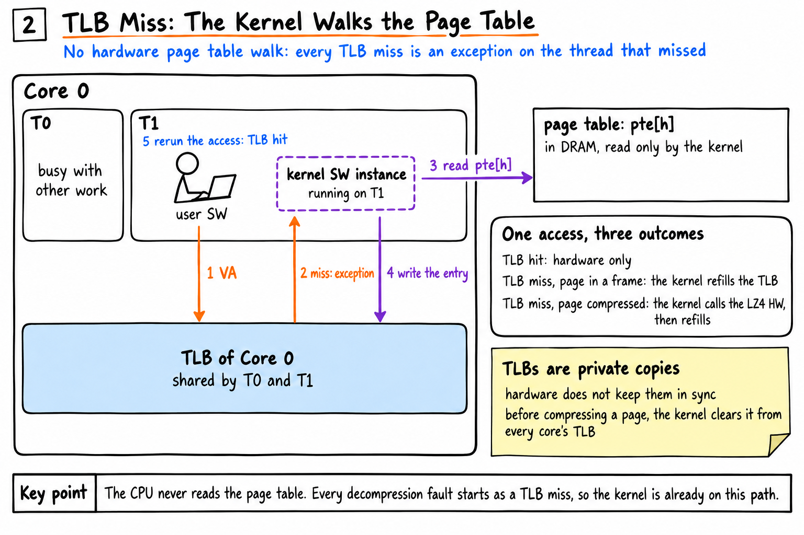

查得到叫 TLB hit，查不到叫 TLB miss。TLB miss 時 CPU 發出 exception：CPU 停在這一道指令，改去執行 kernel SW 的一段程式，叫 TLB miss handler。它讀 PTE、把對應寫進 TLB、返回，CPU 再執行一次同一道指令。圖上的五個編號就是這個過程。

| 結果 | 條件 | 誰做事 | user SW 的感覺 |
|---|---|---|---|
| TLB hit | TLB 裡有這個 page | 只有硬體 | 沒有感覺 |
| TLB miss，PTE 是 valid | page table 說它在某個 frame | kernel SW 讀 PTE，填 TLB | 慢一點 |
| TLB miss，PTE 是 invalid | page table 說它現在沒有 frame | kernel SW 先讓 page 有 frame，再填 TLB | 慢更多 |

第三種叫 page fault。從 P1 推出來的三件事，後面一直會用到：

- 只有 TLB hit 時 kernel 才不介入。page 在 frame 裡不等於 kernel 不介入。
- 每一次 page fault 都先是一次 TLB miss。page fault 的次數不會超過 TLB miss 的次數。
- TLB miss 是平台本來就有的成本，有沒有壓縮層都一樣。

TLB miss handler 一次要多久，目前不知道。圖右上的「One access, three outcomes」第三列只寫了 page 被壓縮的情形。第 8 層會看到，PTE 是 invalid 的 page 還有別的情形。全文在 README 第 4 節。一步一步的動畫在 [CPU MMU 動畫](https://datochuang.github.io/dram-compression-tutorial/mmu/)。

**留給下一層的問題**：processor 有好幾個 core。TLB 是大家共用一張，還是各有各的？

## 4. 第 4 層：多個 core 時，哪些每個 core 一份

**上一層留下的問題**：processor 有好幾個 core。TLB 是大家共用一張，還是各有各的？

### 白板圖 1：每個 core 自己的，與共用的

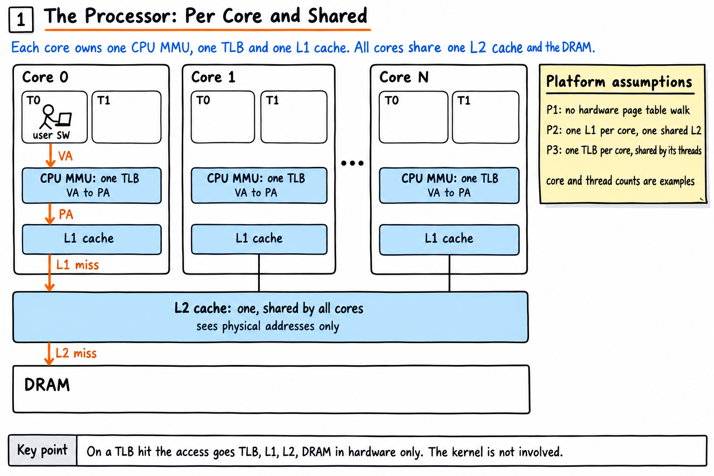

一個 core 可以同時跑好幾個 hardware thread，圖上寫成 T0、T1。

| 東西 | 幾份 | 依據 |
|---|---|---|
| CPU MMU 與 TLB | 每個 core 一份，由該 core 的 hardware thread 共用 | 平台前提 P3。這一條是假設，還沒對過 CPU 手冊 |
| L1 cache | 每個 core 一個 | 平台前提 P2 |
| L2 cache | 一個，所有 core 共用 | 平台前提 P2 |
| DRAM 與 page table | 一份 | |

這一層要帶走兩件事。每個 core 的 TLB 是各自的抄本，Core 0 有的對應，Core 1 不一定有。硬體不會幫忙對帳，kernel 改了 PTE，沒有一張 TLB 會自己知道。

**圖上的 Core N**：這裡的 N 只是最後一個 core 的編號。第 5 層與第 7 層的 N 是 LZ4 HW 同時能做的 job 數，兩者無關。core 與 thread 的數目都是例子。

全文在 README 第 5 節。

**留給下一層的問題**：兩個 core 可以同時 TLB miss。kernel SW 是不是同時有兩個在跑？

## 5. 第 5 層：一份 kernel，多個 instance

**上一層留下的問題**：兩個 core 可以同時 TLB miss。kernel SW 是不是同時有兩個在跑？

### 白板圖 3：一個 kernel，多個 instance

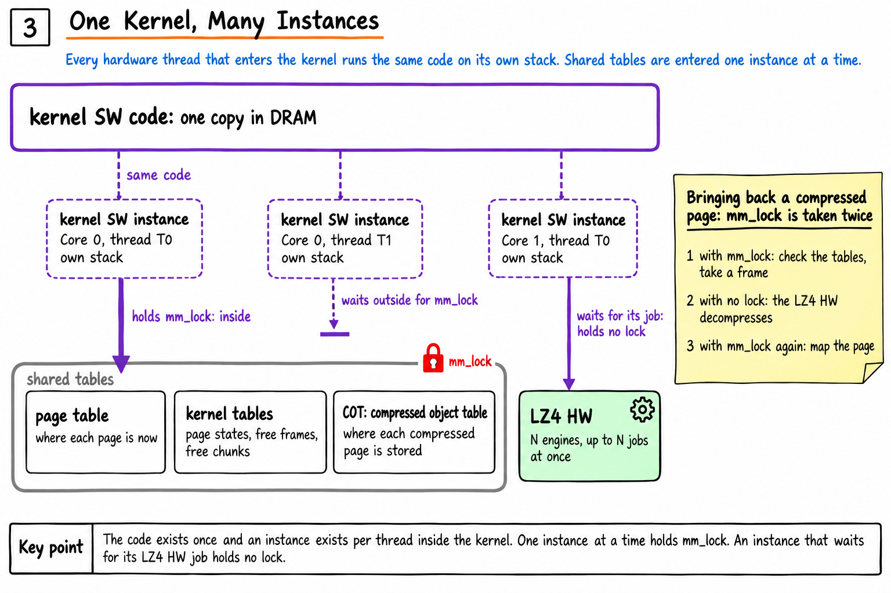

是的。kernel SW 的程式碼只有一份。每一個進 kernel 的 hardware thread 都執行同一份程式，用自己的 stack。這樣的一次執行叫一個 kernel SW instance。

它們讀寫同一批表：page table、kernel 自己記帳的表、壓縮層的 COT。COT 記每個被壓縮的 page 收在哪裡，第 9 層會講。兩個 instance 同時改同一筆，表就壞了。所以改這些表之前要先拿 `mm_lock`。同一時間只有一個 instance 拿得到。

圖右邊有一個 instance 在等 LZ4 HW，手上沒有 lock。會等很久的事不握著 lock 做。右邊的便條說，把一個壓縮的 page 拿回來要拿兩次 `mm_lock`，第 10 層把這兩次拆開來看。lock 保護的是共用的表，不是硬體，core 再多 lock 也在。

**圖上的 N engines**：照平台前提 P4，N 暫定 4，不是定案。第 7 層再講。

還沒設計的一件事：只需要填 TLB 的那種 TLB miss，handler 讀 PTE 時要不要拿 `mm_lock`。全文在 README 第 6 節。

**留給下一層的問題**：kernel 握著 lock 改了一個 PTE。別的 core 的 TLB 裡還留著舊的那一筆，怎麼辦？

## 6. 第 6 層：拿走 frame 時，先清每個 core 的 TLB

**上一層留下的問題**：kernel 握著 lock 改了一個 PTE。別的 core 的 TLB 裡還留著舊的那一筆，怎麼辦？

### 白板圖 C：拿走 frame 之前，先清每個 core 的 TLB

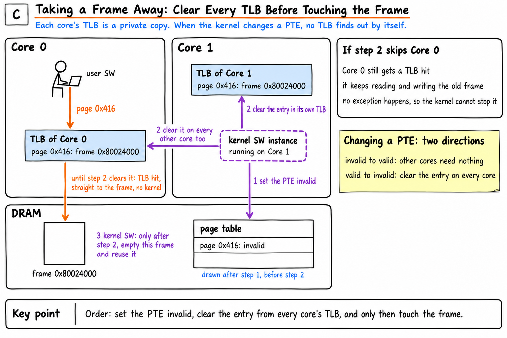

PTE 從 invalid 改成 valid 時，別的 core 不用處理，它們的 TLB 裡本來就沒有這一筆。從 valid 改成 invalid 時，要把這一筆從每一個 core 的 TLB 清掉。否則那個 core 會一直 TLB hit，繼續讀寫舊的 frame，kernel 擋不住。

| 順序 | 做什麼 | 順序反過來會怎樣 |
|---|---|---|
| 1 | 把 PTE 改成 invalid | 先清 TLB 的話，某個 core 可能馬上又 TLB miss，從還是 valid 的 PTE 把舊對應填回去 |
| 2 | 把這一筆從所有 core 的 TLB 清掉 | |
| 3 | 之後才能動那個 frame：給別的 page，或讓 LZ4 HW 去讀它 | 別的 core 還在寫那個 frame，資料會丟掉或混在一起 |

kernel model 的測試裡有一個故意只清自己這個 core 的版本，測試第一個檢查就抓到。第 13 層的圖 7，步驟 3、4、5 就是這裡的 1、2、3。

清別的 core 的 TLB 用什麼機制、要多久，目前不知道。圖上只畫要清，不畫怎麼清。全文在 README 第 7 節。

**留給下一層的問題**：這些和 DRAM compression 有什麼關係？壓縮的工作由誰做？

## 7. 第 7 層：壓縮層接在哪裡，LZ4 HW 怎麼服務每個 core

**上一層留下的問題**：這些和 DRAM compression 有什麼關係？壓縮的工作由誰做？

壓縮層沒有替 CPU MMU 增加任何機制，它用的全是前面六層已有的東西。

| 前面講過的機制 | 壓縮層怎麼用 |
|---|---|
| kernel 可以把 PTE 從 valid 改成 invalid | frame 不夠時，kernel 挑一個 page，照第 6 層的順序拿走它的 frame，內容壓縮後收起來 |
| PTE 是 invalid 的 access 一定進 kernel | 有人再碰這個 page，kernel 請 LZ4 HW 把它解壓縮到一個 frame，再把 PTE 改回 valid |
| user SW 只感覺到時間 | user SW 不用改，代價是那一次 access 變慢 |
| 會等很久的事不握著 lock 做 | 等 LZ4 HW 的那一段不握 `mm_lock` |

做壓縮的是 LZ4 HW。LZ4 是一種壓縮格式，LZ4 HW 是做 LZ4 壓縮與解壓縮的硬體。kernel 交給它的一件工作叫 job，有兩種：

| job | LZ4 HW 做什麼 |
|---|---|
| COMPRESS | 讀一個 frame 的 4096 B，壓縮後寫進幾個 chunk |
| DECOMPRESS | 讀幾個 chunk，解壓縮後寫進一個 frame |

chunk 是 DRAM 裡 512 B 的一小塊。一個 page 壓縮後的資料叫 stream，分放在幾個 chunk 裡。放 chunk 的區域叫 chunk pool，圖上畫成斜線。

**和平台前提的差別**：白板圖 4 右上角寫 N 還沒決定。照平台前提 P4，LZ4 HW 同時最多做 N 個 job，N 暫定 4。4 不是定案。

### 白板圖 4：一個 LZ4 HW，N 個 engine，服務每個 core

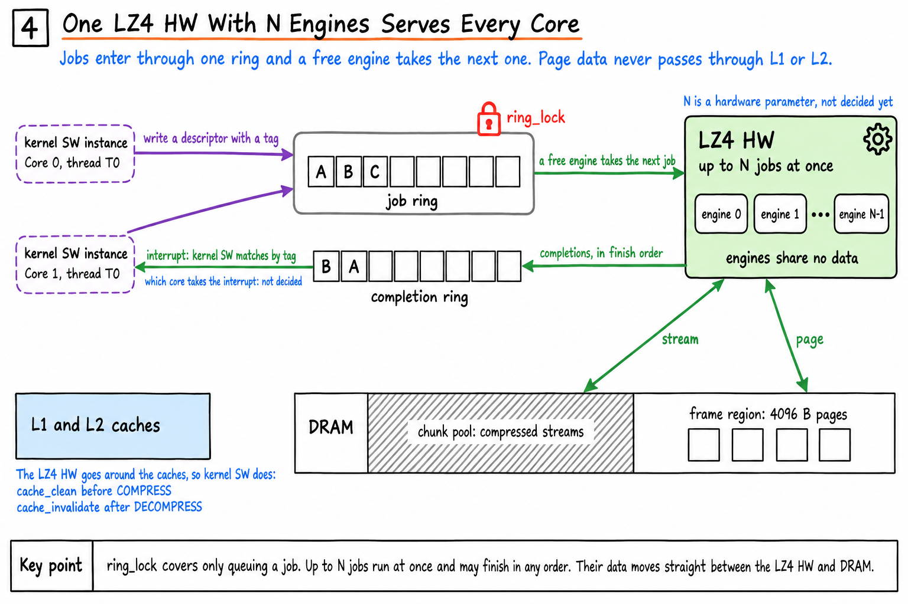

| 圖上的東西 | 意思 |
|---|---|
| job ring | kernel 放 job 的地方。一格放一個 descriptor，就是 job 的說明，帶一個編號叫 tag |
| `ring_lock` | 往 job ring 放 job 之前要拿的 lock。它只管放 job 這一下 |
| engine 0 到 N-1 | LZ4 HW 裡做事的單位。有一個空著，就從 job ring 取下一個 job。engine 之間不共用資料 |
| completion ring | LZ4 HW 做完一個 job 就寫一筆 completion。順序是做完的順序，不是送出的順序 |
| interrupt | LZ4 HW 通知 CPU 有 job 做完。kernel SW 用 tag 找出是哪一個 job。送到哪一個 core 還沒決定 |
| 左下的藍字 | LZ4 HW 直接讀寫 DRAM，不經過 L1 與 L2。所以送 COMPRESS 前 kernel 要把 frame 在 cache 裡的新資料寫回 DRAM，叫 `cache_clean`。DECOMPRESS 做完後要丟掉 cache 裡的舊資料，叫 `cache_invalidate` |

N 等於 4 的模擬看到三件事，數字在 [spec/sim-results-v0.md](../spec/sim-results-v0.md) 的 1.7 與 F15、F16：

- page fault 排在 COMPRESS 後面的等待幾乎消失。
- engine 共用一個 DRAM 出入口，LZ4 HW 那一段最長的一次變長。等的地方從 job ring 移了一部分到 DRAM 出入口。
- 最慢的 page fault 變成碰到正在被 COMPRESS 的 page 的那一種。它等的是 kernel 自己送出的 COMPRESS，engine 再多也沒用。

還不知道的：job ring 是一個，還是每個 core 一個；N 個 engine 怎麼接到 DRAM，模擬照共用一個算；N 個 engine 是否完全相同。

### 白板圖 D：兩邊各多常叫醒 kernel SW，由什麼決定

CPU MMU 與壓縮層都在管 page，但它們是兩件事。CPU MMU 這邊是小工作、很常做；壓縮層這邊是大工作，只在 page 進出 frame 時做。兩者只在兩個地方碰到。

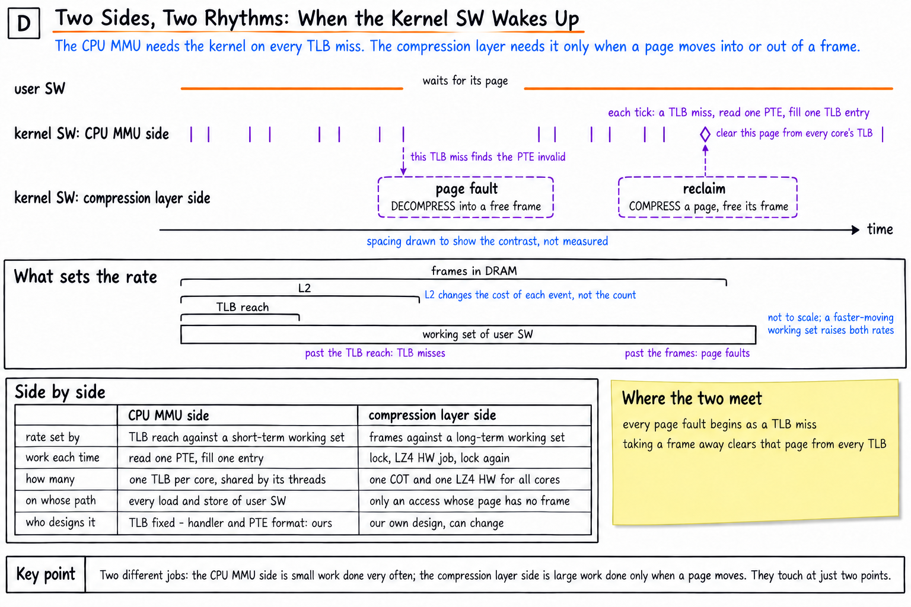

| 圖上的東西 | 意思 |
|---|---|
| 時間軸 | 上面一條是 user SW，中間是 CPU MMU 這邊的 kernel SW，下面是壓縮層這邊的 kernel SW。間距只用來對照，沒有量過。這個平台的 fault 率還沒有實際資料 |
| 兩條虛線箭頭 | 兩邊碰到的兩個地方。往下的那條：一次 TLB miss 發現 PTE 是 invalid，變成 page fault。往上的那條：reclaim 拿走 frame 時，要把那個 page 從每個 core 的 TLB 清掉 |
| What sets the rate | 兩邊的頻率都由 working set 和一個容量相比決定。CPU MMU 這邊是 TLB reach，也就是 TLB 格數乘以 4 KB，對上短時間內碰到的 page。壓縮層這邊是 frame 區，對上長時間內碰到的 page。frame 區比 TLB reach 大好幾個數量級，所以 TLB miss 遠比 page fault 多 |
| L2 的括號 | L2 不改變兩邊的次數，只改變每一次的代價。refill handler 讀的 PTE 在 L2 裡就快。LZ4 HW 寫進 DRAM 的 page 不在任何 cache 裡，fault 回來之後的頭幾次存取一定 miss L2 |
| COT | kernel 的表，每個 page 一筆，記壓縮後的資料放在哪些 chunk。LZ4 HW 不讀它 |
| who designs it | CPU MMU 這邊固定的只有 TLB。照平台前提 P1，refill handler 與 PTE 的格式由 kernel 決定 |

working set 一旦超過 frame 區，轉換的頻率不是慢慢增加，而是突然跳上去。這是壓縮層最壞情況的來源。

有一個相關的推論沒有上圖。照 P1，page 有沒有被用過只能在 TLB miss handler 裡記。一個 page 一直 TLB hit，kernel 就看不到它被用過，挑要收起來的 page 時可能挑錯。這是控制程序文件的 D5，還沒有設計。

**留給下一層的問題**：kernel 把一個 page 收起來之後，PTE 是 invalid。page fault 時 kernel 怎麼知道這個 page 現在是什麼情形？

## 8. 第 8 層：一個 page 的六種狀態

**上一層留下的問題**：kernel 把一個 page 收起來之後，PTE 是 invalid。page fault 時 kernel 怎麼知道這個 page 現在是什麼情形？

kernel 為每個 page 另外記 1 B，叫 page state。記的表叫 page state table，就是第 9 層圖 1 的 `state[h]`。`h` 是 page 的編號。

page 分兩種。RO page 只讀不寫，它壓縮後的 stream 開機時就放進 chunk pool，一直留著，所以從 compressed 開始。RW page 可以寫，從 untouched 開始。

| 狀態 | 意思 | 資料在哪 | PTE |
|---|---|---|---|
| untouched | 還沒有人碰過 | 沒有地方，讀起來是 0 | invalid |
| present | 在一個 frame 裡 | frame | valid |
| compressing | LZ4 HW 正在壓縮它 | frame，LZ4 HW 在讀 | invalid |
| compressed | 壓縮好了 | chunk | invalid |
| decompressing | LZ4 HW 正在解壓縮它 | chunk，LZ4 HW 在寫一個 frame | invalid |
| lost | 壓縮的資料壞了 | 沒有好的一份 | invalid |

**和平台前提衝突，圖沒有重畫**：圖 0 是 2026-11-11 畫的，早於 P1。

- 最下面「On access」一列，present 那一格寫「direct, kernel not involved」。照 P1，這只在 TLB hit 時成立。TLB miss 時 kernel 的 TLB miss handler 仍然會跑，讀 PTE、填 TLB，見第 3 層。
- 中間「MMU sees」一列與左邊的 MMU 小人，說 MMU 看得到 PTE 的 valid 或 invalid。照 P1，CPU MMU 只查 TLB，不讀 page table，見白板圖 B。看到 valid 或 invalid 的是 kernel 的 TLB miss handler。這一列讀成「TLB miss handler 讀到的 PTE」。

### 圖 0：一個 page 的六種狀態

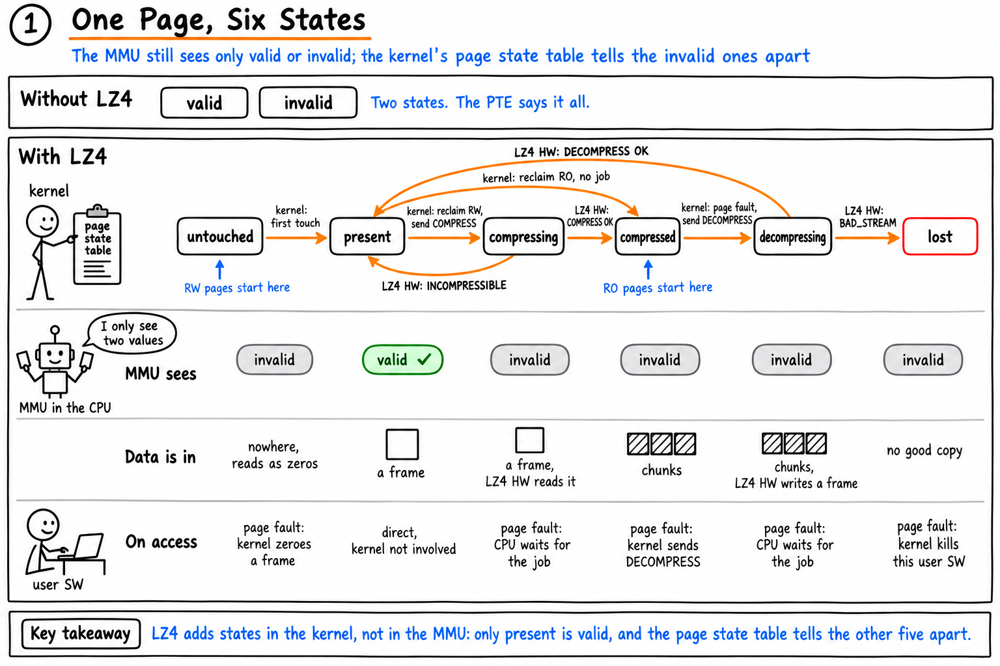

- 橘色箭頭是狀態的變化，不是資料相依，和後面的圖不同。
- 標「LZ4 HW:」的箭頭，意思是 LZ4 HW 的回答決定走哪一條。寫 `state[h]` 的永遠是 kernel。
- 八個變化和 [spec/control-procedures-v0.md](../spec/control-procedures-v0.md) 第 2.2 節相同。每一個變化在哪一張圖的哪一步寫進 `state[h]`，見下表。

| 變化 | 圖 0 上的標籤 | 寫 `state[h]` 的步驟 |
|---|---|---|
| untouched 到 present | kernel: first touch | 圖 5 步驟 6 `set_present` |
| compressed 到 decompressing | kernel: page fault, send DECOMPRESS | 圖 2 步驟 6 `mark_decompressing` |
| decompressing 到 present | LZ4 HW: DECOMPRESS OK | 圖 4 步驟 14 `set_present`，軟體救回時是圖 6A 步驟 19 |
| decompressing 到 lost | LZ4 HW: BAD_STREAM | 圖 6B 步驟 16 `set_lost` |
| present 到 compressed | kernel: reclaim RO, no job | 圖 7 步驟 6 `set_compressed` |
| present 到 compressing | kernel: reclaim RW, send COMPRESS | 圖 8 步驟 7 `mark_compressing` |
| compressing 到 compressed | LZ4 HW: COMPRESS OK | 圖 10 步驟 18 `set_compressed` |
| compressing 到 present | LZ4 HW: INCOMPRESSIBLE | 圖 10 步驟 17 `set_present` |

圖 0 有兩個標籤比現在的設計粗，狀態與箭頭的數量沒有錯：

- decompressing 到 lost 只標「LZ4 HW: BAD_STREAM」。實際上 kernel 會先用自己的解碼器再解一次，也解不開才寫 LOST，見圖 6B。
- decompressing 到 present 只標「LZ4 HW: DECOMPRESS OK」。LZ4 HW 回失敗而軟體解得開，也回到 present，見圖 6A。

主管與新手讀到這裡就夠了。address 動畫畫的是同一件事在 logical 與 physical 兩邊的樣子：[address 動畫](https://datochuang.github.io/dram-compression-tutorial/addrspace/)。

**留給下一層的問題**：kernel 改這些狀態時讀寫哪些表？表在 DRAM 的哪裡，一次要多少？

## 9. 第 9 層：表放在哪裡，八個場景各要多少

**上一層留下的問題**：kernel 改這些狀態時讀寫哪些表？表在 DRAM 的哪裡，一次要多少？

這一層是 kernel SW 細節的入口。先看表放在哪，再看八個場景的總表。第 10 到 14 層一個場景一個場景拆開。

**從這裡到第 14 層都適用的說明**

**圖 1 到圖 11 畫的是一個 job 的過程。** 這些圖在 P4 之前畫，LZ4 HW 畫成一次做一個 job。照 P4，LZ4 HW 同時最多做 N 個 job，N 暫定 4。一個 job 從頭到尾仍然由一個 engine 做，所以每一步、每一個箭頭都成立。改變的只在 job 之間：

- completion 不照送出的順序回來。`cpl_read` 本來就比對 tag，見圖 3。
- 同一個 frame 或 chunk 不可以同時出現在兩個 job 裡。這由 kernel 握著 `mm_lock` 保證，LZ4 HW 不檢查。
- 四個 engine 同時做時，LZ4 HW 那一段可能比圖上長，見第 7 層。

**還沒照平台前提改：指令數與 TLB 相關的步驟。** 圖上的指令數是在 Apple M1 上量的，指令的選擇是 AArch64 的。這個平台的指令集還不知道，換指令集數字會變。和 TLB 有關的步驟是在 P1 之前寫的，假設硬體會自己讀 page table：`access` 與 `rerun` 記成硬體做、成本 0；`tlb_inval` 用的是 AArch64 的指令，500 ns 是假設；`pick_victim` 讀的 accessed flag 假設是硬體設的。每一處在用到的那張圖旁邊再標一次。

**還沒照最新的文字版改：LZ4 HW 的模型時間。** 圖 3、圖 9、圖 11 上的 LZ4 HW 模型時間是 1253 ns 與 4260 ns。數字的來源 [spec/kernel-step-detail-v0.md](../spec/kernel-step-detail-v0.md) 在 2026-11-13 重新產生之後，是 1269 ns 與 4266 ns。圖上用到這兩個數的合計，也差同樣的 16 ns 與 6 ns，例如圖 3 的 4403 ns 與圖 11 的 7910 ns。其餘數字相同。[figures/README.md](README.md) 第 5 節的表也還是舊的。這份文件的表照現在的文字版。

### 圖 1：表放在哪裡

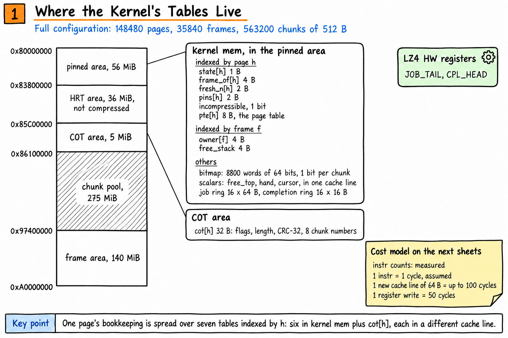

左邊是 DRAM 的配置。pinned area 是永遠不壓縮的區域，kernel 的程式與表在這裡。HRT area 是 HRT 硬體用的，也不壓縮。COT area 放 COT，每個被壓縮的 page 一筆 32 B，記它的 stream 在哪幾個 chunk、多長、CRC-32 檢查碼。frame area 是放沒有壓縮的 page 的 frame。

| 圖上的名字 | 意思 |
|---|---|
| `h` | page 的編號，表的索引 |
| `f` | frame 的編號 |
| `state[h]` | page state，第 8 層的六種狀態 |
| `frame_of[h]`、`owner[f]` | page 在哪個 frame，frame 裡是哪個 page |
| `pte[h]` | page table 裡的 PTE |
| `free_stack`、`free_top` | 空的 frame 疊成一疊，`free_top` 是疊的高度 |
| bitmap | 每個 chunk 一個 bit，記它有沒有被用 |
| `fresh[t]`、`fresh_n[h]` | thread t 最近 fault 進來的幾個 page。`fresh_n[h]` 不是 0 的 page 不會被選去趕出 |
| `pins[h]` | page 被要求暫時不能趕出的次數，不是 0 就不會被選去趕出 |
| JOB_TAIL、CPL_HEAD | LZ4 HW 的 register。kernel 寫 JOB_TAIL 告訴它有新 job，寫 CPL_HEAD 告訴它 completion 讀到哪裡 |

- 後面每一張圖的方塊都用這張的區域名稱：kernel mem、page table、COT area、chunk pool、frame area、ring、HW register。
- 每個 page 的資訊分在七張以 `h` 為索引的表，各在自己的 cache line 上。cache line 是 cache 存取的單位，64 B。後面的成本多半花在把 line 從 DRAM 讀進來。
- 右下的便條是成本的模型，下面的表有完整說明。
- 文字版：第 2 節「資料結構放在哪」。

**八個場景**

kernel 的工作分成八個場景。第 10 到 14 層照這個順序，每一條線先看常見的，再看少見的。

| 場景 | 什麼時候發生 | 圖 | 在第幾層 |
|---|---|---|---|
| `fault_ro` | 碰到一個 compressed 的 RO page，解壓縮回來 | 圖 2、圖 3、圖 4 | 10 |
| `fault_rw` | 碰到一個 compressed 的 RW page，多還它的 chunk | 圖 2、圖 3、圖 4 | 10 |
| `first_touch` | 第一次碰一個 RW page，給它一個填 0 的 frame | 圖 5 | 11 |
| `fault_rescue` | LZ4 HW 回失敗，kernel 用軟體解開 | 圖 6A | 12 |
| `fault_lost` | stream 真的壞了，page 遺失 | 圖 6B | 12 |
| `evict_ro` | 趕出一個 RO page，不必壓縮 | 圖 7 | 13 |
| `evict_rw` | 趕出一個 RW page，送 COMPRESS | 圖 8、圖 9、圖 10 | 14 |
| `evict_rw_incompressible` | RW page 壓不進去，全部還原 | 圖 8、圖 9、圖 10 | 14 |

### 圖 11：八個場景的總表

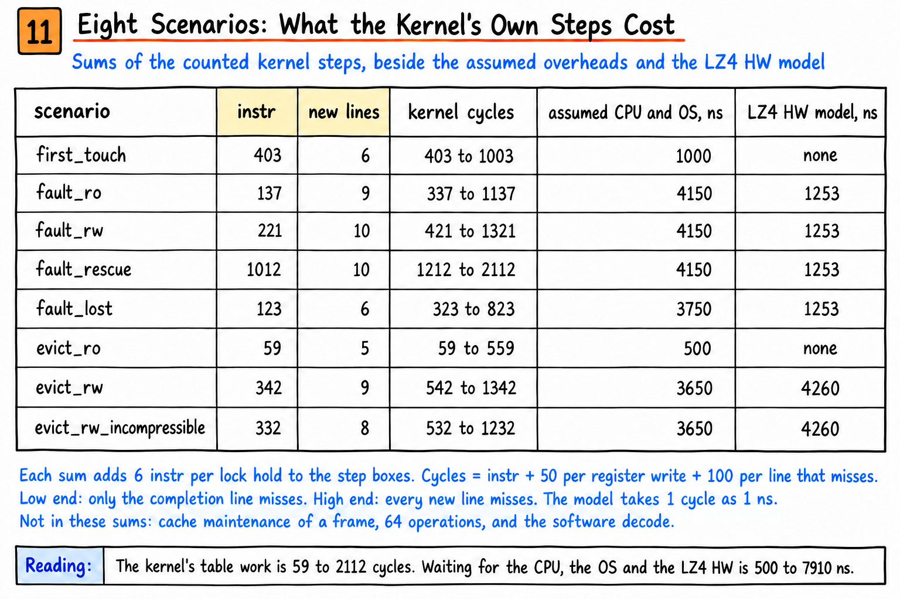

圖上的數字有四種，可信度不同：

| 數字 | 怎麼來的 |
|---|---|
| instr | 量測。每一步是 `sim/kstep/kstep.h` 的一個 C 函式，在 Apple M1 上數執行的指令 |
| lines | 計數。這個場景第一次碰到的 cache line 才算一條 |
| cycles | 模型。1 instr 算 1 cycle；一條新的 line 最多 100 cycle；LZ4 HW 剛寫的 completion 那條 line 一定是 100 cycle；寫一次 LZ4 HW register 是 50 cycle |
| ns | 假設或 LZ4 HW 模型。假設的是 exception 進出、interrupt 與叫醒 thread、TLB invalidate |

cycle 換成時間用 1 cycle 等於 1 ns，也就是 CPU 以 1 GHz 計。圖 11 的指令數含每次握 lock 的 6 道：lock 4 道、unlock 2 道。

同一張表照現在的文字版，抄自文字版第 4 節：

| 場景 | 指令數 | 新的 line | register 寫入 | 模型 cycle | CPU 與 OS 的假設 ns | LZ4 HW 模型 ns | 沒有數字的步驟 |
|---|---|---|---|---|---|---|---|
| `first_touch` | 403 | 6 | 0 | 403 到 1003 | 1000 | | |
| `fault_ro` | 137 | 9 | 2 | 337 到 1137 | 4150 | 1269 | `cache_invalidate` |
| `fault_rw` | 221 | 10 | 2 | 421 到 1321 | 4150 | 1269 | `cache_invalidate` |
| `fault_rescue` | 1012 | 10 | 2 | 1212 到 2112 | 4150 | 1269 | `cache_invalidate`、`sw_decode`、`sw_clean` |
| `fault_lost` | 123 | 6 | 2 | 323 到 823 | 3750 | 1269 | `cache_invalidate`、`sw_decode` |
| `evict_ro` | 59 | 5 | 0 | 59 到 559 | 500 | | |
| `evict_rw` | 342 | 9 | 2 | 542 到 1342 | 3650 | 4266 | `cache_clean` |
| `evict_rw_incompressible` | 332 | 8 | 2 | 532 到 1232 | 3650 | 4266 | `cache_clean` |

讀這張表要帶走的：kernel 自己查表改表的工作很小，一次 fault 的時間大半在假設的 exception、interrupt、叫醒 thread 與 LZ4 HW 上。表裡沒有 TLB miss handler 讀 PTE 與填 TLB 的時間，見第 10 層的說明。

需要設計的工程師讀到這裡就夠了。kernel SW 的效率該怎麼看，見 [spec/kernel-sw-efficiency-in-perspective.md](../spec/kernel-sw-efficiency-in-perspective.md)。

**怎麼讀圖 2 到圖 10**

| 圖上的東西 | 意思 |
|---|---|
| 步驟編號 | 每個場景各自編號，等於文字版第 4 節的編號。不同場景的圖會出現相同的號碼。藍色旗標寫「from step N」「to step N」，指同一個場景的步驟 |
| 方塊的顏色 | 白色是 kernel，淺藍是 CPU 硬體，淺綠帶齒輪是 LZ4 HW。`tlb_inval`、`notify`、`wake_page`、`kill` 由 kernel 發起、CPU 或 OS 完成，畫成白色 |
| 橘色實線 | 資料相依：後一步要用前一步算出來的值 |
| 黑色虛線 | 規則要求的順序：資料上不相依，但順序錯了會出事 |
| 沒有箭頭 | 沒有先後。握 lock 的那一段裡，方塊擺在哪裡沒有意義 |
| 黃色便條 | 那一步的成本 |
| 灰色括號或灰框 | 握著 `mm_lock` 的那一段。圖 3 與圖 9 整張不握 lock，寫在標題 |
| lock hold A、lock hold B | 同一個場景的第一次與第二次握 `mm_lock` |

- 箭頭是化簡過的。一條相依如果已經被別的路徑保證，就不畫。
- 同一步在不同圖上 line 數不同是正常的。line 只在第一次碰到時算。
- 各張圖底部的握 lock 小計不含 lock 與 unlock 的 6 道。
- kernel 指這個專案要寫的 LZ4 控制程式。OS 指它呼叫的排程服務，叫醒 thread 與結束 user SW 都算 OS。

**留給下一層的問題**：最常見的 page fault，把一個 compressed 的 page 拿回來，拆開來每一步做什麼？

## 10. 第 10 層：常見的 page fault，把壓縮的 page 拿回來

**上一層留下的問題**：最常見的 page fault，把一個 compressed 的 page 拿回來，拆開來每一步做什麼？

一次 page fault 分三段：先握 lock 檢查並準備，放開 lock 等 LZ4 HW 解壓縮，再握 lock 記帳並返回。這就是白板圖 3 便條上的「mm_lock is taken twice」。三段各一張圖。

**還沒照平台前提改：圖 2 的步驟 1 與 2。** 步驟 1 `access` 寫成 CPU 硬體讀 `pte[h]`、看到 bit 0 是 0，成本不算。照 P1，CPU 硬體不讀 page table。實際的順序是白板圖 2 的那一條：TLB miss，exception，kernel 的 TLB miss handler 讀 `pte[h]`，看到 invalid，才進到步驟 3。所以步驟 2 的 exception 是 TLB miss 的 exception，而 kernel 讀 `pte[h]` 的那一次沒有畫，也沒有算成本。600 ns 是假設。

### 圖 2：page fault，第一次握 lock

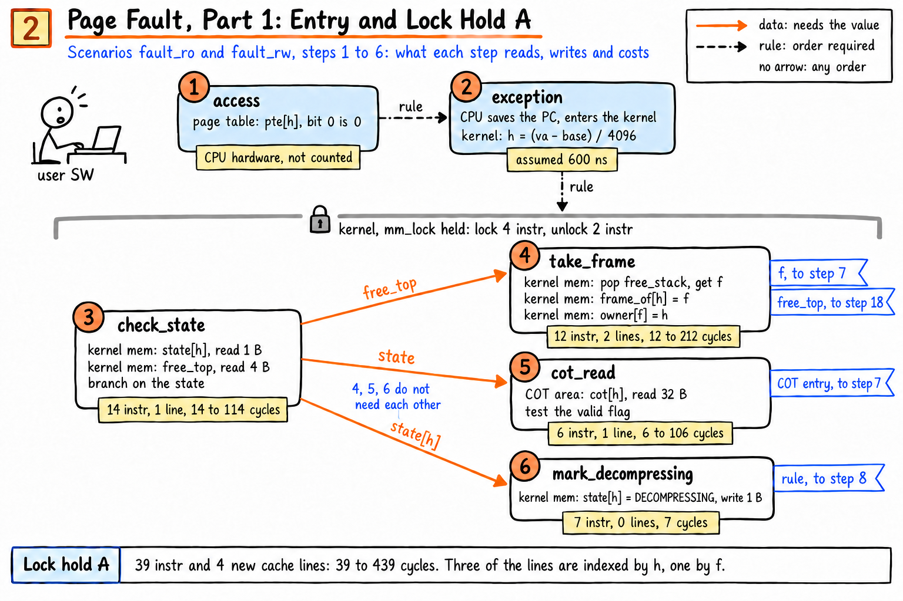

- 主張：四個步驟，39 道指令與 4 條 line。`check_state` 之後的三步互不相依。39 道不含 lock 與 unlock 的 6 道。
- 步驟 4 `take_frame` 從 `free_stack` 拿一個空的 frame。
- 步驟 5 `cot_read` 把 32 B 的 COT entry 讀進 thread 自己的變數。圖 3 的步驟 7 用這一份準備 job，圖 4 的 `release_chunks` 也用這一份。
- 步驟 6 把 `state[h]` 寫成 DECOMPRESSING，就是圖 0 的 compressed 到 decompressing。
- 旗標「free_top, to step 18」用的是 `fault_ro` 的編號。
- 文字版：第 4.2、4.3 節。

### 圖 3：DECOMPRESS job，不握 lock

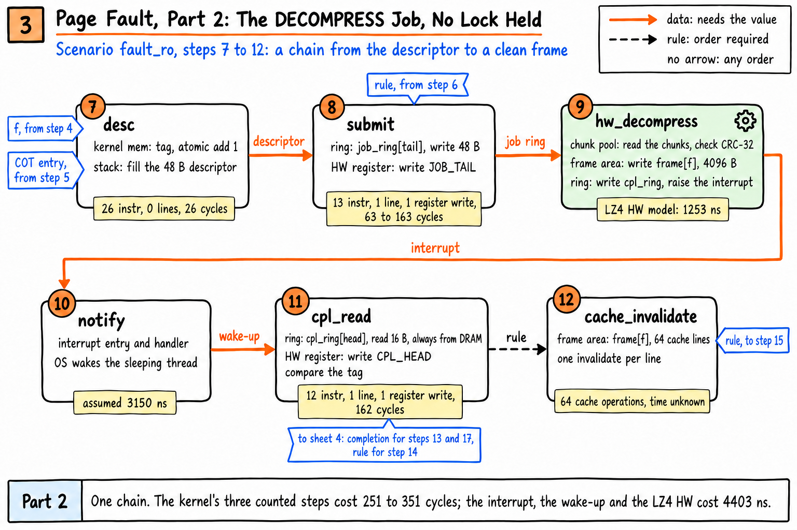

- 主張：一條直鏈。kernel 的三步 251 到 351 cycle。
- 圖上的等待 4403 ns 是假設的 interrupt 與叫醒 3150 ns 加上 LZ4 HW 模型。LZ4 HW 模型照現在的文字版是 1269 ns，圖上是 1253 ns。
- `fault_rw` 的這一段完全相同，副標題只寫了 `fault_ro`。
- `job_ring` 一格 64 B，`submit` 只寫 48 B。descriptor 是 48 B，放在格子前段，一格剛好一條 cache line。
- `cpl_read` 是 162 cycle，沒有下限。completion 那條 line 是 LZ4 HW 剛寫的，一定要從 DRAM 讀。步驟 11 比對 tag，所以 completion 不照順序回來也找得到自己的 job。
- 步驟 11 的旗標沒有列到圖 4 的步驟 a，也沒有列圖 6A 與圖 6B。LZ4 HW 沒有答 OK 時，步驟 11 之後接的是 6A 或 6B。
- `cache_invalidate` 沒有量。
- 文字版：第 4.2 節。

**還沒照平台前提改：圖 4 的步驟 15 與 20。** 步驟 15 `pte_map` 只寫 page table。步驟 20 `rerun` 寫成 CPU 硬體再讀一次 `pte[h]`，這次是 valid。照 P1，沒有人把新的對應寫進 TLB，rerun 會再 TLB miss 一次。是 fault 的這一份 instance 在步驟 19 `eret` 之前自己填 TLB，還是讓 rerun 再走一次 TLB miss handler，目前沒有設計，兩種的成本都沒有算。圖 5 步驟 7 與圖 6A 步驟 20 也一樣。

### 圖 4：page fault，第二次握 lock 與返回

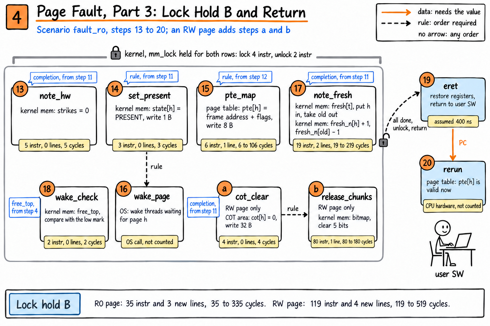

- 主張：都只等 completion。RO page 是 35 道指令，RW page 多還 chunk，變成 119 道。
- `fault_rw` 多的兩步在圖上標成 a 與 b。
- 步驟 13 `note_hw` 等的是 `cpl_read`。LZ4 HW 答 OK，`strikes` 歸零。`strikes` 記 LZ4 HW 連續答錯幾次，滿 3 次就停用 LZ4 HW，見第 12 層。
- `release_chunks` 清 5 個 bit 要 80 道。chunk 編號要從 32 B 的 COT entry 一個一個解出來，每個約 16 道。
- `cot[h]` 先清成 0 再還 chunk 是安全的。`release_chunks` 用的是握 lock A 時 `cot_read` 讀進來的那一份。
- 步驟 18 `wake_check` 看空的 frame 是不是少於下限，是的話叫醒趕 page 的 thread，見第 13 層。
- 文字版：第 4.2、4.3 節。

**留給下一層的問題**：page 從來沒人碰過時，沒有壓縮的資料可以解。這時 kernel 做什麼？

## 11. 第 11 層：第一次碰一個 page

**上一層留下的問題**：page 從來沒人碰過時，沒有壓縮的資料可以解。這時 kernel 做什麼？

給它一個填滿 0 的 frame。沒有 LZ4 job，所以只握一次 lock。

### 圖 5：第一次碰一個 page

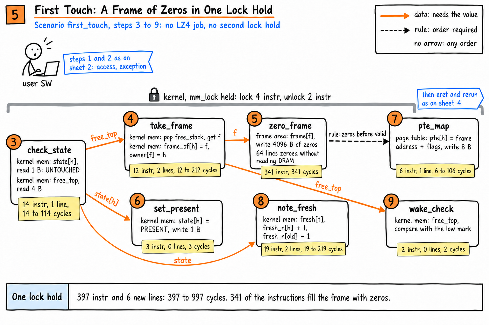

- 主張：一次握 lock、沒有 LZ4 job。397 道指令裡 341 道在填 0。
- 397 道加上握一次 lock 的 6 道，就是圖 11 的 403 道。
- `zero_frame` 的 341 道在握 `mm_lock` 的時候做。量測時用的是 AArch64 的 `DC ZVA`，一次把一條 line 寫成 0，不必先從 DRAM 讀進來。這個平台有沒有同樣的指令還不知道。
- 它寫的 64 條 line 只記成「寫了 64 條」，沒有算進 cycle 模型的 miss。
- 步驟 1、2 與圖 2 相同，步驟 7 之後與圖 4 相同，第 10 層的兩個 P1 說明在這裡也成立。
- 文字版：第 4.1 節。

**留給下一層的問題**：LZ4 HW 回答失敗時呢？

## 12. 第 12 層：LZ4 HW 沒把 page 交出來

**上一層留下的問題**：LZ4 HW 回答失敗時呢？

LZ4 HW 的失敗有兩種回答：bus error 是讀寫 frame 或 chunk 時 bus 回報錯誤；bad stream 是它認為 stream 壞了。kernel 這時用自己的軟體解碼器再解一次。解得開就救回，見圖 6A。解不開，page 就遺失，見圖 6B。

`strikes` 記 LZ4 HW 答錯幾次，滿 3 次就把 `lz4_off` 設成 1，之後不再送 job，全部用軟體解。

| LZ4 HW 的回答 | 軟體解碼 | page 的結局 | `strikes` | 畫在哪 |
|---|---|---|---|---|
| OK | 不做 | present | 歸零 | 圖 4 |
| bus error | 解得開 | present | 加 1 | 圖 6A，模擬跑的是這一種 |
| bad stream | 解得開 | present | 加 1 | 圖 6A |
| bad stream | 解不開 | lost | 歸零 | 圖 6B，模擬跑的是這一種 |
| bus error | 解不開 | lost | 加 1 | 沒有畫。步驟同圖 6B，`note_hw` 改成加 1 |
| 沒有回答 | 做，結局看解不解得開 | present 或 lost | 直接變 3，停用 LZ4 HW | 沒有畫 |

`lz4_off` 已經是 1 時不送 job，直接軟體解碼，也不跑 `note_hw`。這條路沒有畫。表的來源是 `sim/hostsim/kernel.py` 的 `fault_in`。

### 圖 6A：LZ4 HW 沒交出 page，軟體救回

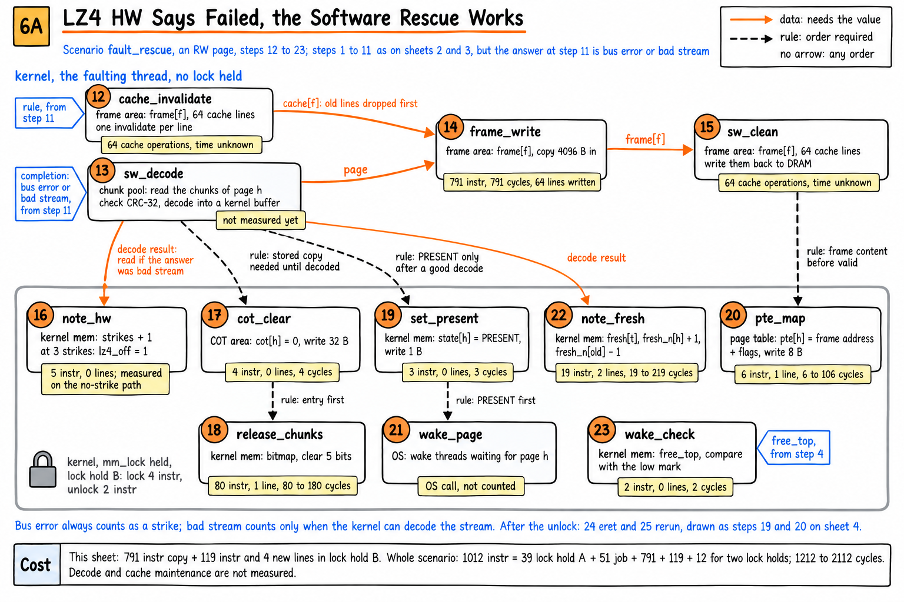

- 主張：不握 lock 做軟體解壓縮、複製 4096 B、清 cache。複製是 791 道指令，整個場景 1012 道。
- 步驟 1 到 11 同圖 2 與圖 3，差別是步驟 11 的回答是 bus error 或 bad stream。
- `sw_decode` 往下四支箭頭有兩種。`note_hw` 與 `note_fresh` 讀解碼結果，是資料箭頭。`cot_clear` 與 `set_present` 的順序寫成規則，是規則箭頭。
- `note_hw` 等 `sw_decode`，因為 bad stream 算不算答錯，要看軟體解不解得開。bus error 那一次嚴格說不必等，圖上仍然畫了，標籤寫明。
- `note_hw` 的 5 道指令是答對那條路量的。加 strike 的那條路沒有量。
- 解碼與 cache 維護沒有量。步驟 24 `eret` 與 25 rerun 同圖 4 的步驟 19 與 20。
- 文字版：第 4.4 節。

### 圖 6B：stream 壞了，page 遺失

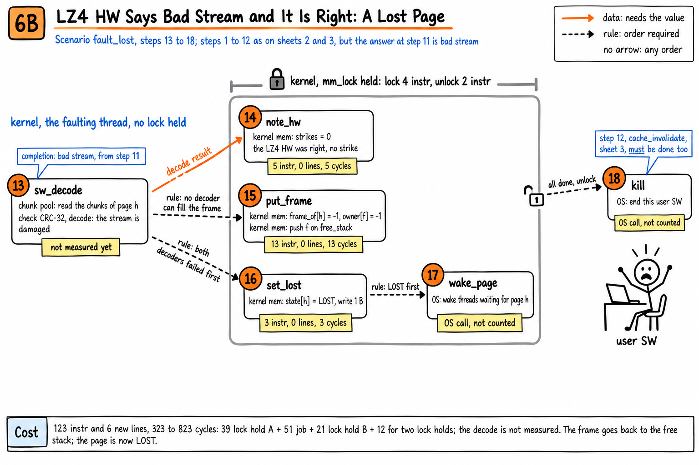

- 主張：還 frame、標成 LOST、結束 user SW。握 lock 21 道指令，LZ4 HW 不記 strike。
- LZ4 HW 回 bad stream，軟體也解不開，代表 LZ4 HW 答對了，所以 `strikes` 歸零。
- `kill` 除了等 unlock，還要等圖 3 的步驟 12 `cache_invalidate` 做完才能離開 exception。
- 整個場景 123 道指令與 6 條新的 line，323 到 823 cycle。解碼沒有量。
- 文字版：第 4.5 節。

**留給下一層的問題**：前面每一次 fault 都拿走一個空的 frame。空的 frame 用完之前，誰把 frame 騰出來？

## 13. 第 13 層：騰出 frame，趕出一個 RO page

**上一層留下的問題**：前面每一次 fault 都拿走一個空的 frame。空的 frame 用完之前，誰把 frame 騰出來？

kernel 裡有一個專門的 thread，叫 reclaimer。空的 frame 少於下限時，圖 4 或圖 5 的 `wake_check` 叫醒它。它用 clock 掃描挑一個 page 趕出去：一根指針沿著 frame 一個一個看，最近用過的放過、清掉記號，沒用過的就選它。最近有沒有用過記在 PTE 的一個 bit，叫 accessed flag。

RO page 的 stream 開機時就在 chunk pool 裡，所以趕出它不必壓縮，只改帳。

**還沒照平台前提改：accessed flag 與 `tlb_inval`。**

- 步驟 2 `pick_victim` 測 PTE 的 bit 10，也就是 accessed flag。這假設 CPU 硬體在 access 時自己設這個 bit。照 P1，硬體不讀寫 page table，這個 bit 只能由 kernel 自己記。最自然的地方是 TLB miss handler，這是推論。怎麼做還沒決定，是控制程序文件的 D5。
- 步驟 4 `tlb_inval` 寫「CPU MMU: drop the TLB entry on all cores」，500 ns 是假設，指令是 AArch64 的。清別的 core 的 TLB 用什麼機制、要多久，都還不知道，見第 6 層。

### 圖 7：clock 掃描，趕出 RO page

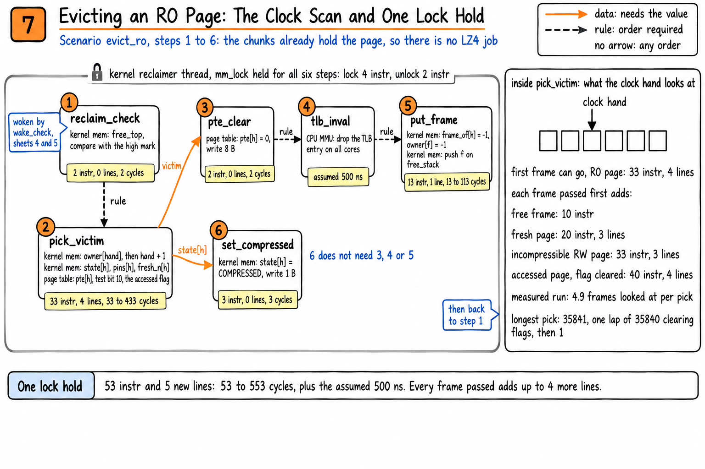

- 主張：每看一個 frame 最多 4 條新的 line。RO page 一次握 lock 53 道指令。53 道加上握一次 lock 的 6 道，就是圖 11 的 59 道。
- 步驟 3、4、5 是白板圖 C 的順序：PTE 改成 invalid，清每個 core 的 TLB，才把 frame 放回空的那一疊。
- `pick_victim` 的 33 道是「指針碰到的第一個 frame 就可以趕」的情況。
- 全尺寸的執行裡每選一個 page 平均看 4.9 個 frame，照模型是 83 到 2299 cycle。
- 最長一次掃描看了 35841 個 frame，frame 只有 35840 個。第一次 reclaim 時每個 page 的 accessed flag 都是 1，指針繞完整圈把 flag 清掉，回到第一個 frame 才選到。這一段整段握著 `mm_lock`，照模型約 1.4 到 15.8 ms。
- 文字版：第 4.6 節與第 3.3 節。

**留給下一層的問題**：RW page 的內容可能改過，chunk pool 裡沒有它的 stream。趕出它多了什麼？

## 14. 第 14 層：趕出一個 RW page

**上一層留下的問題**：RW page 的內容可能改過，chunk pool 裡沒有它的 stream。趕出它多了什麼？

要先壓縮。和 page fault 一樣分三段：握 lock 選 page、保留 chunk、拿走 PTE；放開 lock 等 LZ4 HW 壓縮；再握 lock 記帳。壓縮前先保留 7 個 chunk，壓完把多的還回去。壓完超過 7 個 chunk 的 page 叫 incompressible，全部還原，之後不再挑它。

第 13 層的兩個 P1 說明在圖 8 也成立：`pick_victim` 的 accessed flag，與步驟 6 `tlb_inval`。

### 圖 8：趕出 RW page，第一次握 lock

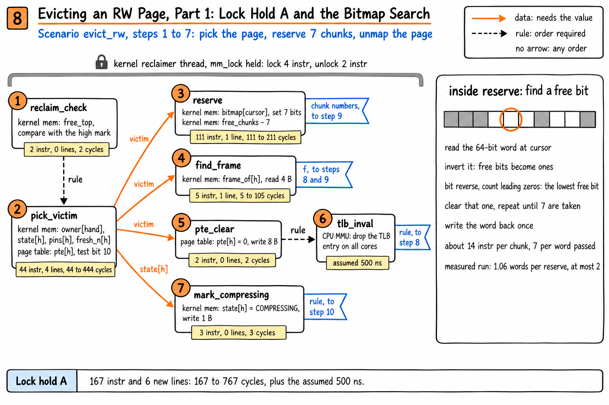

- 主張：找空的 chunk 是取反、bit reverse、count leading zeros。保留 7 個 chunk 是 111 道指令與 1 條 line。
- 量測用的 AArch64 做這三件事是 `MVN`、`RBIT`、`CLZ` 三道指令。這個平台的指令集還不知道。全尺寸的執行裡每次平均掃 1.06 個 word，最多 2 個。
- `pick_victim` 在這張是 44 道，比圖 7 多 11 道。RW page 多三個檢查：`pool_full`、`lz4_off`、incompressible 的那個 bit。
- 這一段握 lock 合計 167 道指令與 6 條 line，另外加上假設 500 ns 的 TLB invalidate。
- 文字版：第 4.7 節。

### 圖 9：COMPRESS job，不握 lock

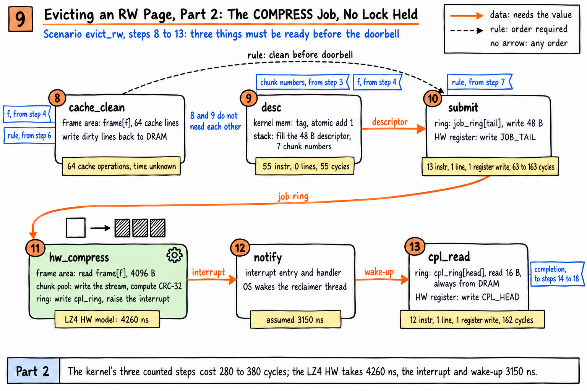

- 主張：步驟 10 `submit` 送出之前要等三件事：步驟 8 把 frame 的 cache 寫回 DRAM，步驟 9 填好 descriptor，圖 8 的步驟 7 把 `state[h]` 標成 COMPRESSING。LZ4 HW 的壓縮是最長的一段。
- kernel 有數字的三步合計 280 到 380 cycle。interrupt 與叫醒是假設的 3150 ns。LZ4 HW 模型照現在的文字版是 4266 ns，圖上是 4260 ns。
- `cpl_read` 同圖 3，162 cycle。
- `cache_clean` 沒有量。
- 文字版：第 4.7 節。

### 圖 10：趕出 RW page，第二次握 lock 的兩種結局

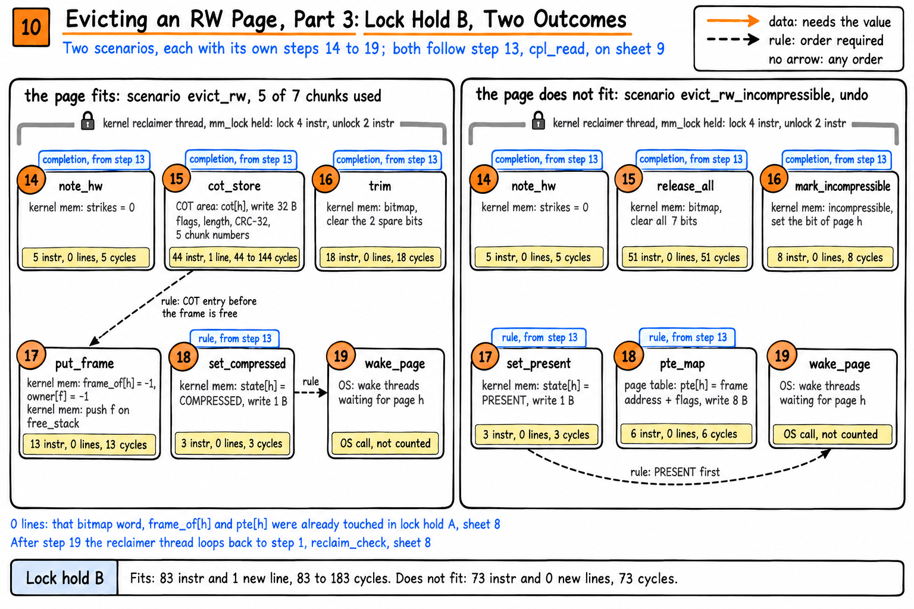

- 主張：壓得進去，寫 COT、還多的 chunk、還 frame，83 道指令。壓不進去，全部還原，73 道。
- `trim` 清 2 個 bit 是 18 道，`release_all` 清 7 個是 51 道。chunk 編號是剛保留時留在 stack 上的陣列，每個約 7 道，所以比圖 4 的 `release_chunks` 便宜。
- `put_frame` 在 `evict_rw` 是 0 條 line，因為 `frame_of[h]` 已經在 `find_frame` 讀過。
- `pte_map` 在 `evict_rw_incompressible` 是 0 條 line，因為 `pte[h]` 在握 lock A 時已經寫過。
- 文字版：第 4.7、4.8 節。

寫或審 kernel SW 的人讀完這一層，再讀附錄 B。

## 15. 讀完之後

| 想知道 | 讀 |
|---|---|
| 整顆 processor 與壓縮層畫在一頁上 | [figures/system-overview/processor-overview.png](system-overview/processor-overview.png)。程式畫的總覽，不是白板圖。圖上寫 N 還沒決定，N 暫定 4 |
| CPU MMU 一步一步怎麼動，兩個 core、hardware thread、L1 與 L2、`mm_lock` | [CPU MMU 動畫](https://datochuang.github.io/dram-compression-tutorial/mmu/)，十個場景 |
| 一個 symbol 在 logical 與 physical 兩邊的樣子 | [address 動畫](https://datochuang.github.io/dram-compression-tutorial/addrspace/) |
| LZ4 逐 byte 的壓縮與解壓縮 | [3D 課程](https://datochuang.github.io/dram-compression-tutorial/lesson/)，四課 |
| 一次模擬的重播 | [3D replay](https://datochuang.github.io/dram-compression-tutorial/replay/) |
| 每一步的完整表格 | [spec/kernel-step-detail-v0.md](../spec/kernel-step-detail-v0.md) |
| 哪些步驟真的要等別的步驟，八個場景的相依圖 | [spec/kernel-sw-dependency-v0.md](../spec/kernel-sw-dependency-v0.md) |
| kernel SW 的控制程序與 pseudo code | [spec/control-procedures-v0.md](../spec/control-procedures-v0.md) |
| kernel 與 LZ4 HW 之間的介面 | [spec/hw-fw-interface.md](../spec/hw-fw-interface.md) |
| LZ4 HW 的設計規格 | [spec/lz4-hw-design-spec-v0.md](../spec/lz4-hw-design-spec-v0.md) |
| N 個 engine 的模擬結果 | [spec/sim-results-v0.md](../spec/sim-results-v0.md) |

動畫、課程與重播以壓縮層為主角，`docs/` 裡 2026-11-13 之前做的頁面畫的是一個 engine。CPU MMU 動畫以 CPU MMU 為主角。

## 附錄 A：省容量的三種做法

這兩張是 2026-11-06 選方向時畫的，讀者是 SoC 架構師，風格和其他圖不同。它們比較三種做法，下半部用到 OSPA、CTE、NUMA node、balloon driver 等這份文件其他地方不用的名詞，而且早於平台前提。放在開頭會讓新手在學 CPU MMU 之前先學三套別的機制，所以放在附錄。第 0 層只用一段話講為什麼要壓縮。

三種做法沒有一種和第 7 到 14 層的設計完全相同。第 7 到 14 層的設計由 kernel SW 決定哪些 page 壓縮，在 page fault 時解壓縮回來。附錄圖 1 上方畫的 CPU、GPU、NPU 都經過壓縮層，但這份文件的每一層只講 CPU 上的 user SW。

### 附錄圖 1：一個壓縮層，三種省容量的做法

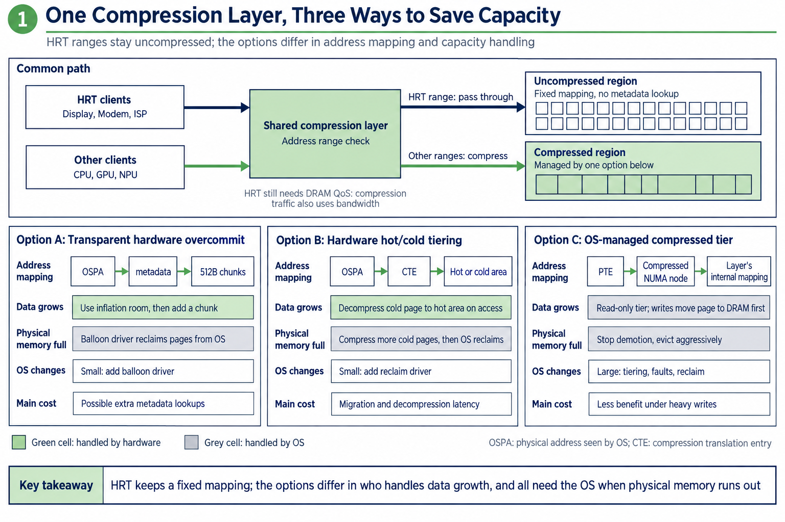

| 圖上的名字 | 意思 |
|---|---|
| OSPA | OS 看到的 physical address。做法 A 與 B 裡，硬體在它和 DRAM 之間再轉換一次 |
| CTE | compression translation entry，做法 B 裡記 page 在熱區還是冷區的那一筆 |
| balloon driver | 做法 A 裡，實體記憶體不夠時，從 OS 要回 page 的 driver |
| inflation room | 做法 A 裡，每個壓縮 page 預留的空間，資料變大時先用它 |
| NUMA node | 做法 C 裡，OS 把壓縮區當成另一塊記憶體來管 |
| 綠色格子、灰色格子 | 綠色由硬體處理，灰色由 OS 處理 |

### 附錄圖 2：省下的空間從哪裡來

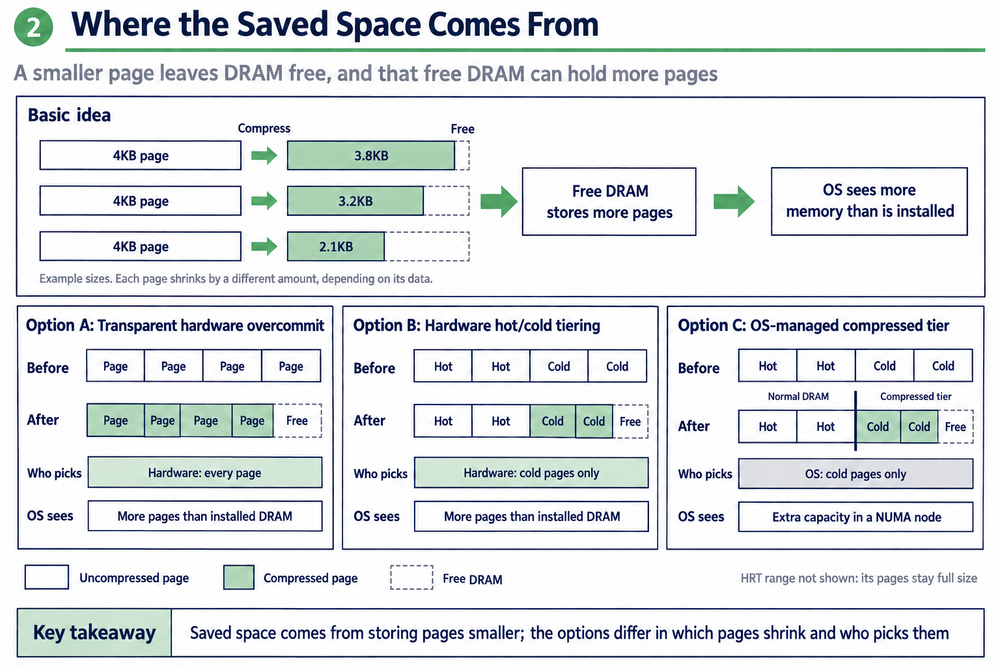

上半部是共同的想法：page 壓小之後空出的 DRAM 可以放更多 page。3.8KB、3.2KB、2.1KB 是例子，每個 page 壓完的大小不同，看它的資料。下半部比較三種做法由誰挑要壓的 page。

## 附錄 B：這份文件標出的衝突、缺口與還不知道的事

**圖和平台前提衝突，或還沒照前提改的地方**

| 哪裡 | 圖上的說法 | 照平台前提或現在的文字版 | 在這份文件的哪裡標出 |
|---|---|---|---|
| 圖 0，On access 一列 | present 的 page 直接存取，kernel 不介入 | 只有 TLB hit 時成立 | 第 8 層，圖的前面 |
| 圖 0，MMU sees 一列 | MMU 看得到 valid 或 invalid | CPU MMU 只查 TLB，看 PTE 的是 kernel 的 TLB miss handler | 第 8 層，圖的前面 |
| 白板圖 3、白板圖 4 | N engines，N 還沒決定 | N 暫定 4 | 第 5 層、第 7 層 |
| 圖 1 到圖 11 | LZ4 HW 一次做一個 job | 同時最多 N 個 job。一個 job 仍由一個 engine 做完，步驟不變 | 第 9 層開頭 |
| 圖 1 到圖 11 的指令數 | 在 Apple M1 上量的 AArch64 指令數 | 這個平台的指令集還不知道 | 第 9 層開頭 |
| 圖 2 步驟 1 `access` | CPU 硬體讀 `pte[h]`，成本 0 | TLB miss handler 讀 `pte[h]`，成本不知道 | 第 10 層，圖 2 的前面 |
| 圖 4 步驟 20、圖 5、圖 6A 的 rerun | CPU 硬體再讀 `pte[h]` | 沒有人填 TLB，rerun 會再 TLB miss。怎麼填還沒設計 | 第 10 層，圖 4 的前面 |
| 圖 7、圖 8 的 `pick_victim` | 測 PTE 的 accessed flag，假設硬體設 | 只能由 kernel 自己記，D5 未決 | 第 13 層，圖 7 的前面 |
| 圖 7、圖 8 的 `tlb_inval` | 清所有 core 的 TLB，500 ns | 機制與時間都不知道，500 ns 是假設 | 第 13 層，圖 7 的前面 |
| 圖 3、圖 9、圖 11 | LZ4 HW 模型 1253 ns、4260 ns | 現在的文字版是 1269 ns、4266 ns | 第 9 層開頭，圖 3 與圖 9 的說明 |

**圖和圖之間說法不一致的地方**

| 兩張圖 | 不一致的地方 | 以哪一張為準 |
|---|---|---|
| 白板圖 2 與圖 2、圖 4 | 白板圖 2 是 kernel 讀 PTE、kernel 填 TLB。圖 2 步驟 1 與圖 4 步驟 20 是 CPU 硬體讀 PTE | 白板圖 2，照 P1 |
| 白板圖 B 與圖 0 | 白板圖 B 說 CPU MMU 從不讀 page table。圖 0 說 MMU 看到 PTE 的兩種值 | 白板圖 B，照 P1 |
| 白板圖 1 與白板圖 3、4 | 白板圖 1 的 N 是 core 的編號，白板圖 3、4 的 N 是 engine 的數目 | 兩者無關，第 4 層已註明 |
| 四組圖的 badge | 白板圖 1、圖 0、圖 1、附錄圖 1 的 badge 都是 1 | 用第 0 層的名字 |
| 白板圖 2 的便條與圖 7 | 便條說壓縮 page 之前要清每個 core 的 TLB。圖 7 趕出 RO page 沒有壓縮，也要清 | 圖 7 與白板圖 C：拿走 frame 之前都要清 |
| 白板圖 2 右上與圖 0 | 白板圖 2 的第三種結果只寫 page 被壓縮。圖 0 有五種 invalid 的狀態 | 圖 0。白板圖 2 只舉了最常見的一種 |

**從 TLB miss 到 page fault 的鏈還缺的地方**

白板圖 2 與 README 第 3 層講清楚了 TLB miss 怎麼進 kernel，圖 2 到圖 10 講清楚了 page fault 之後的每一步。兩者之間還缺下面這些，沒有圖，也沒有設計：

| 缺口 | 現況 |
|---|---|
| TLB miss handler 讀 `pte[h]`、看到 invalid、轉進 page fault 的那一步 | 圖 2 把它畫成 CPU 硬體做，沒有成本 |
| page fault 處理完之後誰把新的對應寫進 TLB | 圖 4 的 rerun 假設硬體讀 page table。fault 的 instance 自己填，或讓 rerun 再走一次 TLB miss handler，還沒設計 |
| 只填 TLB 的 TLB miss handler 要不要拿 `mm_lock` | 還沒設計。`sim/hostsim` 的 kernel model 填 TLB 時不經過 kernel、不拿 lock |
| accessed flag 由誰設 | 圖 7、圖 8 假設硬體設。照 P1 只能由 kernel 記，D5 未決 |
| PTE 是 valid 的 TLB miss 要多少成本 | 沒有圖，也沒有數字 |

**還不知道的事**

- CPU 的指令集與型號。TLB 有幾格，有沒有 ASID。TLB miss handler 一次要多久。
- 清掉其他 core 的 TLB entry 用什麼機制，要多久。
- 同一個 core 的兩個 hardware thread 同時改 TLB，CPU 有什麼限制。
- L1 與 L2 的大小，cache 維護指令的行為。
- N 的最後值。job ring 是一個還是每個 core 一個。N 個 engine 怎麼接到 DRAM。completion 的 interrupt 送到哪一個 core。
- 還沒量的：一個 frame 64 條 line 的 cache 維護，軟體解碼 `sw_decode`，`note_hw` 加 strike 的那條路，OS 的 `wake_page`、`kill`、`notify`。

## 附錄 C：名詞

| 名詞 | 意思 | 第一次出現 |
|---|---|---|
| logical address、VA | user SW 用的 address | 第 1 層 |
| physical address、PA | DRAM 上的位置 | 第 1 層 |
| page、frame | logical 與 DRAM 兩邊各 4096 B 的一塊 | 第 1 層 |
| page table、PTE | 完整的對照表，與其中的一筆。只有 kernel SW 讀寫 | 第 2 層 |
| TLB | CPU 裡的小表，放最近用過的對應。每個 core 一張 | 第 2 層 |
| CPU MMU | 每次 access 查 TLB、做轉換的硬體 | 第 2 層 |
| TLB hit、TLB miss | TLB 裡查得到、查不到 | 第 3 層 |
| exception | CPU 停在目前的指令，改去執行 kernel SW，做完再回來 | 第 3 層 |
| page fault | TLB miss 之後，kernel 發現 PTE 是 invalid | 第 3 層 |
| hardware thread | 一個 core 同時跑的幾條執行線 | 第 4 層 |
| kernel SW instance | 某個 hardware thread 正在執行 kernel SW 的那一次 | 第 5 層 |
| `mm_lock` | 改共用的表之前要拿的 lock | 第 5 層 |
| LZ4 HW、job、engine | 做壓縮的硬體、交給它的一件工作、它裡面做事的單位 | 第 7 層 |
| chunk、stream、chunk pool | 512 B 的小塊、一個 page 壓縮後的資料、放 chunk 的區域 | 第 7 層 |
| descriptor、tag、completion | job 的說明、job 的編號、做完的回報 | 第 7 層 |
| page state、`state[h]` | kernel 為每個 page 記的六種狀態之一 | 第 8 層 |
| RO page、RW page | 只讀的 page、可寫的 page | 第 8 層 |
| COT | 每個被壓縮的 page 一筆，記 chunk、長度、CRC-32 | 第 5 層、第 9 層 |
| cache line | cache 存取的單位，64 B | 第 9 層 |
| lock hold A、B | 同一個場景的第一次與第二次握 `mm_lock` | 第 9 層 |
| reclaimer、clock 掃描、accessed flag | 趕 page 的 thread、它挑 page 的方法、最近有沒有用過的記號 | 第 13 層 |
| `strikes`、`lz4_off` | LZ4 HW 答錯的次數、停用 LZ4 HW 的旗標 | 第 10 層、第 12 層 |
| HRT | 要準時拿到資料的硬體，記憶體不壓縮 | 第 0 層 |
