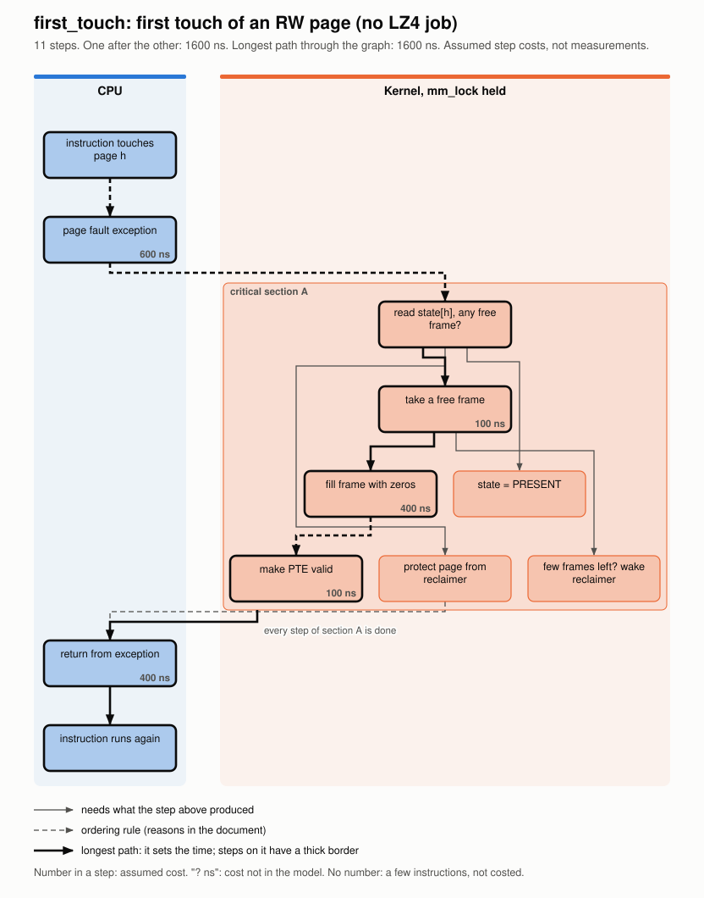
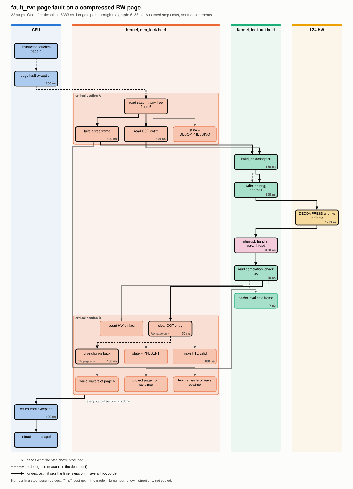
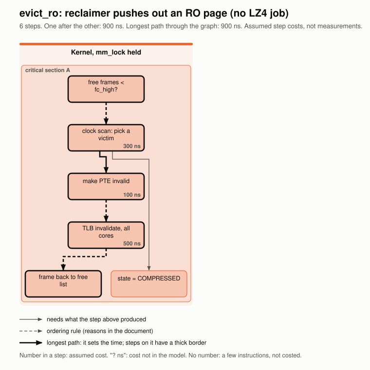
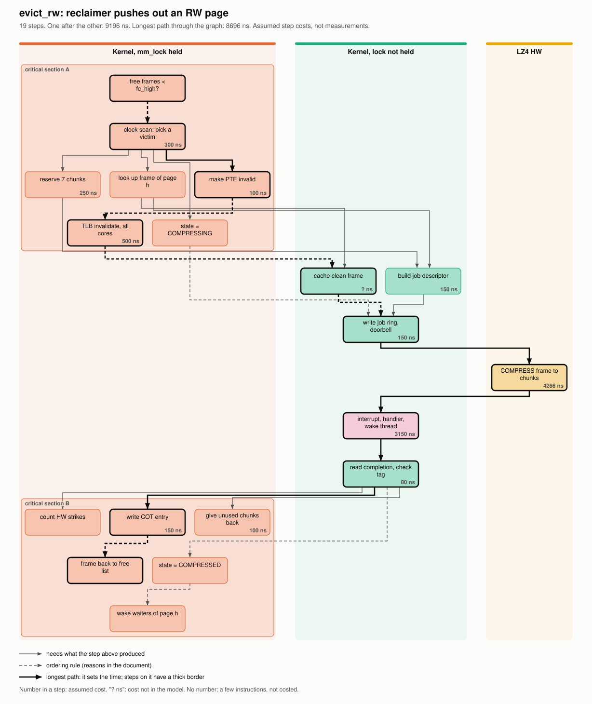
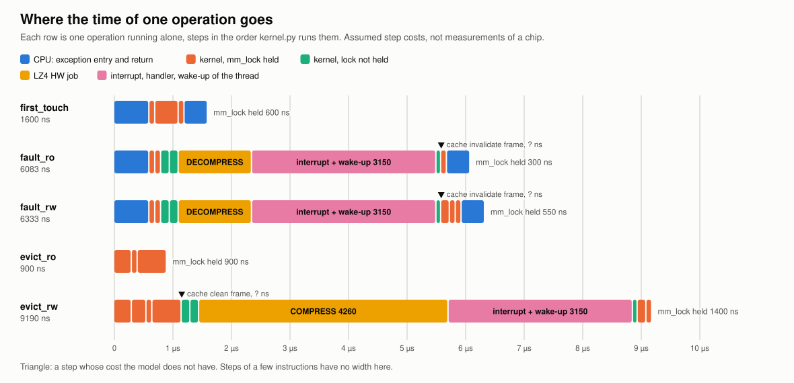
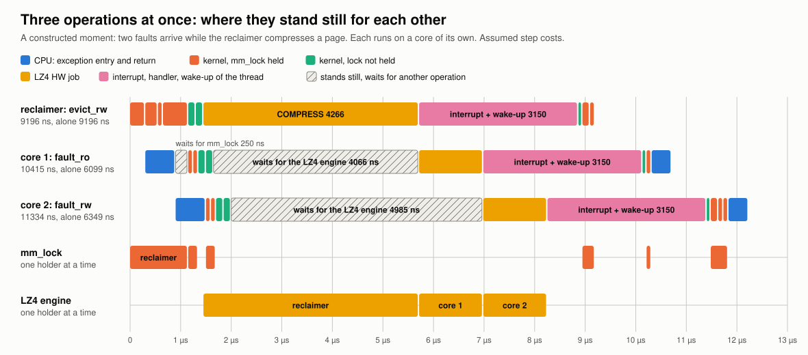
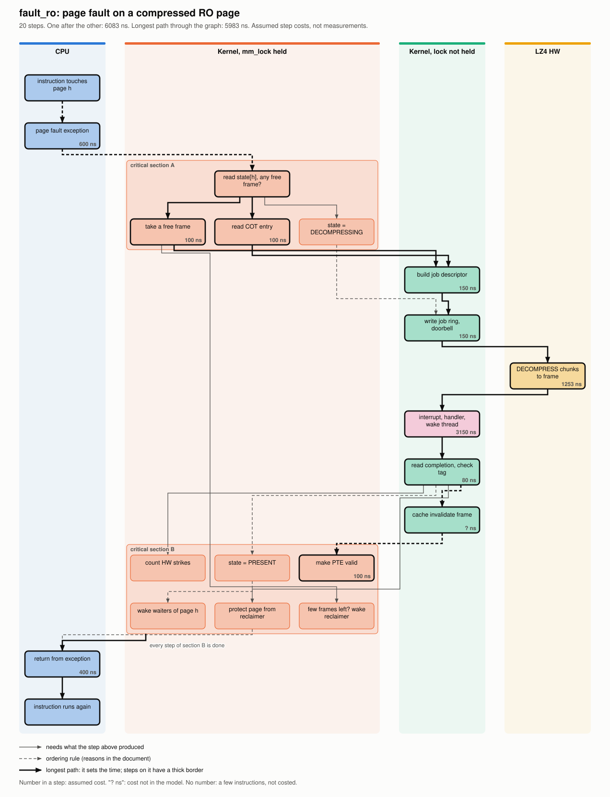
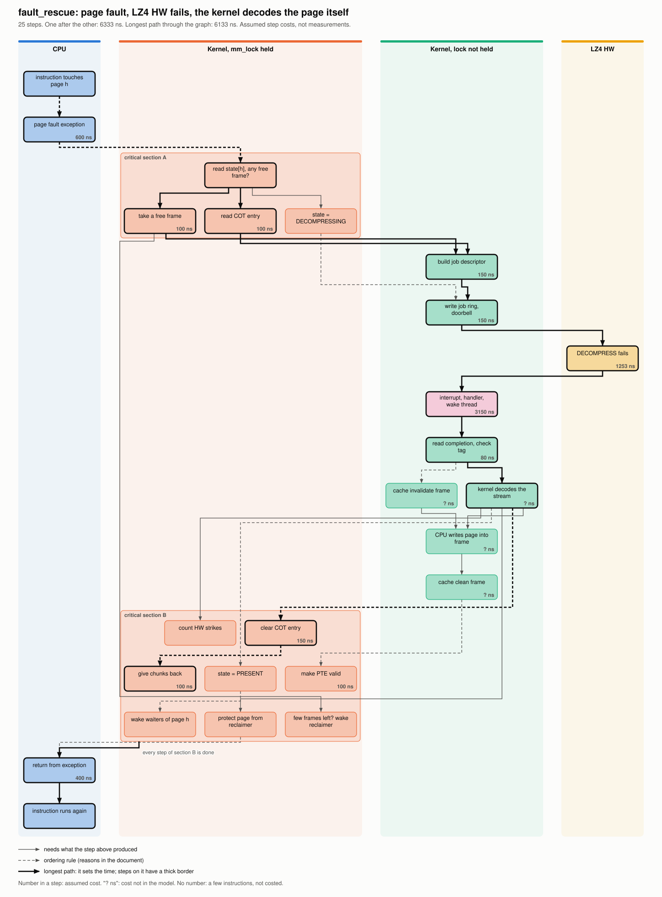
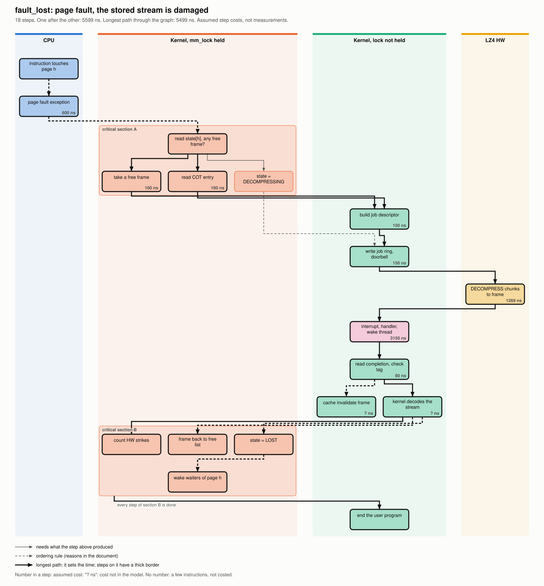
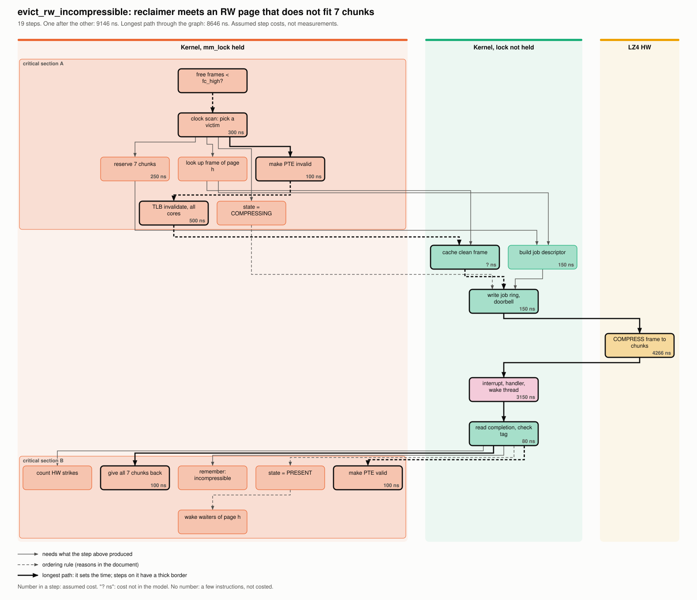

# Kernel SW 的動作拆解與相依圖，第 0 版

> 這份文件由 `python3 sim/run_host.py gen-deps` 產生。表格與圖來自 `sim/hostsim/deps.py`，需要執行才有的數字存在 `kernel-sw-dependency-v0.json`。
> 第 0 節的結論、第 6 到 8 節的建議是對這一版數字手寫的。重跑之後數字有變的話，這幾處要重讀一次。
> 所有以 ns 表示的步驟成本都是假設，不是晶片的量測。它們只用來比較輕重，不能當作規格。
> 這份文件只有分析與提案。`kernel.py` 沒有為了效能做任何修改。
> **2026-11-13：平台前提 P4 指定 LZ4 HW 可以同時接受 N 個 job，N 暫定 4。時間模型 `sim/ifsim` 同一天擴充成 N 個 engine 並重跑，這份文件引用的時間模型數字都換成 4 個 engine 的。步驟與相依圖不受影響。和 LZ4 引擎排隊有關的結論逐項列在 0.1。5.4 的例子仍然是一個 engine 的算術，那裡有註明。**

## 0. 結論

問題是：所有動作都要 kernel 控制，而且一次只做一件事，kernel 會不會卡住系統。把 kernel 的動作拆成 44 個步驟、8 個動作之後，答案分成五點。

1. **「一次只做一件事」只對了一部分。** kernel 不是一個單獨的 thread。每個發生 page fault 的 thread 在自己的 core 上跑 fault 的程序，LZ4 job 進行期間它不握 lock。真正一次只能一個的有四樣：`mm_lock` 保護的區段、LZ4 引擎和它的 ring、reclaimer thread、在 lock 裡面做的 clock 掃描。其中 LZ4 引擎在平台前提 P4 之後是一次 N 個，N 暫定 4，見 0.1。
2. **單一個動作的相依圖幾乎是一條鏈。** 一次 RO page 的 fault，一步接一步是 6 099 ns，圖上最長的路徑是 5 999 ns。趕出一個 RW page 是 9 196 ns 對 8 696 ns。所以在一個動作裡面把步驟排成平行，最多省幾百 ns。
3. **時間花在少數幾個重的步驟上。** 一次 RO fault 的 6 099 ns 裡，等 interrupt 和叫醒 thread 佔 3 150 ns，約 52%。LZ4 HW 的 DECOMPRESS 佔 1 269 ns，約 21%。CPU 進出 exception 佔 1 000 ns，約 16%。kernel 自己查表改表的部分加起來不到 700 ns。要快，是把重的步驟縮短，不是把步驟並排。
4. **塞車的位置在動作和動作之間。** 不同 page 的兩個動作之間沒有先後關係，它們只在共用的東西上相遇。在基準負載下，`mm_lock` 有 2.2% 的時間有人握著，4 個 LZ4 engine 平均每個忙 1.0%，reclaimer 忙 6.7%。負載加重時先撐不住的是 reclaimer，其次是 `mm_lock`。4 個 engine 全部有 job 的時間，在所有掃過的執行裡最多 1.5%。
5. **有兩處會讓個別的 fault 等很久，平均值看不出來。** reclaimer 握一次 lock 最多連續趕出 14 個 page。clock 掃描最長的一次看了 35 841 個 frame，全程握著 lock。這兩件事在控制程序文件裡是 F6 和 D3，這裡補上了數字。

建議的順序如下，理由在第 6 節和第 7 節。

| 順序 | 做法 | 屬於 | 解決什麼 | 證據 |
|---|---|---|---|---|
| 1 | 每握一次 lock 只趕出一個 page，而且掃描的 frame 數有上限 | kernel SW | 個別 fault 等 lock 的最長時間 | 5.3 的握 lock 統計 |
| 2 | reclaimer 同時送出至少 2 個 COMPRESS | kernel SW | 負載重時等不到 free frame | 6.1 的掃描。4 個 engine 時 2 到 8 個都可以。時間模型的預設值在 2026-11-13 改成 2，`kernel.py` 還沒改 |
| 3 | fault 的 DECOMPRESS 不排在 COMPRESS 後面 | LZ4 HW | fault 被一個 COMPRESS 擋住約 4 µs | 平台前提 P4 的 N 個 engine 已經做到大部分，見 0.1。不需要另外的優先權 |
| 4 | TLB invalidate 和填 0 移到 lock 外面 | kernel SW | 握 lock 的總時間 | 6.3 的試算，尚未執行驗證 |
| 5 | fault 的 thread 用 polling 等 completion | kernel SW | 一次 fault 少約 3 µs，代價是 CPU | 6.2，取決於用哪顆 CPU |
| 6 | LZ4 HW 的 master port 接成 coherent | 整合 | 每個 job 少兩次 cache 操作 | 成本未知，見第 8 節 |

不建議現在做的：把 `mm_lock` 拆成幾個 lock、讓硬體管 chunk 或 COT、讓硬體選要趕出的 page、用硬體填 0。理由在 6.4 和 7.2。

### 0.1 平台前提 P4 之後，哪些還成立

平台前提 P4 是 2026-11-13 指定的：LZ4 HW 可以同時接受 N 個 job，N 暫定 4。時間模型 `sim/ifsim` 同一天擴充成 N 個 engine 並重跑。下表右欄有數字的都是模擬的結果，出處是 `sim-results-v0.md`。標成推論的沒有模擬過。

| 這份文件的內容 | 4 個 engine 之後 |
|---|---|
| 第 1 到 4 節：步驟、相依圖、`mm_lock` 保護什麼、哪些步驟要在同一段 | 不變。P4 沒有改 kernel 的任何一步。lock 保護的是 kernel 的表，不是 engine |
| 結論第 1 點：一次只能一個的有四樣 | LZ4 引擎從一次一個變成一次 4 個。job ring 仍然只有一個，`ring_lock` 還在。其餘三樣不變 |
| 結論第 2、3 點：單一動作是一條鏈，時間花在通知、HW、exception | 不變。一個 job 仍然由一個 engine 從頭做到尾，不會因為 engine 變多而變快 |
| 結論第 4 點與 5.2：各自多忙，「還能撐幾倍」 | 已經換成 4 個 engine 的數字。engine 平均每個忙 1.0%，比 `mm_lock` 的 2.2% 還低。先撐不住的順序變成 reclaimer、`mm_lock`、LZ4 引擎 |
| 結論第 5 點與 5.3：握 lock 的最長時間 | 不變。P4 不影響握 lock 的時間 |
| 5.4 的例子與 F4：fault 排在一個 COMPRESS 後面多等 4 到 5 µs | 基準負載下，fault 在 ring 裡排隊最長的一次，一個 engine 是 7 192 ns，4 個 engine 是 0 ns。5.4 的圖仍然畫一個 engine，用來說明排隊是怎麼發生的 |
| 6.1：reclaimer 同時送出 2 個最好 | 只對一個 engine 成立。4 個 engine 時 2 到 8 個的 p99 都在 8 243 到 8 950 ns 之間。1 個不夠，這一點和 engine 的數量無關 |
| 「reclaimer 同時在外的 COMPRESS 不超過 N 減 1，就一定有 engine 留給 fault」 | 只對一半。留下來的 engine 可能正在做別的 fault 的 DECOMPRESS。模擬裡 3 個與 4 個分不出差別，見 6.1 |
| 6.4：不增加 reclaimer thread，因為 LZ4 引擎只有一個 | 理由的前半不成立了。結論不變：照 6.1 讓一個 reclaimer 送出好幾個 job，同樣用得到 4 個 engine，而且沒有 reclaimer 之間的競爭。這一項是推論 |
| 建議順序 1、4、5、6 | 不變 |
| 建議順序 2 | 方向不變。4 個 engine 時至少 2 個，再多也不拖慢 fault |
| 建議順序 3 與 7.1 的 H1a：DECOMPRESS 不排在 COMPRESS 後面 | 4 個 engine 時，fault 在 ring 裡排隊最長的一次是 2 162 ns，一個 engine 時是 15 823 ns。H1a 最多拿回這 2 162 ns |
| 7.1 的 H1b 與 H3：多一份 datapath | P4 已經涵蓋。硬體設計規格現在是 N 個相同的 engine，每個都能做 COMPRESS 與 DECOMPRESS |
| K5 | 建議不做 H1a，見第 8 節 |

模擬另外看到兩件這份文件原本沒有的事。

1. **engine 共用一個 DRAM port，等的地方從 ring 移了一部分到 port。** 所有 fault 裡 HW 那一段最長的一次，一個 engine 是 1 729 ns，4 個 engine 是 4 055 ns。這是大機器、負載 10 倍的數字。總帳仍然是賺的，但 HW 那一段的最壞情況變長了。時間模型文件的 F15。
2. **4 個 engine 之後，最慢的 fault 等的是 kernel 自己。** 它碰到的 page 正好在被 reclaimer 趕出去，要等那個 COMPRESS 做完才能解壓縮回來。大機器上這一段最長的一次是 7 012 ns，engine 再多也不會變短。一個 engine 時這種 fault 也有，而且等得更久。時間模型文件的 F16，第 6.5 節。

## 1. 這些圖是怎麼來的

### 1.1 做法

1. 每個步驟只宣告一次：誰做、讀什麼、寫什麼、成本取自哪個參數。全部在 `sim/hostsim/deps.py` 的 `STEPS`。
2. 每個動作是一串步驟，順序就是 `kernel.py` 執行的順序，中間標出 lock 與 unlock。
3. 先後關係不是手畫的。兩個步驟碰到同一樣東西，而且至少一方是寫，後面那一步就必須排在前面那一步之後。
4. 有些先後關係從讀寫看不出來，例如 LZ4 HW 什麼時候會去讀 frame。這些另外列成 29 條規則，每一條寫明理由，其中 15 條有 mutant 見證：把那一步拿掉，並行測試會抓到。
5. 一條先後關係如果可以由其他關係推得，圖上就不畫。

步驟宣告裡沒有索引的名字，例如 `f`、`e`、`cpl`，是只有正在跑的那個 thread 自己有的值。有索引的名字，例如 `state[h]`、`cot[h]`，是 kernel 的表。`[*]` 代表整張表。

### 1.2 和執行對過的部分

宣告有可能寫錯，所以做了四種核對，全部在 `sim/tests/test_hostsim_deps.py` 裡，每次跑測試都會重做。

**步驟順序。** 由宣告推出每個動作應該留下的 step log，和真實執行留下的 log 逐筆比對。

| 動作 | 宣告推得的 log 筆數 | 真實執行的 log 筆數 | 逐筆比對 |
|---|---|---|---|
| `first_touch` | 9 | 9 | 相同 |
| `fault_ro` | 16 | 16 | 相同 |
| `fault_rw` | 18 | 18 | 相同 |
| `fault_rescue` | 21 | 21 | 相同 |
| `fault_lost` | 16 | 16 | 相同 |
| `evict_ro` | 4 | 4 | 相同 |
| `evict_rw` | 14 | 14 | 相同 |
| `evict_rw_incompressible` | 13 | 13 | 相同 |

**讀寫。** 在三次執行中，記錄 `kernel.py` 每一行對 kernel 的表與對外呼叫的每一次讀寫，共 1 444 304 次，再和宣告比對。34 組步驟中，執行有而宣告沒有的 0 項，宣告有而執行沒出現的 0 項，不屬於任何步驟的 0 項。宣告為罕見、這三次執行也確實沒遇到的：reserve 寫 `pool_full`；wait_page 寫 `waiters[h]`。

| 執行 | access | first touch | fault RO | fault RW | 趕出 RW page | LOST |
|---|---|---|---|---|---|---|
| plain | 20 000 | 731 | 596 | 637 | 1303 | 0 |
| damaged streams | 8 000 | 465 | 273 | 168 | 555 | 23 |
| failing LZ4 HW | 8 781 | 656 | 588 | 353 | 769 | 0 |

**規則的方向。** 每條規則的先後和程式碼的順序一致，否則產生器會直接報錯。

**時間的算術。** 單獨跑一個動作時，把各步驟排上時間軸得到的結束時間，等於各步驟成本的總和。

### 1.3 沒有對過的部分

- thread 自己的區域值是讀程式碼宣告的，追蹤工具看不到它們。
- 對外呼叫各自碰了什麼，例如 `pte_unmap` 會寫 PTE 和 TLB，也是宣告。
- 步驟成本全部是假設。下表列出用到的成本。只有 LZ4 HW 的兩個時間來自時間模型的執行結果，而那個模型的 HW 速度本身也是假設。

| 成本 | ns | 來源 |
|---|---|---|
| `bitmap_release_ns` | 100 | `ifsim.params` 的預設值，假設 |
| `bitmap_reserve_ns` | 250 | `ifsim.params` 的預設值，假設 |
| `cot_read_ns` | 100 | `ifsim.params` 的預設值，假設 |
| `cot_write_ns` | 150 | `ifsim.params` 的預設值，假設 |
| `cpl_read_ns` | 80 | `ifsim.params` 的預設值，假設 |
| `desc_build_ns` | 150 | `ifsim.params` 的預設值，假設 |
| `desc_write_ns` | 100 | `ifsim.params` 的預設值，假設 |
| `fault_entry_ns` | 600 | `ifsim.params` 的預設值，假設 |
| `fault_exit_ns` | 400 | `ifsim.params` 的預設值，假設 |
| `frame_alloc_ns` | 100 | `ifsim.params` 的預設值，假設 |
| `hw_compress` | 4 266 | 時間模型量到的 LZ4 HW job 平均時間 |
| `hw_decompress` | 1 269 | 時間模型量到的 LZ4 HW job 平均時間 |
| `irq_handler_ns` | 150 | `ifsim.params` 的預設值，假設 |
| `irq_latency_ns` | 1 000 | `ifsim.params` 的預設值，假設 |
| `mmio_ns` | 50 | `ifsim.params` 的預設值，假設 |
| `pte_write_ns` | 100 | `ifsim.params` 的預設值，假設 |
| `tlb_inval_ns` | 500 | `ifsim.params` 的預設值，假設 |
| `victim_pick_ns` | 300 | `ifsim.params` 的預設值，假設 |
| `wakeup_ns` | 2 000 | `ifsim.params` 的預設值，假設 |
| `zero_fill_ns` | 400 | `ifsim.params` 的預設值，假設 |

沒有成本的步驟有兩種。只是幾道指令的，成本記 0。模型根本沒有數字的，表裡寫「？」，圖上寫 `? ns`：兩個 cache 操作和 kernel 自己的 LZ4 decoder 屬於這一種。

## 2. 每個動作的步驟與相依圖

### 2.1 總表

| 動作 | 說明 | 步驟 | 所有先後關係 | 去掉可推得的之後 | 一步接一步 ns | 圖上最長路徑 ns | 差 ns | 不在最長路徑上的步驟 |
|---|---|---|---|---|---|---|---|---|
| `first_touch` | 第一次碰一個 RW page（沒有 LZ4 job） | 11 | 19 | 13 | 1 600 | 1 600 | 0 | 3 |
| `fault_ro` | page fault，RO page，由 LZ4 HW 解壓縮 | 20 | 38 | 25 | 6 099 | 5 999 | 100 | 6 |
| `fault_rw` | page fault，RW page，由 LZ4 HW 解壓縮 | 22 | 44 | 28 | 6 349 | 6 149 | 200 | 8 |
| `fault_rescue` | page fault，LZ4 HW 沒交出 page，kernel 自己解回來（RW page） | 25 | 61 | 32 | 6 349 | 6 149 | 200 | 10 |
| `fault_lost` | page fault，存放的 stream 壞了，page 遺失 | 18 | 33 | 22 | 5 599 | 5 499 | 100 | 1 |
| `evict_ro` | reclaimer 趕出一個 RO page（沒有 LZ4 job） | 6 | 7 | 5 | 900 | 900 | 0 | 1 |
| `evict_rw` | reclaimer 趕出一個 RW page，由 LZ4 HW 壓縮 | 19 | 34 | 22 | 9 196 | 8 696 | 500 | 8 |
| `evict_rw_incompressible` | reclaimer 想趕出一個 RW page，但它壓不進 7 個 chunk | 19 | 32 | 22 | 9 146 | 8 646 | 500 | 8 |

「差」是把所有可以並排的步驟都並排之後，理論上最多能省的時間。它假設有無限多個 CPU 同時做同一個動作，實際上做不到，所以是上限。

### 2.2 圖怎麼讀

- 每一欄是一個執行者：CPU、握著 `mm_lock` 的 kernel、沒握 lock 的 kernel、LZ4 HW。
- 由上往下是時間。同一列的步驟彼此沒有先後關係。
- 實線是資料上的先後：下面那一步要用上面那一步產生的東西。虛線是規則上的先後。
- 粗線是最長的路徑，它決定這個動作最快能多快。粗框的步驟在這條路徑上。
- 橘色的框是一段 critical section。
- 步驟右下角是假設的成本。

### 2.3 四個主要的動作

#### `first_touch`：第一次碰一個 RW page（沒有 LZ4 job）

11 個步驟。一步接一步做完是 1 600 ns，圖上最長的路徑是 1 600 ns。不在最長路徑上的步驟：state = PRESENT、protect page from reclaimer、few frames left? wake reclaimer。

| # | 步驟，圖上的字 | 誰做 | 成本 ns | 最早能開始 ns | 可以晚多少 ns |
|---|---|---|---|---|---|
| 1 | instruction touches page h | CPU | 0 | 0 | 在最長路徑上 |
| 2 | page fault exception | CPU | 600 | 0 | 在最長路徑上 |
| 3 | read state[h], any free frame? | kernel，握 mm_lock，第 A 段 | 0 | 600 | 在最長路徑上 |
| 4 | take a free frame | kernel，握 mm_lock，第 A 段 | 100 | 600 | 在最長路徑上 |
| 5 | fill frame with zeros | kernel，握 mm_lock，第 A 段 | 400 | 700 | 在最長路徑上 |
| 6 | state = PRESENT | kernel，握 mm_lock，第 A 段 | 0 | 600 | 600 |
| 7 | make PTE valid | kernel，握 mm_lock，第 A 段 | 100 | 1 100 | 在最長路徑上 |
| 8 | protect page from reclaimer | kernel，握 mm_lock，第 A 段 | 0 | 600 | 600 |
| 9 | few frames left? wake reclaimer | kernel，握 mm_lock，第 A 段 | 0 | 700 | 500 |
| 10 | return from exception | CPU | 400 | 1 200 | 在最長路徑上 |
| 11 | instruction runs again | CPU | 0 | 1 600 | 在最長路徑上 |

先後關係，已去掉可以由其他關係推得的：

| 先 | 後 | 為什麼有先後 | 拿掉會被哪個 mutant 抓到 |
|---|---|---|---|
| instruction touches page h | page fault exception | 規則：CPU MMU 查到 PTE 不是 valid，才會有 exception |  |
| page fault exception | read state[h], any free frame? | 規則：CPU 進了 exception，kernel 的 handler 才開始跑 |  |
| read state[h], any free frame? | take a free frame | 兩步都碰 `free_frames`，至少一方是寫 |  |
| take a free frame | fill frame with zeros | 兩步都碰 `f`，至少一方是寫 |  |
| read state[h], any free frame? | state = PRESENT | 兩步都碰 `state[h]`，至少一方是寫 |  |
| fill frame with zeros | make PTE valid | 規則：PTE 變成 valid 之前，frame 的內容要先就緒 |  |
| read state[h], any free frame? | protect page from reclaimer | 兩步都碰 `s`，至少一方是寫 |  |
| take a free frame | few frames left? wake reclaimer | 兩步都碰 `free_frames`，至少一方是寫 |  |
| state = PRESENT | return from exception | thread 離開 kernel 之前，這一段的每一步都要做完 |  |
| make PTE valid | return from exception | thread 離開 kernel 之前，這一段的每一步都要做完 |  |
| protect page from reclaimer | return from exception | 規則：thread 離開 kernel 之前，page 要先受保護 | `protect_1` |
| few frames left? wake reclaimer | return from exception | thread 離開 kernel 之前，這一段的每一步都要做完 |  |
| return from exception | instruction runs again | 兩步都碰 `pc`，至少一方是寫 |  |

#### `fault_rw`：page fault，RW page，由 LZ4 HW 解壓縮

22 個步驟。一步接一步做完是 6 349 ns，圖上最長的路徑是 6 149 ns。不在最長路徑上的步驟：state = DECOMPRESSING、cache invalidate frame、count HW strikes、state = PRESENT、make PTE valid、wake waiters of page h、protect page from reclaimer、few frames left? wake reclaimer。

| # | 步驟，圖上的字 | 誰做 | 成本 ns | 最早能開始 ns | 可以晚多少 ns |
|---|---|---|---|---|---|
| 1 | instruction touches page h | CPU | 0 | 0 | 在最長路徑上 |
| 2 | page fault exception | CPU | 600 | 0 | 在最長路徑上 |
| 3 | read state[h], any free frame? | kernel，握 mm_lock，第 A 段 | 0 | 600 | 在最長路徑上 |
| 4 | take a free frame | kernel，握 mm_lock，第 A 段 | 100 | 600 | 在最長路徑上 |
| 5 | read COT entry | kernel，握 mm_lock，第 A 段 | 100 | 600 | 在最長路徑上 |
| 6 | state = DECOMPRESSING | kernel，握 mm_lock，第 A 段 | 0 | 600 | 250 |
| 7 | build job descriptor | kernel，不握 lock | 150 | 700 | 在最長路徑上 |
| 8 | write job ring, doorbell | kernel，不握 lock | 150 | 850 | 在最長路徑上 |
| 9 | DECOMPRESS chunks to frame | LZ4 HW | 1 269 | 1 000 | 在最長路徑上 |
| 10 | interrupt, handler, wake thread | kernel，interrupt 與叫醒 | 3 150 | 2 269 | 在最長路徑上 |
| 11 | read completion, check tag | kernel，不握 lock | 80 | 5 419 | 在最長路徑上 |
| 12 | cache invalidate frame | kernel，不握 lock | ？ | 5 499 | 150 |
| 13 | count HW strikes | kernel，握 mm_lock，第 B 段 | 0 | 5 499 | 250 |
| 14 | clear COT entry | kernel，握 mm_lock，第 B 段 | 150 | 5 499 | 在最長路徑上 |
| 15 | give chunks back | kernel，握 mm_lock，第 B 段 | 100 | 5 649 | 在最長路徑上 |
| 16 | state = PRESENT | kernel，握 mm_lock，第 B 段 | 0 | 5 499 | 250 |
| 17 | make PTE valid | kernel，握 mm_lock，第 B 段 | 100 | 5 499 | 150 |
| 18 | wake waiters of page h | kernel，握 mm_lock，第 B 段 | 0 | 5 499 | 250 |
| 19 | protect page from reclaimer | kernel，握 mm_lock，第 B 段 | 0 | 5 499 | 250 |
| 20 | few frames left? wake reclaimer | kernel，握 mm_lock，第 B 段 | 0 | 700 | 5 049 |
| 21 | return from exception | CPU | 400 | 5 749 | 在最長路徑上 |
| 22 | instruction runs again | CPU | 0 | 6 149 | 在最長路徑上 |

先後關係，已去掉可以由其他關係推得的：

| 先 | 後 | 為什麼有先後 | 拿掉會被哪個 mutant 抓到 |
|---|---|---|---|
| instruction touches page h | page fault exception | 規則：CPU MMU 查到 PTE 不是 valid，才會有 exception |  |
| page fault exception | read state[h], any free frame? | 規則：CPU 進了 exception，kernel 的 handler 才開始跑 |  |
| read state[h], any free frame? | take a free frame | 兩步都碰 `free_frames`，至少一方是寫 |  |
| read state[h], any free frame? | read COT entry | 兩步都碰 `s`，至少一方是寫 |  |
| read state[h], any free frame? | state = DECOMPRESSING | 兩步都碰 `state[h]`，至少一方是寫 |  |
| take a free frame | build job descriptor | 兩步都碰 `f`，至少一方是寫 |  |
| read COT entry | build job descriptor | 兩步都碰 `e`，至少一方是寫 |  |
| state = DECOMPRESSING | write job ring, doorbell | 規則：放開 lock 去跑 job 之前，要先把 page 標成 DECOMPRESSING，否則另一個 thread 會對同一個 page 再開一個 job | `no_decompressing` |
| build job descriptor | write job ring, doorbell | 兩步都碰 `desc`，至少一方是寫 |  |
| write job ring, doorbell | DECOMPRESS chunks to frame | 兩步都碰 `job_ring`，至少一方是寫 |  |
| DECOMPRESS chunks to frame | interrupt, handler, wake thread | 兩步都碰 `irq`，至少一方是寫 |  |
| interrupt, handler, wake thread | read completion, check tag | 兩步都碰 `wake`，至少一方是寫 |  |
| read completion, check tag | cache invalidate frame | 規則：LZ4 HW 寫完 frame 之後才能丟 cache line；kernel 是從 completion 才知道 HW 寫完了 | `no_cache_invalidate` |
| read completion, check tag | count HW strikes | 兩步都碰 `cpl`，至少一方是寫 |  |
| read completion, check tag | clear COT entry | 兩步都碰 `cpl`，至少一方是寫 |  |
| clear COT entry | give chunks back | 規則：先清 COT entry 再還 chunk：entry 永遠不會指到已經還掉的 chunk |  |
| read completion, check tag | state = PRESENT | 規則：kernel 看過 job 的結果之後，page 才能是 PRESENT |  |
| cache invalidate frame | make PTE valid | 規則：user SW 碰得到這個 page 之前，cache 裡不能留著比 DRAM 舊的 line | `no_cache_invalidate` |
| state = PRESENT | wake waiters of page h | 規則：等的 thread 醒來要讀到新的 state | `no_wake_page` |
| read completion, check tag | protect page from reclaimer | 兩步都碰 `cpl`，至少一方是寫 |  |
| take a free frame | few frames left? wake reclaimer | 兩步都碰 `free_frames`，至少一方是寫 |  |
| count HW strikes | return from exception | thread 離開 kernel 之前，這一段的每一步都要做完 |  |
| give chunks back | return from exception | thread 離開 kernel 之前，這一段的每一步都要做完 |  |
| make PTE valid | return from exception | thread 離開 kernel 之前，這一段的每一步都要做完 |  |
| wake waiters of page h | return from exception | thread 離開 kernel 之前，這一段的每一步都要做完 |  |
| protect page from reclaimer | return from exception | 規則：thread 離開 kernel 之前，page 要先受保護 | `protect_1` |
| few frames left? wake reclaimer | return from exception | thread 離開 kernel 之前，這一段的每一步都要做完 |  |
| return from exception | instruction runs again | 兩步都碰 `pc`，至少一方是寫 |  |

RO page 的 fault 少了兩步：清 COT entry、還 chunk。它的圖在附錄 A。

#### `evict_ro`：reclaimer 趕出一個 RO page（沒有 LZ4 job）

6 個步驟。一步接一步做完是 900 ns，圖上最長的路徑是 900 ns。不在最長路徑上的步驟：state = COMPRESSED。

| # | 步驟，圖上的字 | 誰做 | 成本 ns | 最早能開始 ns | 可以晚多少 ns |
|---|---|---|---|---|---|
| 1 | free frames < fc_high? | kernel，握 mm_lock，第 A 段 | 0 | 0 | 在最長路徑上 |
| 2 | clock scan: pick a victim | kernel，握 mm_lock，第 A 段 | 300 | 0 | 在最長路徑上 |
| 3 | make PTE invalid | kernel，握 mm_lock，第 A 段 | 100 | 300 | 在最長路徑上 |
| 4 | TLB invalidate, all cores | kernel，握 mm_lock，第 A 段 | 500 | 400 | 在最長路徑上 |
| 5 | frame back to free list | kernel，握 mm_lock，第 A 段 | 0 | 900 | 在最長路徑上 |
| 6 | state = COMPRESSED | kernel，握 mm_lock，第 A 段 | 0 | 300 | 600 |

先後關係，已去掉可以由其他關係推得的：

| 先 | 後 | 為什麼有先後 | 拿掉會被哪個 mutant 抓到 |
|---|---|---|---|
| free frames < fc_high? | clock scan: pick a victim | 規則：free frame 不夠，才會去找下一個 page |  |
| clock scan: pick a victim | make PTE invalid | 兩步都碰 `victim`，至少一方是寫 |  |
| make PTE invalid | TLB invalidate, all cores | 規則：先改 PTE，再清 TLB，否則 TLB 會從舊的 PTE 再填回來 |  |
| TLB invalidate, all cores | frame back to free list | 規則：frame 交給別的 page 之前，任何 core 都不能再透過舊的 TLB entry 碰到它 | `local_tlb_flush` |
| clock scan: pick a victim | state = COMPRESSED | 兩步都碰 `state[*]`，至少一方是寫 |  |

#### `evict_rw`：reclaimer 趕出一個 RW page，由 LZ4 HW 壓縮

19 個步驟。一步接一步做完是 9 196 ns，圖上最長的路徑是 8 696 ns。不在最長路徑上的步驟：reserve 7 chunks、look up frame of page h、state = COMPRESSING、build job descriptor、count HW strikes、give unused chunks back、state = COMPRESSED、wake waiters of page h。

| # | 步驟，圖上的字 | 誰做 | 成本 ns | 最早能開始 ns | 可以晚多少 ns |
|---|---|---|---|---|---|
| 1 | free frames < fc_high? | kernel，握 mm_lock，第 A 段 | 0 | 0 | 在最長路徑上 |
| 2 | clock scan: pick a victim | kernel，握 mm_lock，第 A 段 | 300 | 0 | 在最長路徑上 |
| 3 | reserve 7 chunks | kernel，握 mm_lock，第 A 段 | 250 | 300 | 200 |
| 4 | look up frame of page h | kernel，握 mm_lock，第 A 段 | 0 | 300 | 450 |
| 5 | make PTE invalid | kernel，握 mm_lock，第 A 段 | 100 | 300 | 在最長路徑上 |
| 6 | TLB invalidate, all cores | kernel，握 mm_lock，第 A 段 | 500 | 400 | 在最長路徑上 |
| 7 | state = COMPRESSING | kernel，握 mm_lock，第 A 段 | 0 | 300 | 600 |
| 8 | cache clean frame | kernel，不握 lock | ？ | 900 | 在最長路徑上 |
| 9 | build job descriptor | kernel，不握 lock | 150 | 550 | 200 |
| 10 | write job ring, doorbell | kernel，不握 lock | 150 | 900 | 在最長路徑上 |
| 11 | COMPRESS frame to chunks | LZ4 HW | 4 266 | 1 050 | 在最長路徑上 |
| 12 | interrupt, handler, wake thread | kernel，interrupt 與叫醒 | 3 150 | 5 316 | 在最長路徑上 |
| 13 | read completion, check tag | kernel，不握 lock | 80 | 8 466 | 在最長路徑上 |
| 14 | count HW strikes | kernel，握 mm_lock，第 B 段 | 0 | 8 546 | 150 |
| 15 | write COT entry | kernel，握 mm_lock，第 B 段 | 150 | 8 546 | 在最長路徑上 |
| 16 | give unused chunks back | kernel，握 mm_lock，第 B 段 | 100 | 8 546 | 50 |
| 17 | frame back to free list | kernel，握 mm_lock，第 B 段 | 0 | 8 696 | 在最長路徑上 |
| 18 | state = COMPRESSED | kernel，握 mm_lock，第 B 段 | 0 | 8 546 | 150 |
| 19 | wake waiters of page h | kernel，握 mm_lock，第 B 段 | 0 | 8 546 | 150 |

先後關係，已去掉可以由其他關係推得的：

| 先 | 後 | 為什麼有先後 | 拿掉會被哪個 mutant 抓到 |
|---|---|---|---|
| free frames < fc_high? | clock scan: pick a victim | 規則：free frame 不夠，才會去找下一個 page |  |
| clock scan: pick a victim | reserve 7 chunks | 兩步都碰 `pool_full`、`victim`，至少一方是寫 |  |
| clock scan: pick a victim | look up frame of page h | 兩步都碰 `victim`，至少一方是寫 |  |
| clock scan: pick a victim | make PTE invalid | 兩步都碰 `victim`，至少一方是寫 |  |
| make PTE invalid | TLB invalidate, all cores | 規則：先改 PTE，再清 TLB，否則 TLB 會從舊的 PTE 再填回來 |  |
| clock scan: pick a victim | state = COMPRESSING | 兩步都碰 `state[*]`，至少一方是寫 |  |
| look up frame of page h | cache clean frame | 兩步都碰 `f`，至少一方是寫 |  |
| TLB invalidate, all cores | cache clean frame | 規則：cache clean 之後不能再有 core 寫這個 frame，所以要先讓所有 core 都碰不到它 | `local_tlb_flush` |
| reserve 7 chunks | build job descriptor | 兩步都碰 `c`，至少一方是寫 |  |
| look up frame of page h | build job descriptor | 兩步都碰 `f`，至少一方是寫 |  |
| state = COMPRESSING | write job ring, doorbell | 規則：放開 lock 去跑 job 之前，要先把 page 標成 COMPRESSING，否則碰到這個 page 的 thread 不知道要等 | `no_compressing` |
| cache clean frame | write job ring, doorbell | 規則：doorbell 一寫，LZ4 HW 隨時會開始讀 frame，所以 cache clean 要在 submit 之前做完 | `no_cache_clean` |
| build job descriptor | write job ring, doorbell | 兩步都碰 `desc`，至少一方是寫 |  |
| write job ring, doorbell | COMPRESS frame to chunks | 兩步都碰 `job_ring`，至少一方是寫 |  |
| COMPRESS frame to chunks | interrupt, handler, wake thread | 兩步都碰 `irq`，至少一方是寫 |  |
| interrupt, handler, wake thread | read completion, check tag | 兩步都碰 `wake`，至少一方是寫 |  |
| read completion, check tag | count HW strikes | 兩步都碰 `cpl`，至少一方是寫 |  |
| read completion, check tag | write COT entry | 兩步都碰 `cpl`，至少一方是寫 |  |
| read completion, check tag | give unused chunks back | 兩步都碰 `cpl`，至少一方是寫 |  |
| write COT entry | frame back to free list | 規則：壓縮好的那一份寫完而且記進 COT 之後，才能把 frame 還掉 |  |
| read completion, check tag | state = COMPRESSED | 規則：kernel 看過 job 的結果之後，page 才能是 COMPRESSED |  |
| state = COMPRESSED | wake waiters of page h | 規則：等的 thread 醒來要讀到新的 state | `no_wake_page` |

## 3. 一個動作裡面，能並排的有多少

### 3.1 時間花在哪裡

| 動作 | CPU 進出 exception | kernel，握 mm_lock | kernel，不握 lock | LZ4 HW job | interrupt 與叫醒 | 合計 ns |
|---|---|---|---|---|---|---|
| `first_touch` | 1 000 | 600 | 0 | 0 | 0 | 1 600 |
| `fault_ro` | 1 000 | 300 | 380 | 1 269 | 3 150 | 6 099 |
| `fault_rw` | 1 000 | 550 | 380 | 1 269 | 3 150 | 6 349 |
| `evict_ro` | 0 | 900 | 0 | 0 | 0 | 900 |
| `evict_rw` | 0 | 1 400 | 380 | 4 266 | 3 150 | 9 196 |

這張表是上圖的數字版。兩個 cache 操作的成本未知，沒有算進去，圖上用三角形標出它們發生的位置。

### 3.2 讀法

1. **不在最長路徑上的步驟都很小。** 2.3 的每張步驟表最後一欄寫著每一步可以晚多少。fault 的程序裡，能和別的步驟並排的只有改 state、清 COT entry 這類 100 到 250 ns 的步驟。趕出 RW page 的程序裡，保留 chunk、查 frame、改 state 可以和改 PTE、TLB invalidate 並排，合計約 500 ns。
2. **這些並排在一個 thread 上沒有意義。** 一個 thread 本來就是一步接一步做。要真的並排，得把一個動作拆給兩個 core，光是叫醒另一個 core 就要 2000 ns 左右，比省下的還多。
3. **LZ4 HW 工作的那段時間，kernel 沒有可以先做的事。** job 結束後要做的每一步都要先看到 completion：清 COT entry 要等 page 確定回來，還 chunk 要等 COT entry 清掉，把 PTE 改成 valid 要等 cache 處理完。圖上唯一和 HW job 無關的步驟是「要不要叫醒 reclaimer」，它幾乎不花時間。
4. **HW 工作時 core 並沒有閒著。** 用 interrupt 等的時候，這個 thread 睡著，core 去跑別的 thread。這已經是平行，只是發生在動作和動作之間，不在一個動作裡面。

所以單一個動作的結構沒有平行化的空間。該看的是兩件事：重的步驟能不能變短，以及很多個動作同時發生時在哪裡互相擋住。第 5 節到第 7 節談這兩件事。

## 4. 動作和動作之間

### 4.1 兩個動作會在哪裡相遇

兩個動作如果處理的是不同的 page，它們各自的 page、frame、chunk 都不同，沒有任何先後關係。它們只在全系統只有一份的東西上相遇。下表由步驟的讀寫宣告算出。

| 動作一 | 動作二，不同 page | 兩邊都碰、至少一邊寫的東西 |
|---|---|---|
| `fault_ro` | `fault_ro` | `cpl_ring`、`engine`、`free_frames`、`fresh_n[*]`、`job_ring`、`lz4_off`、`reclaimer`、`strikes`、`tag` |
| `fault_rw` | `fault_rw` | `bitmap`、`cpl_ring`、`engine`、`free_frames`、`fresh_n[*]`、`job_ring`、`lz4_off`、`pool_full`、`reclaimer`、`strikes`、`tag` |
| `first_touch` | `fault_rw` | `free_frames`、`fresh_n[*]`、`reclaimer` |
| `fault_rw` | `evict_ro` | `accessed[*]`、`free_frames`、`fresh_n[*]`、`lz4_off`、`owner[*]`、`pool_full`、`state[*]`、`tlb` |
| `fault_rw` | `evict_rw` | `accessed[*]`、`bitmap`、`cpl_ring`、`engine`、`free_frames`、`fresh_n[*]`、`job_ring`、`lz4_off`、`owner[*]`、`pool_full`、`state[*]`、`strikes`、`tag`、`tlb` |
| `evict_rw` | `evict_rw` | `accessed[*]`、`bitmap`、`cpl_ring`、`engine`、`frame_waiters`、`free_frames`、`hand`、`job_ring`、`lz4_off`、`owner[*]`、`pool_full`、`state[*]`、`strikes`、`tag`、`tlb` |

### 4.2 共用的東西，誰讀誰寫

| 共用的東西 | 是什麼 | 誰寫 | 誰只讀 | 靠什麼保護 |
|---|---|---|---|---|
| `free_frames` | free frame list | take a free frame、frame back to free list | read state[h], any free frame?、few frames left? wake reclaimer、free frames < fc_high? | mm_lock |
| `frame_waiters` | 等 frame 的 thread | frame back to free list |  | mm_lock |
| `reclaimer` | 叫醒 reclaimer | few frames left? wake reclaimer |  | mm_lock |
| `fresh_n[*]` | 每個 thread 剛拿回來、還沒重跑的 page | protect page from reclaimer | clock scan: pick a victim | mm_lock |
| `hand` | clock 的指針 | clock scan: pick a victim |  | mm_lock |
| `owner[*]` | frame 屬於哪個 page，掃描時整張讀 | take a free frame、frame back to free list | clock scan: pick a victim | mm_lock |
| `state[*]` | page 的 state，掃描時整張讀 | state = PRESENT、state = DECOMPRESSING、state = COMPRESSED、state = COMPRESSING | read state[h], any free frame?、clock scan: pick a victim | mm_lock |
| `accessed[*]` | accessed bit，掃描時讀也清 | make PTE valid、instruction runs again、clock scan: pick a victim |  | kernel 這一側靠 mm_lock。CPU MMU 設 bit 時不經過 lock |
| `tlb` | 所有 core 的 TLB | TLB invalidate, all cores | instruction touches page h | mm_lock |
| `bitmap` | chunk pool 的 bitmap | give chunks back、reserve 7 chunks、give unused chunks back、give all 7 chunks back |  | mm_lock |
| `pool_full` | chunk pool 滿了的記號 | give chunks back、reserve 7 chunks | clock scan: pick a victim | mm_lock |
| `incompressible` | 壓不小的 page 名單 | remember: incompressible | clock scan: pick a victim | mm_lock |
| `strikes` | LZ4 HW 連續出錯的次數 | count HW strikes |  | mm_lock |
| `lz4_off` | LZ4 HW 已停用 | count HW strikes | state = DECOMPRESSING、clock scan: pick a victim | mm_lock |
| `tag` | 下一個 job 的 tag | build job descriptor |  | 不靠 mm_lock。介面規格的 `ring_lock` |
| `job_ring` | job ring | write job ring, doorbell | DECOMPRESS chunks to frame、COMPRESS frame to chunks | 不靠 mm_lock。介面規格的 `ring_lock` |
| `cpl_ring` | completion ring | DECOMPRESS chunks to frame、COMPRESS frame to chunks | read completion, check tag | 不靠 mm_lock。driver 依 tag 把 completion 交給送出那個 job 的 thread |
| `engine` | LZ4 HW 的引擎，一次一個 job | DECOMPRESS chunks to frame、COMPRESS frame to chunks |  | LZ4 HW 自己 |

### 4.3 `mm_lock` 實際上保護了什麼

下表是 1.2 那三次執行的紀錄：每一樣東西被碰到時，當時有沒有握著 lock。

| kernel 碰的東西 | 握著 lock 時的次數 | 沒握 lock 時的次數 | 結論 |
|---|---|---|---|
| `accessed[*]` | 29 570 | 0 | 一律握著 mm_lock |
| `accessed[h]` | 4 510 | 0 | 一律握著 mm_lock |
| `bitmap` | 8 911 | 0 | 一律握著 mm_lock |
| `cache[f]` | 1 852 | 5 855 | 兩種都有 |
| `chunk[c]` | 0 | 1 412 | 從不握 mm_lock |
| `cot[h]` | 6 368 | 0 | 一律握著 mm_lock |
| `cpl_ring` | 0 | 4 957 | 從不握 mm_lock |
| `frame[f]` | 1 852 | 3 229 | 兩種都有 |
| `frame_of[h]` | 14 609 | 0 | 一律握著 mm_lock |
| `frame_waiters` | 3 753 | 0 | 一律握著 mm_lock |
| `free_frames` | 33 874 | 0 | 一律握著 mm_lock |
| `fresh_n[*]` | 161 828 | 0 | 一律握著 mm_lock |
| `fresh_n[h]` | 8 934 | 0 | 一律握著 mm_lock |
| `hand` | 312 266 | 0 | 一律握著 mm_lock |
| `incompressible` | 10 371 | 0 | 一律握著 mm_lock |
| `job_ring` | 0 | 4 957 | 從不握 mm_lock |
| `lz4_off` | 150 568 | 0 | 一律握著 mm_lock |
| `owner[*]` | 156 133 | 0 | 一律握著 mm_lock |
| `owner[f]` | 8 230 | 0 | 一律握著 mm_lock |
| `pins[*]` | 152 900 | 0 | 一律握著 mm_lock |
| `pool_full` | 149 098 | 0 | 一律握著 mm_lock |
| `pte[h]` | 8 294 | 0 | 一律握著 mm_lock |
| `reclaimer` | 195 | 0 | 一律握著 mm_lock |
| `state[*]` | 152 900 | 0 | 一律握著 mm_lock |
| `state[h]` | 18 006 | 0 | 一律握著 mm_lock |
| `strikes` | 9 921 | 0 | 一律握著 mm_lock |
| `tag` | 0 | 9 914 | 從不握 mm_lock |
| `tlb` | 3 784 | 0 | 一律握著 mm_lock |
| `waiters[h]` | 5 253 | 0 | 一律握著 mm_lock |

讀法有三點。

1. 所有 kernel 的表都只在握著 lock 時被碰。目前只有一個 lock，它保護全部。
2. `tag`、job ring、completion ring、chunk 的內容從不靠 `mm_lock`。chunk 在 job 期間只屬於那個 job。取 tag 和寫 job ring 在 host simulation 裡是不可分割的一步；介面規格用另一個 `ring_lock` 保護這一步。時間模型的基準執行中，`ring_lock` 被拿了 103 375 次，其中要等的 717 次，有人握著的時間佔 0.52%。它不是塞車的地方。
3. frame 的內容和它的 cache 兩種都有。握著 lock 的那些全部來自 `first_touch` 的填 0。這是把填 0 移到 lock 外面的依據，見 6.3。

### 4.4 哪些步驟一定要在同一段裡

lock 可以縮短，但下面每一組步驟必須留在同一段 critical section 裡，否則並行測試會抓到錯誤。這張表是之後動 lock 時的底線。

| 要在同一段 critical section 裡的步驟 | 為什麼 | 拆開會被哪個 mutant 抓到 |
|---|---|---|
| read state[h], any free frame?、take a free frame、state = DECOMPRESSING | 讀 state[h]、拿 frame、把 state[h] 改成 DECOMPRESSING 要一氣呵成：兩個 thread 同時碰同一個 page，只有一個能開 job | `no_decompressing` |
| state = PRESENT、make PTE valid、protect page from reclaimer、wake waiters of page h | state 變成 PRESENT、PTE 變成 valid、記進 fresh 名單、叫醒等的 thread：reclaimer 的掃描要嘛全看到，要嘛全沒看到 | `no_wake_page` |
| clock scan: pick a victim、make PTE invalid、TLB invalidate, all cores、state = COMPRESSING | 選中的 page 從 PRESENT 到 PTE invalid 到 COMPRESSING 中間不能有人插進來：否則會有 fault 看到 PRESENT 卻碰不到 | `no_compressing` |
| clock scan: pick a victim、make PTE invalid、TLB invalidate, all cores、frame back to free list、state = COMPRESSED | RO page 同理：PTE invalid、frame 還回去、state 變成 COMPRESSED 在同一段裡 | `local_tlb_flush` |
| write COT entry、give unused chunks back、frame back to free list、state = COMPRESSED、wake waiters of page h | COT entry 寫好、frame 還掉、state 變成 COMPRESSED 在同一段裡：醒來的 fault 會立刻讀這個 COT entry | `no_wake_page` |
| frame back to free list | 還 frame 和叫醒等 frame 的 thread 在同一段裡 | `no_wake_frame` |

第三組和第四組把 TLB invalidate 列在裡面，是因為現在的程式這樣寫，而且並行測試的檢查規定任何 core 都不能使用 kernel 已經拿走的 translation。這條檢查比實際需要的嚴，6.3 會回來談。

## 5. 哪裡真的是一次一件

### 5.1 每個動作佔用多少

| 動作 | 基準執行裡的次數 | 握 mm_lock ns | 佔 LZ4 引擎 ns | 佔 CPU ns | 整條 ns | 佔全部握 lock 時間 |
|---|---|---|---|---|---|---|
| `first_touch` | 32 912 | 600 | 0 | 1 600 | 1 600 | 27.1% |
| `fault_ro` | 23 188 | 300 | 1 269 | 1 830 | 6 099 | 9.5% |
| `fault_rw` | 6 391 | 550 | 1 269 | 2 080 | 6 349 | 4.8% |
| `evict_ro` | 11 630 | 900 | 0 | 900 | 900 | 14.4% |
| `evict_rw` | 22 498 | 1 400 | 4 266 | 1 930 | 9 196 | 43.2% |
| `evict_rw_incompressible` | 508 | 1 350 | 4 266 | 1 880 | 9 146 | 0.9% |

握 lock 的時間有 59% 花在趕 page 出去，27% 花在第一次碰 page 時的填 0。解壓縮的 fault 本身握 lock 的時間很短。

### 5.2 基準負載下各自多忙

基準是時間模型的那次執行：4 個 core，每秒 18 888 次 fault。把各動作的次數乘上 5.1 的佔用時間，除以總時間，就是忙碌比例。

| 數量有限的東西 | 每次 fault 平均用掉 ns | 由步驟成本算出的忙碌比例 | 時間模型量到的 | 照比例還能撐幾倍負載 |
|---|---|---|---|---|
| mm_lock | 1 166 | 2.20% | 2.20% | 45 倍 |
| LZ4 引擎，4 個，平均每個 | 2 171 | 1.03% | 1.03% | 98 倍 |
| reclaimer thread，一次一個 page | 3 553 | 6.71% | 沒有直接量 | 15 倍 |

`mm_lock` 和 LZ4 引擎兩列，由步驟成本算出的數字和時間模型直接量到的數字相符，表示這份拆解沒有漏掉握 lock 或佔引擎的步驟。LZ4 引擎那一列是 4 個 engine 平均每個的忙碌比例。「還能撐幾倍」只是照比例放大，沒有考慮排隊，真實的極限會更早到。reclaimer 那一列照一次一個 page 算，那是 `kernel.py` 現在的做法。時間模型的 reclaimer 從 2026-11-13 起同時送 2 個 COMPRESS，下表是那樣跑出來的。

負載加重時實際發生的事，時間模型掃過一次，用的是小機器：

| 兩次 access 之間 ns | 負載 | fault p50 ns | p99 ns | LZ4 引擎忙，平均每個 | mm_lock 忙 | 等不到 frame 的次數 | 一次 RO fault 裡等 lock ns | 等 frame ns | 在 ring 裡排隊 ns |
|---|---|---|---|---|---|---|---|---|---|
| 20 000 | 1 倍 | 6 332 | 6 977 | 0.9% | 1.7% | 0 | 11 | 0 | 0 |
| 5 000 | 4 倍 | 6 354 | 7 813 | 3.4% | 6.2% | 0 | 80 | 0 | 0 |
| 2 000 | 10 倍 | 6 396 | 8 243 | 7.7% | 13.9% | 10 | 166 | 20 | 0 |
| 1 000 | 20 倍 | 6 453 | 15 150 | 13.2% | 23.5% | 178 | 348 | 257 | 0 |
| 500 | 40 倍 | 6 686 | 20 416 | 18.7% | 33.0% | 716 | 872 | 1 077 | 7 |

負載到 40 倍時，4 個 LZ4 engine 平均每個忙 19%，`mm_lock` 忙 33%，都還沒滿。但一次 RO fault 平均要等 1 077 ns 才拿得到 free frame。先撐不住的仍然是 reclaimer。這張表的 reclaimer 同時送 2 個 COMPRESS，是時間模型在 2026-11-13 之後的預設值。負載 10 倍時等 frame 的次數已經很少，20 倍以上還是跟不上。一次只送一個時更早撐不住，見 6.1 與時間模型文件的 F5 和 1.8。

### 5.3 一次握 lock 握多久

上面都是平均。個別的 fault 會不會等很久，要看一次握 lock 最長多久。下表來自 host simulation，統計每一次從 lock 到 unlock 之間做了什麼。

| 機器 | 誰握 lock | 握的次數 | 平均 ns | p50 ns | p99 ns | 最長 ns | 一次最多趕出幾個 page | 掃過的 frame p50 | p99 | 最多 |
|---|---|---|---|---|---|---|---|---|---|---|
| small | fault 路徑 | 3 197 | 303 | 200 | 600 | 600 | 0 | 0 | 0 | 0 |
| small | reclaimer | 1 357 | 1 633 | 1 400 | 4 100 | 5 900 | 6 | 3 | 47 | 513 |
| full | fault 路徑 | 115 908 | 310 | 200 | 600 | 600 | 0 | 0 | 0 | 0 |
| full | reclaimer | 31 454 | 1 828 | 1 400 | 5 000 | 13 100 | 14 | 3 | 34 | 35 841 |

1. **fault 路徑握 lock 很短，而且有上限。** 最長 600 ns，就是第一次碰 page 時的填 0。
2. **reclaimer 握 lock 沒有上限。** `kernel.py` 的 `reclaim` 握著 lock 一路做到 free frame 夠了為止。RO page 不需要 LZ4 job，所以連續幾個 RO page 會在同一次握 lock 裡被趕出去。大機器上最多一次 14 個 page，照假設的成本是 13 100 ns。
3. **clock 掃描的長度沒有算進上面的時間。** 模型把選一個 page 記成固定的 300 ns。大機器上共選了 46 692 次，共看了 228 141 個 frame，平均每次 4.9 個。但最長的一次看了 35 841 個，也就是整整一圈再多一格。那是第 1 次選 page：開機後每個 page 的 accessed bit 都是 1，要先整圈清過才選得出來。除了那一次，最長的是 1 305 個。小機器也一樣：第 1 次看了 513 個，其餘最長 168 個。每看一個 frame 要多久沒有數字。如果是 2 ns，那一次是 71 µs。如果是 10 ns，是 358 µs。這段時間所有的 fault 都進不了 lock。
4. 時間模型的 reclaimer 每趕出一個 page 就放一次 lock，host simulation 沒有。兩個模型在這一點不一致，要以控制程序為準訂下來，見第 8 節。

### 5.4 三件事同時發生的例子

| 誰 | 開始 ns | 單獨跑 ns | 一起跑 ns | 等 mm_lock ns | 等 LZ4 引擎 ns |
|---|---|---|---|---|---|
| reclaimer: evict_rw | 0 | 9 196 | 9 196 | 0 | 0 |
| core 1: fault_ro | 300 | 6 099 | 10 415 | 250 | 4 066 |
| core 2: fault_rw | 900 | 6 349 | 11 334 | 0 | 4 985 |

這是刻意安排的例子：reclaimer 剛送出一個 COMPRESS，兩個 fault 緊接著進來。它是步驟成本的算術，不是時間模型的執行結果。

**這個例子刻意只用一個 engine。** 兩個 fault 幾乎沒有等 lock，卻都等了 LZ4 引擎 4 到 5 µs，因為引擎一次只做一個 job，而 COMPRESS 排在前面。RO fault 從 6 099 ns 變成 10 415 ns。

4 個 engine 時，這三個 job 各佔一個 engine，兩個 fault 都不用等引擎。時間模型量到的也是這樣：基準負載下，fault 在 ring 裡排隊最長的一次，一個 engine 是 7 192 ns，4 個 engine 是 0 ns。一個 engine 的數字比一個 COMPRESS 長，因為時間模型的 reclaimer 現在同時送 2 個，fault 前面最多排兩個。見時間模型文件的 F4。

## 6. Kernel SW 可以怎麼改

每一項都標明證據來自哪裡。沒有執行過的會明說。

### 6.1 reclaimer 同時送出不只一個 COMPRESS

時間模型已經有這個選項，掃過一次，負載是基準的 10 倍：

| engine 數 | reclaimer 同時送出的 COMPRESS | fault p50 ns | p99 ns | 最大 ns | 等不到 frame 的次數 | 一次 RO fault 裡等 frame ns | 在 ring 裡排隊 ns | 在 ring 裡排隊，最長的一次 ns | HW 那一段，最長的一次 ns | 等同一個 page 的 job，最長的一次 ns |
|---|---|---|---|---|---|---|---|---|---|---|
| 1 | 1 | 6 436 | 31 746 | 44 914 | 245 | 1 007 | 1 121 | 5 210 | 1 544 | 0 |
| 1 | 2 | 6 411 | 12 646 | 17 582 | 11 | 21 | 968 | 7 180 | 1 514 | 2 732 |
| 1 | 3 | 6 412 | 15 969 | 17 869 | 0 | 0 | 1 871 | 10 405 | 1 607 | 1 177 |
| 1 | 4 | 6 410 | 20 105 | 21 438 | 0 | 0 | 3 015 | 15 091 | 1 542 | 0 |
| 1 | 8 | 6 397 | 37 690 | 49 637 | 0 | 0 | 5 304 | 32 562 | 1 530 | 17 123 |
| 4 | 1 | 6 392 | 28 543 | 36 235 | 258 | 1 020 | 0 | 0 | 2 775 | 0 |
| 4 | 2 | 6 396 | 8 243 | 14 940 | 10 | 20 | 0 | 0 | 3 427 | 7 273 |
| 4 | 3 | 6 389 | 8 438 | 9 008 | 0 | 0 | 2 | 634 | 3 254 | 0 |
| 4 | 4 | 6 391 | 8 601 | 13 062 | 0 | 0 | 2 | 716 | 3 113 | 5 445 |
| 4 | 8 | 6 396 | 8 950 | 10 050 | 0 | 0 | 8 | 1 082 | 2 829 | 0 |

兩種 engine 數都一樣的是：1 個不夠，fault 等不到 free frame。

一個 engine 時 2 個最好。再多的話，fault 的 DECOMPRESS 要排在更多 COMPRESS 後面，在 ring 裡排隊的時間變長，p99 反而變差。

4 個 engine 時沒有這個代價。2 到 8 個的 p99 都在 8 243 到 8 950 ns 之間，在 ring 裡排隊最長的一次不超過 1 082 ns。3 個與 4 個分不出差別，所以從模擬看不出需要把「不超過 N 減 1」訂成規則。

表的最後一欄是另一種等待：fault 碰到正在被 COMPRESS 的 page，要等那個 COMPRESS 做完。它不是每一次執行都發生，engine 再多也不會消失。見 6.5。

從相依圖看，這個改法不違反任何先後關係。兩個 `evict_rw` 處理不同的 page，4.1 的表列出它們共用的東西，全部只在握 lock 時碰到，而且每個 job 有自己的 tag 與自己的 chunk。要做的是把 reclaimer 改成：握 lock 選兩個 page 並送出，放 lock，等任一個完成，再握 lock 收尾。

負責人在 2026-11-13 同意 `reclaim_inflight` 可以改。時間模型的預設值已經從 1 改成 2，改了之後的數字在時間模型文件的 1.8。

`kernel.py` 目前一次一個，還沒有跟著改，所以控制程序的 pseudo code 也還是一次一個。兩個模型在這一點暫時不一致。改 `kernel.py` 之後 20 個 mutant 要全部重跑，另外要加一個 mutant：兩個 job 的 completion 對調。它和 K4 的放 lock 方式是同一段程式，建議一起決定。

### 6.2 fault 的 thread 怎麼等 completion

| 等 completion 的方式 | RO fault p50 ns | p99 ns | CPU 與 kernel | 等 lock | 送 job | 在 ring 裡排隊 | HW | 通知 | kernel 佔 CPU |
|---|---|---|---|---|---|---|---|---|---|
| interrupt | 6 175 | 6 978 | 1 450 | 19 | 150 | 0 | 1 270 | 3 315 | 1.29% |
| polling | 2 980 | 4 110 | 1 450 | 20 | 151 | 0 | 1 269 | 241 | 2.27% |

用 polling 等，RO fault 的 p50 從 6 175 ns 降到 2 980 ns，kernel 佔的 CPU 從 1.29% 升到 2.27%。DECOMPRESS 只要約 1 269 ns，比叫醒一個 thread 還短，所以 fault 路徑用 polling 是合理的。reclaimer 等的是 COMPRESS，不急，繼續用 interrupt。

這一項取決於實際的 CPU 與 kernel 或 RTOS：interrupt 延遲與叫醒時間是模型裡最大的假設，而 polling 期間這個 core 不能做別的事。

### 6.3 把步驟移到 lock 外面

由 5.1 的數字試算，只算握 lock 的時間：

| 做法 | 每次 fault 平均握 lock ns | mm_lock 忙碌比例 | 少掉的握 lock 時間 |
|---|---|---|---|
| 現在 | 1 166 | 2.20% |  |
| `first_touch` 的填 0 移到 lock 外 | 955 | 1.80% | 18.1% |
| `evict_rw` 的 TLB invalidate 移到 lock 外 | 982 | 1.85% | 15.8% |
| `evict_ro` 的 TLB invalidate 也移到 lock 外 | 1 073 | 2.03% | 8.0% |
| 以上三項都做 | 678 | 1.28% | 41.8% |

**填 0。** 第一次碰 page 時，填 0 佔握 lock 時間的三分之二。4.3 的紀錄顯示它是唯一在 lock 裡碰 frame 內容的步驟。移出去的做法和解壓縮一樣：握 lock 時把 page 標成進行中，放 lock，填 0，再握 lock 把 state 改成 PRESENT、PTE 改成 valid、叫醒等的 thread。代價是多握一次 lock，以及多一個狀態要驗證。

**趕出 RW page 時的 TLB invalidate。** 相依圖上，TLB invalidate 之後只有一條規則：它要在 cache clean 之前完成，因為 clean 之後不能再有 core 寫這個 frame。cache clean 本來就在 lock 外面。所以 TLB invalidate 可以放在 unlock 之後、cache clean 之前。這段期間 page 的 state 是 COMPRESSING，會 fault 的 thread 都在等，還留著舊 translation 的 core 讀寫的仍然是這個 page 自己的 frame。

**趕出 RO page 時的 TLB invalidate。** 這個不能直接移。frame 一還回 free list 就可能被別的 page 拿走，舊的 translation 會碰到別人的資料。要移的話，frame 必須等 TLB invalidate 做完才還回去。

這三項都是由圖推理，還沒有執行驗證。並行測試現在的檢查是「任何 core 都不能使用已經被拿走的 translation」，照這條規則，後兩項一定會被判錯。要驗證就得先把規則改寫成真正的需求：frame 換主人之前、以及 cache clean 之前，所有 core 的舊 translation 都要清掉。

TLB invalidate 的實際成本要看 CPU。模型假設 500 ns。如果 CPU 沒有能一次通知所有 core 的指令，就得逐一中斷其他 core，成本會高一個數量級，這一項的價值也跟著變大。

### 6.4 現在不建議的

| 做法 | 為什麼現在不做 |
|---|---|
| 把 `mm_lock` 依資源拆成幾個 lock | 基準負載下 lock 只忙 2.2%，照比例放大到 10 倍也還有餘。4.4 的每一組步驟都跨了不只一類資源，例如讀 state、拿 frame、改 state 要一氣呵成。拆開之後 20 個 mutant 與等待和叫醒的不可分割性都要重新證明 |
| 增加 reclaimer thread | 一個 reclaimer 照 6.1 同時送出好幾個 COMPRESS，就用得到 4 個 engine。多個 reclaimer thread 的效果相同，卻多了 reclaimer 之間的競爭。這一項是推論，沒有模擬 |
| 發生 fault 的 thread 自己趕 page 出去 | fault 的延遲會多出一整個 COMPRESS。只在 reclaimer 完全跟不上時才有意義，而那時該先做 6.1 |

### 6.5 fault 碰到正在被趕出去的 page

這一節是 2026-11-13 時間模型擴充成 4 個 engine 之後才看到的。只記錄，沒有改程式。

reclaimer 選了一個 RW page，送出 COMPRESS。COMPRESS 還在做的時候，user SW 又碰了這個 page。照現在的控制程序，fault 的 thread 要等 COMPRESS 做完、page 變成 COMPRESSED，再送一個 DECOMPRESS 把它解回來。

大機器、負載 10 倍、4 個 engine、reclaimer 同時送 2 個時，最慢的一次 fault 是 13 696 ns，其中 5 553 ns 在等這個 COMPRESS。時間模型裡 4 個 engine、沒有 fault 等不到 frame 的那些執行，只要出現這種 fault，最慢的一次就是它。

engine 的數量幫不上忙。8 個 engine 時這一段一樣長。一個 engine 時更長，大機器量到 11 369 ns，因為那個 COMPRESS 自己還要在 ring 裡排隊。

可以考慮的做法有兩個，都是 kernel SW 的事。

| 做法 | 省下什麼 | 要注意什麼 |
|---|---|---|
| COMPRESS 做完時，如果有 thread 在等這個 page，就丟掉壓縮結果，page 直接回到 PRESENT | 省掉後面那一個 DECOMPRESS，大約是一次 fault 的時間 | COMPRESSING 到 PRESENT 這條路已經有了，INCOMPRESSIBLE 用的就是它。要加的是「有人在等」的判斷，以及釋放剛配的 chunk。這一次 reclaim 沒有拿到 frame，reclaimer 要再選一個 page。要加 mutant |
| fault 不等 COMPRESS 做完，直接取消它 | 連剩下的 COMPRESS 時間也省掉 | frame 在 COMPRESS 期間 HW 還在讀。這會讓 COMPRESSING 涵蓋的範圍變小，控制程序 3.5 明說這類修改要先加反例。不建議先做 |

這兩項都是效能類的修改。在負責人同意之前程式不動，見 K3。

## 7. 硬體可以幫什麼

判斷的準則是先前定下的：複雜而容易出錯的部分留在軟體，硬體對每個 job 不保留狀態，只做協助。

### 7.1 值得評估的

| 編號 | 做法 | 省下什麼 | 證據 | 硬體是否仍然對每個 job 不保留狀態 |
|---|---|---|---|---|
| H1a | 排隊的 job 裡，DECOMPRESS 先做。第二個 ring，或 descriptor 帶優先權 | fault 最多只等正在做的那一個 COMPRESS 做完，不再等排在前面的。6.1 因此可以開到 2 個以上 | 6.1 的掃描：一個 engine、同時送 8 個時 fault 在 ring 裡平均排 5 304 ns。4 個 engine 時是 8 ns，最長的一次 2 162 ns，所以 4 個 engine 時不需要。這個做法本身沒有在時間模型裡跑過 | 是。只改取 job 的順序。介面規格的 O4 就是這一項 |
| H1b | DECOMPRESS 有自己的 datapath，可以和 COMPRESS 同時進行 | fault 完全不等 COMPRESS，最慢的 fault 少約 4 266 ns | 5.4 的例子，時間模型的 F4 | 是。但硬體要多一份 datapath，見下文 |
| H2 | LZ4 HW 的 master port 和 CPU cache 接成 coherent | 每個 job 少一次 cache clean 或 cache invalidate，一個 page 是 64 條 cache line。程序也少兩條容易做錯的規則 | 成本未知，模型裡是「？」。兩個步驟都在最長路徑上 | 是。這是整合方式，不是 LZ4 HW 內部的功能。控制程序的 D8 |
| H3 | 第二個 COMPRESS 的 datapath | LZ4 引擎的容量加倍 | 4 個 engine 時，基準負載下平均每個只忙 1.0%，40 倍負載時 19%。在那之前 reclaimer 先撐不住 | 是。但只有在做完 6.1 之後引擎成為瓶頸時才值得 |

這張表與下面兩段是平台前提 P4 指定之前寫的。P4 之後硬體設計規格改成 N 個相同的 engine，H1b 與 H3 都已經涵蓋，見 0.1。

H1a 和 H1b 差在硬體的代價。P4 之前的硬體設計規格裡，encoder 和 decoder 是分開的 block，但 page buffer、兩個 FIFO、CRC-32、packer、讀寫 DRAM 的兩個 block 和 job FSM 只有一份，一次只能服務一個 job。H1b 要把這些再做一份，只有 encoder 和 hash table 不用。照那份規格 5.4 的表，page buffer 加兩個 FIFO 是 49 152 bit，約佔全部記憶體 62 656 bit 的八成。H1a 只動取 job 的邏輯，但正在做的那個 COMPRESS 還是擋得住 fault，最多 4 266 ns 左右。

當時的建議是先在時間模型裡加上 H1a 跑一次，看 p99 剩多少，再決定要不要 H1b。P4 之後順序改成：先把時間模型擴充成 N 個 engine，再看 H1a 還需不需要。

2026-11-13 擴充並重跑的結果：4 個 engine 時，fault 在 ring 裡排隊最長的一次是 2 162 ns，H1a 最多拿回這一段。同一批執行裡，HW 那一段最長的一次因為共用 DRAM port 從 1 729 ns 變成 4 055 ns。所以硬體這邊剩下值得看的不是 ring 的順序，是 port 上 DECOMPRESS 的 burst 要不要優先。那是硬體設計規格 12.3 的第 21 項。負責人在 2026-11-13 指示先不用模擬，但要記著，所以這一項留在待辦，沒有數字。

### 7.2 評估過、不建議的

| 做法 | 為什麼不做 |
|---|---|
| 硬體填 0 | CPU 填一個 page 假設是 400 ns。交給硬體要送 job、等 completion，光通知就超過這個數字 |
| 硬體管 chunk 的 bitmap 或自己讀寫 COT | 這些步驟各只有 100 到 250 ns，而且是最容易出錯、最需要 mutant 驗證的部分。交給硬體等於讓硬體持有跨 job 的狀態，違反準則 |
| 硬體選要趕出的 page | 掃描要讀 PTE 的 accessed bit、page 的 state、pin 與 fresh 名單，全是 kernel 的表。5.3 的問題用軟體設上限就能解決 |
| 硬體收到 page 編號後自己查 COT | 省下讀 COT 與組 descriptor 共約 250 ns，卻讓硬體依賴 COT 的格式與位置 |
| completion 專用的喚醒訊號 | 6.2 的 polling 不需要新硬體就拿到大部分的好處 |

TLB invalidate 能不能一道指令通知所有 core，是 CPU 的特性，不是 LZ4 HW 能幫的。

## 8. 還缺的數字，和要請你決定的事

### 8.1 還缺的數字

| 缺什麼 | 影響哪個判斷 | 怎麼取得 |
|---|---|---|
| cache clean 與 cache invalidate 一個 page 要多久 | H2 值不值得 | 選定 CPU 後查手冊或實測 |
| TLB invalidate 通知所有 core 要多久 | 6.3 的後兩項值不值得 | 同上 |
| clock 掃描每看一個 frame 要多久 | 5.3 的第 3 點有多嚴重，上限該設多少 | 實作後量，或用 cache miss 的成本估 |
| interrupt 延遲與叫醒 thread 的時間 | 6.2，以及一次 fault 的一半時間 | 取決於 kernel 或 RTOS |
| kernel 自己的 LZ4 decoder 解一個 page 要多久 | LZ4 HW 停用後的延遲 | 在目標 CPU 上跑 |
| 真實負載每秒幾次 fault、RO 與 RW 的比例 | 第 5 節全部。基準是合成負載 | 真實的 access 紀錄 |

### 8.2 要請你決定的事

| 編號 | 問題 | 我的建議 |
|---|---|---|
| K1 | 用哪顆 CPU、哪個 kernel 或 RTOS | 這決定 TLB、interrupt、polling 三件事的成本，先定下來，其餘的才算得準 |
| K2 | 目標是平均延遲，還是最慢的那些 fault | 建議以最慢的為準。平均已經由通知時間決定，結構上的問題都出在尾端 |
| K3 | 是否開始為效能修改 `kernel.py` | 建議先做順序 1 和順序 2。兩者都要加 mutant 並重跑全部並行測試。2026-11-13 負責人同意 `reclaim_inflight` 可以改，時間模型的預設值已經改成 2。`kernel.py` 的 `reclaim` 還沒有動：那是把握 lock 的方式一起改掉的修改，和 K4 是同一段程式，等你確認要不要現在做 |
| K4 | reclaimer 每趕出一個 page 要不要放一次 lock | 建議要，並採用控制程序 D3 的選項 B：掃描有上限。這也讓兩個模型一致 |
| K5 | H1 要不要列入 LZ4 HW 的設計規格 | 平台前提 P4 之後 H1b 不用再決定。H1a 建議不做：4 個 engine 時它最多拿回 2 162 ns。這也是介面規格的 O4 |

## 附錄 A. 其餘四個動作

### `fault_ro`：page fault，RO page，由 LZ4 HW 解壓縮

20 個步驟。一步接一步做完是 6 099 ns，圖上最長的路徑是 5 999 ns。不在最長路徑上的步驟：state = DECOMPRESSING、count HW strikes、state = PRESENT、wake waiters of page h、protect page from reclaimer、few frames left? wake reclaimer。

| # | 步驟，圖上的字 | 誰做 | 成本 ns | 最早能開始 ns | 可以晚多少 ns |
|---|---|---|---|---|---|
| 1 | instruction touches page h | CPU | 0 | 0 | 在最長路徑上 |
| 2 | page fault exception | CPU | 600 | 0 | 在最長路徑上 |
| 3 | read state[h], any free frame? | kernel，握 mm_lock，第 A 段 | 0 | 600 | 在最長路徑上 |
| 4 | take a free frame | kernel，握 mm_lock，第 A 段 | 100 | 600 | 在最長路徑上 |
| 5 | read COT entry | kernel，握 mm_lock，第 A 段 | 100 | 600 | 在最長路徑上 |
| 6 | state = DECOMPRESSING | kernel，握 mm_lock，第 A 段 | 0 | 600 | 250 |
| 7 | build job descriptor | kernel，不握 lock | 150 | 700 | 在最長路徑上 |
| 8 | write job ring, doorbell | kernel，不握 lock | 150 | 850 | 在最長路徑上 |
| 9 | DECOMPRESS chunks to frame | LZ4 HW | 1 269 | 1 000 | 在最長路徑上 |
| 10 | interrupt, handler, wake thread | kernel，interrupt 與叫醒 | 3 150 | 2 269 | 在最長路徑上 |
| 11 | read completion, check tag | kernel，不握 lock | 80 | 5 419 | 在最長路徑上 |
| 12 | cache invalidate frame | kernel，不握 lock | ？ | 5 499 | 在最長路徑上 |
| 13 | count HW strikes | kernel，握 mm_lock，第 B 段 | 0 | 5 499 | 100 |
| 14 | state = PRESENT | kernel，握 mm_lock，第 B 段 | 0 | 5 499 | 100 |
| 15 | make PTE valid | kernel，握 mm_lock，第 B 段 | 100 | 5 499 | 在最長路徑上 |
| 16 | wake waiters of page h | kernel，握 mm_lock，第 B 段 | 0 | 5 499 | 100 |
| 17 | protect page from reclaimer | kernel，握 mm_lock，第 B 段 | 0 | 5 499 | 100 |
| 18 | few frames left? wake reclaimer | kernel，握 mm_lock，第 B 段 | 0 | 700 | 4 899 |
| 19 | return from exception | CPU | 400 | 5 599 | 在最長路徑上 |
| 20 | instruction runs again | CPU | 0 | 5 999 | 在最長路徑上 |

先後關係，已去掉可以由其他關係推得的：

| 先 | 後 | 為什麼有先後 | 拿掉會被哪個 mutant 抓到 |
|---|---|---|---|
| instruction touches page h | page fault exception | 規則：CPU MMU 查到 PTE 不是 valid，才會有 exception |  |
| page fault exception | read state[h], any free frame? | 規則：CPU 進了 exception，kernel 的 handler 才開始跑 |  |
| read state[h], any free frame? | take a free frame | 兩步都碰 `free_frames`，至少一方是寫 |  |
| read state[h], any free frame? | read COT entry | 兩步都碰 `s`，至少一方是寫 |  |
| read state[h], any free frame? | state = DECOMPRESSING | 兩步都碰 `state[h]`，至少一方是寫 |  |
| take a free frame | build job descriptor | 兩步都碰 `f`，至少一方是寫 |  |
| read COT entry | build job descriptor | 兩步都碰 `e`，至少一方是寫 |  |
| state = DECOMPRESSING | write job ring, doorbell | 規則：放開 lock 去跑 job 之前，要先把 page 標成 DECOMPRESSING，否則另一個 thread 會對同一個 page 再開一個 job | `no_decompressing` |
| build job descriptor | write job ring, doorbell | 兩步都碰 `desc`，至少一方是寫 |  |
| write job ring, doorbell | DECOMPRESS chunks to frame | 兩步都碰 `job_ring`，至少一方是寫 |  |
| DECOMPRESS chunks to frame | interrupt, handler, wake thread | 兩步都碰 `irq`，至少一方是寫 |  |
| interrupt, handler, wake thread | read completion, check tag | 兩步都碰 `wake`，至少一方是寫 |  |
| read completion, check tag | cache invalidate frame | 規則：LZ4 HW 寫完 frame 之後才能丟 cache line；kernel 是從 completion 才知道 HW 寫完了 | `no_cache_invalidate` |
| read completion, check tag | count HW strikes | 兩步都碰 `cpl`，至少一方是寫 |  |
| read completion, check tag | state = PRESENT | 規則：kernel 看過 job 的結果之後，page 才能是 PRESENT |  |
| cache invalidate frame | make PTE valid | 規則：user SW 碰得到這個 page 之前，cache 裡不能留著比 DRAM 舊的 line | `no_cache_invalidate` |
| state = PRESENT | wake waiters of page h | 規則：等的 thread 醒來要讀到新的 state | `no_wake_page` |
| read completion, check tag | protect page from reclaimer | 兩步都碰 `cpl`，至少一方是寫 |  |
| take a free frame | few frames left? wake reclaimer | 兩步都碰 `free_frames`，至少一方是寫 |  |
| count HW strikes | return from exception | thread 離開 kernel 之前，這一段的每一步都要做完 |  |
| make PTE valid | return from exception | thread 離開 kernel 之前，這一段的每一步都要做完 |  |
| wake waiters of page h | return from exception | thread 離開 kernel 之前，這一段的每一步都要做完 |  |
| protect page from reclaimer | return from exception | 規則：thread 離開 kernel 之前，page 要先受保護 | `protect_1` |
| few frames left? wake reclaimer | return from exception | thread 離開 kernel 之前，這一段的每一步都要做完 |  |
| return from exception | instruction runs again | 兩步都碰 `pc`，至少一方是寫 |  |

### `fault_rescue`：page fault，LZ4 HW 沒交出 page，kernel 自己解回來（RW page）

25 個步驟。一步接一步做完是 6 349 ns，圖上最長的路徑是 6 149 ns。不在最長路徑上的步驟：state = DECOMPRESSING、cache invalidate frame、CPU writes page into frame、cache clean frame、count HW strikes、state = PRESENT、make PTE valid、wake waiters of page h、protect page from reclaimer、few frames left? wake reclaimer。

| # | 步驟，圖上的字 | 誰做 | 成本 ns | 最早能開始 ns | 可以晚多少 ns |
|---|---|---|---|---|---|
| 1 | instruction touches page h | CPU | 0 | 0 | 在最長路徑上 |
| 2 | page fault exception | CPU | 600 | 0 | 在最長路徑上 |
| 3 | read state[h], any free frame? | kernel，握 mm_lock，第 A 段 | 0 | 600 | 在最長路徑上 |
| 4 | take a free frame | kernel，握 mm_lock，第 A 段 | 100 | 600 | 在最長路徑上 |
| 5 | read COT entry | kernel，握 mm_lock，第 A 段 | 100 | 600 | 在最長路徑上 |
| 6 | state = DECOMPRESSING | kernel，握 mm_lock，第 A 段 | 0 | 600 | 250 |
| 7 | build job descriptor | kernel，不握 lock | 150 | 700 | 在最長路徑上 |
| 8 | write job ring, doorbell | kernel，不握 lock | 150 | 850 | 在最長路徑上 |
| 9 | DECOMPRESS fails | LZ4 HW | 1 269 | 1 000 | 在最長路徑上 |
| 10 | interrupt, handler, wake thread | kernel，interrupt 與叫醒 | 3 150 | 2 269 | 在最長路徑上 |
| 11 | read completion, check tag | kernel，不握 lock | 80 | 5 419 | 在最長路徑上 |
| 12 | cache invalidate frame | kernel，不握 lock | ？ | 5 499 | 150 |
| 13 | kernel decodes the stream | kernel，不握 lock | ？ | 5 499 | 在最長路徑上 |
| 14 | CPU writes page into frame | kernel，不握 lock | ？ | 5 499 | 150 |
| 15 | cache clean frame | kernel，不握 lock | ？ | 5 499 | 150 |
| 16 | count HW strikes | kernel，握 mm_lock，第 B 段 | 0 | 5 499 | 250 |
| 17 | clear COT entry | kernel，握 mm_lock，第 B 段 | 150 | 5 499 | 在最長路徑上 |
| 18 | give chunks back | kernel，握 mm_lock，第 B 段 | 100 | 5 649 | 在最長路徑上 |
| 19 | state = PRESENT | kernel，握 mm_lock，第 B 段 | 0 | 5 499 | 250 |
| 20 | make PTE valid | kernel，握 mm_lock，第 B 段 | 100 | 5 499 | 150 |
| 21 | wake waiters of page h | kernel，握 mm_lock，第 B 段 | 0 | 5 499 | 250 |
| 22 | protect page from reclaimer | kernel，握 mm_lock，第 B 段 | 0 | 5 499 | 250 |
| 23 | few frames left? wake reclaimer | kernel，握 mm_lock，第 B 段 | 0 | 700 | 5 049 |
| 24 | return from exception | CPU | 400 | 5 749 | 在最長路徑上 |
| 25 | instruction runs again | CPU | 0 | 6 149 | 在最長路徑上 |

先後關係，已去掉可以由其他關係推得的：

| 先 | 後 | 為什麼有先後 | 拿掉會被哪個 mutant 抓到 |
|---|---|---|---|
| instruction touches page h | page fault exception | 規則：CPU MMU 查到 PTE 不是 valid，才會有 exception |  |
| page fault exception | read state[h], any free frame? | 規則：CPU 進了 exception，kernel 的 handler 才開始跑 |  |
| read state[h], any free frame? | take a free frame | 兩步都碰 `free_frames`，至少一方是寫 |  |
| read state[h], any free frame? | read COT entry | 兩步都碰 `s`，至少一方是寫 |  |
| read state[h], any free frame? | state = DECOMPRESSING | 兩步都碰 `state[h]`，至少一方是寫 |  |
| take a free frame | build job descriptor | 兩步都碰 `f`，至少一方是寫 |  |
| read COT entry | build job descriptor | 兩步都碰 `e`，至少一方是寫 |  |
| state = DECOMPRESSING | write job ring, doorbell | 規則：放開 lock 去跑 job 之前，要先把 page 標成 DECOMPRESSING，否則另一個 thread 會對同一個 page 再開一個 job | `no_decompressing` |
| build job descriptor | write job ring, doorbell | 兩步都碰 `desc`，至少一方是寫 |  |
| write job ring, doorbell | DECOMPRESS fails | 兩步都碰 `job_ring`，至少一方是寫 |  |
| DECOMPRESS fails | interrupt, handler, wake thread | 兩步都碰 `irq`，至少一方是寫 |  |
| interrupt, handler, wake thread | read completion, check tag | 兩步都碰 `wake`，至少一方是寫 |  |
| read completion, check tag | cache invalidate frame | 規則：LZ4 HW 寫完 frame 之後才能丟 cache line；kernel 是從 completion 才知道 HW 寫完了 | `no_cache_invalidate` |
| read completion, check tag | kernel decodes the stream | 兩步都碰 `cpl`，至少一方是寫 |  |
| cache invalidate frame | CPU writes page into frame | 兩步都碰 `cache[f]`，至少一方是寫。規則：kernel 自己寫 frame 之前，先把舊的 line 丟掉 |  |
| kernel decodes the stream | CPU writes page into frame | 兩步都碰 `page`，至少一方是寫 |  |
| CPU writes page into frame | cache clean frame | 兩步都碰 `cache[f]`、`frame[f]`，至少一方是寫。規則：CPU 寫進 cache 的內容要寫回 DRAM | `sw_decode_no_clean` |
| kernel decodes the stream | count HW strikes | 兩步都碰 `page`，至少一方是寫 |  |
| kernel decodes the stream | clear COT entry | 規則：page 回到 frame 之前，存放的那一份還要用，COT entry 和 chunk 都不能動 |  |
| clear COT entry | give chunks back | 規則：先清 COT entry 再還 chunk：entry 永遠不會指到已經還掉的 chunk |  |
| kernel decodes the stream | state = PRESENT | 規則：page 真的解回來了，才能是 PRESENT | `no_sw_decode` |
| cache clean frame | make PTE valid | 規則：PTE 變成 valid 之前，frame 的內容要先就緒 | `sw_decode_no_clean` |
| state = PRESENT | wake waiters of page h | 規則：等的 thread 醒來要讀到新的 state | `no_wake_page` |
| kernel decodes the stream | protect page from reclaimer | 兩步都碰 `page`，至少一方是寫 |  |
| take a free frame | few frames left? wake reclaimer | 兩步都碰 `free_frames`，至少一方是寫 |  |
| count HW strikes | return from exception | thread 離開 kernel 之前，這一段的每一步都要做完 |  |
| give chunks back | return from exception | thread 離開 kernel 之前，這一段的每一步都要做完 |  |
| make PTE valid | return from exception | thread 離開 kernel 之前，這一段的每一步都要做完 |  |
| wake waiters of page h | return from exception | thread 離開 kernel 之前，這一段的每一步都要做完 |  |
| protect page from reclaimer | return from exception | 規則：thread 離開 kernel 之前，page 要先受保護 | `protect_1` |
| few frames left? wake reclaimer | return from exception | thread 離開 kernel 之前，這一段的每一步都要做完 |  |
| return from exception | instruction runs again | 兩步都碰 `pc`，至少一方是寫 |  |

### `fault_lost`：page fault，存放的 stream 壞了，page 遺失

18 個步驟。一步接一步做完是 5 599 ns，圖上最長的路徑是 5 499 ns。不在最長路徑上的步驟：state = DECOMPRESSING。

| # | 步驟，圖上的字 | 誰做 | 成本 ns | 最早能開始 ns | 可以晚多少 ns |
|---|---|---|---|---|---|
| 1 | instruction touches page h | CPU | 0 | 0 | 在最長路徑上 |
| 2 | page fault exception | CPU | 600 | 0 | 在最長路徑上 |
| 3 | read state[h], any free frame? | kernel，握 mm_lock，第 A 段 | 0 | 600 | 在最長路徑上 |
| 4 | take a free frame | kernel，握 mm_lock，第 A 段 | 100 | 600 | 在最長路徑上 |
| 5 | read COT entry | kernel，握 mm_lock，第 A 段 | 100 | 600 | 在最長路徑上 |
| 6 | state = DECOMPRESSING | kernel，握 mm_lock，第 A 段 | 0 | 600 | 250 |
| 7 | build job descriptor | kernel，不握 lock | 150 | 700 | 在最長路徑上 |
| 8 | write job ring, doorbell | kernel，不握 lock | 150 | 850 | 在最長路徑上 |
| 9 | DECOMPRESS chunks to frame | LZ4 HW | 1 269 | 1 000 | 在最長路徑上 |
| 10 | interrupt, handler, wake thread | kernel，interrupt 與叫醒 | 3 150 | 2 269 | 在最長路徑上 |
| 11 | read completion, check tag | kernel，不握 lock | 80 | 5 419 | 在最長路徑上 |
| 12 | cache invalidate frame | kernel，不握 lock | ？ | 5 499 | 在最長路徑上 |
| 13 | kernel decodes the stream | kernel，不握 lock | ？ | 5 499 | 在最長路徑上 |
| 14 | count HW strikes | kernel，握 mm_lock，第 B 段 | 0 | 5 499 | 在最長路徑上 |
| 15 | frame back to free list | kernel，握 mm_lock，第 B 段 | 0 | 5 499 | 在最長路徑上 |
| 16 | state = LOST | kernel，握 mm_lock，第 B 段 | 0 | 5 499 | 在最長路徑上 |
| 17 | wake waiters of page h | kernel，握 mm_lock，第 B 段 | 0 | 5 499 | 在最長路徑上 |
| 18 | end the user program | kernel，不握 lock | 0 | 5 499 | 在最長路徑上 |

先後關係，已去掉可以由其他關係推得的：

| 先 | 後 | 為什麼有先後 | 拿掉會被哪個 mutant 抓到 |
|---|---|---|---|
| instruction touches page h | page fault exception | 規則：CPU MMU 查到 PTE 不是 valid，才會有 exception |  |
| page fault exception | read state[h], any free frame? | 規則：CPU 進了 exception，kernel 的 handler 才開始跑 |  |
| read state[h], any free frame? | take a free frame | 兩步都碰 `free_frames`，至少一方是寫 |  |
| read state[h], any free frame? | read COT entry | 兩步都碰 `s`，至少一方是寫 |  |
| read state[h], any free frame? | state = DECOMPRESSING | 兩步都碰 `state[h]`，至少一方是寫 |  |
| take a free frame | build job descriptor | 兩步都碰 `f`，至少一方是寫 |  |
| read COT entry | build job descriptor | 兩步都碰 `e`，至少一方是寫 |  |
| state = DECOMPRESSING | write job ring, doorbell | 規則：放開 lock 去跑 job 之前，要先把 page 標成 DECOMPRESSING，否則另一個 thread 會對同一個 page 再開一個 job | `no_decompressing` |
| build job descriptor | write job ring, doorbell | 兩步都碰 `desc`，至少一方是寫 |  |
| write job ring, doorbell | DECOMPRESS chunks to frame | 兩步都碰 `job_ring`，至少一方是寫 |  |
| DECOMPRESS chunks to frame | interrupt, handler, wake thread | 兩步都碰 `irq`，至少一方是寫 |  |
| interrupt, handler, wake thread | read completion, check tag | 兩步都碰 `wake`，至少一方是寫 |  |
| read completion, check tag | cache invalidate frame | 規則：LZ4 HW 寫完 frame 之後才能丟 cache line；kernel 是從 completion 才知道 HW 寫完了 | `no_cache_invalidate` |
| read completion, check tag | kernel decodes the stream | 兩步都碰 `cpl`，至少一方是寫 |  |
| kernel decodes the stream | count HW strikes | 兩步都碰 `page`，至少一方是寫 |  |
| kernel decodes the stream | frame back to free list | 規則：確定沒有 decoder 能把這個 frame 填好，才把它還掉 |  |
| kernel decodes the stream | state = LOST | 規則：LZ4 HW 和 kernel 自己的 decoder 都解不出來，才能判定 LOST | `no_sw_decode` |
| state = LOST | wake waiters of page h | 規則：等的 thread 醒來要讀到新的 state | `no_wake_page` |
| cache invalidate frame | end the user program | thread 離開 kernel 之前，這一段的每一步都要做完 |  |
| count HW strikes | end the user program | thread 離開 kernel 之前，這一段的每一步都要做完 |  |
| frame back to free list | end the user program | thread 離開 kernel 之前，這一段的每一步都要做完 |  |
| wake waiters of page h | end the user program | thread 離開 kernel 之前，這一段的每一步都要做完 |  |

### `evict_rw_incompressible`：reclaimer 想趕出一個 RW page，但它壓不進 7 個 chunk

19 個步驟。一步接一步做完是 9 146 ns，圖上最長的路徑是 8 646 ns。不在最長路徑上的步驟：reserve 7 chunks、look up frame of page h、state = COMPRESSING、build job descriptor、count HW strikes、remember: incompressible、state = PRESENT、wake waiters of page h。

| # | 步驟，圖上的字 | 誰做 | 成本 ns | 最早能開始 ns | 可以晚多少 ns |
|---|---|---|---|---|---|
| 1 | free frames < fc_high? | kernel，握 mm_lock，第 A 段 | 0 | 0 | 在最長路徑上 |
| 2 | clock scan: pick a victim | kernel，握 mm_lock，第 A 段 | 300 | 0 | 在最長路徑上 |
| 3 | reserve 7 chunks | kernel，握 mm_lock，第 A 段 | 250 | 300 | 200 |
| 4 | look up frame of page h | kernel，握 mm_lock，第 A 段 | 0 | 300 | 450 |
| 5 | make PTE invalid | kernel，握 mm_lock，第 A 段 | 100 | 300 | 在最長路徑上 |
| 6 | TLB invalidate, all cores | kernel，握 mm_lock，第 A 段 | 500 | 400 | 在最長路徑上 |
| 7 | state = COMPRESSING | kernel，握 mm_lock，第 A 段 | 0 | 300 | 600 |
| 8 | cache clean frame | kernel，不握 lock | ？ | 900 | 在最長路徑上 |
| 9 | build job descriptor | kernel，不握 lock | 150 | 550 | 200 |
| 10 | write job ring, doorbell | kernel，不握 lock | 150 | 900 | 在最長路徑上 |
| 11 | COMPRESS frame to chunks | LZ4 HW | 4 266 | 1 050 | 在最長路徑上 |
| 12 | interrupt, handler, wake thread | kernel，interrupt 與叫醒 | 3 150 | 5 316 | 在最長路徑上 |
| 13 | read completion, check tag | kernel，不握 lock | 80 | 8 466 | 在最長路徑上 |
| 14 | count HW strikes | kernel，握 mm_lock，第 B 段 | 0 | 8 546 | 100 |
| 15 | give all 7 chunks back | kernel，握 mm_lock，第 B 段 | 100 | 8 546 | 在最長路徑上 |
| 16 | remember: incompressible | kernel，握 mm_lock，第 B 段 | 0 | 8 546 | 100 |
| 17 | state = PRESENT | kernel，握 mm_lock，第 B 段 | 0 | 8 546 | 100 |
| 18 | make PTE valid | kernel，握 mm_lock，第 B 段 | 100 | 8 546 | 在最長路徑上 |
| 19 | wake waiters of page h | kernel，握 mm_lock，第 B 段 | 0 | 8 546 | 100 |

先後關係，已去掉可以由其他關係推得的：

| 先 | 後 | 為什麼有先後 | 拿掉會被哪個 mutant 抓到 |
|---|---|---|---|
| free frames < fc_high? | clock scan: pick a victim | 規則：free frame 不夠，才會去找下一個 page |  |
| clock scan: pick a victim | reserve 7 chunks | 兩步都碰 `pool_full`、`victim`，至少一方是寫 |  |
| clock scan: pick a victim | look up frame of page h | 兩步都碰 `victim`，至少一方是寫 |  |
| clock scan: pick a victim | make PTE invalid | 兩步都碰 `victim`，至少一方是寫 |  |
| make PTE invalid | TLB invalidate, all cores | 規則：先改 PTE，再清 TLB，否則 TLB 會從舊的 PTE 再填回來 |  |
| clock scan: pick a victim | state = COMPRESSING | 兩步都碰 `state[*]`，至少一方是寫 |  |
| look up frame of page h | cache clean frame | 兩步都碰 `f`，至少一方是寫 |  |
| TLB invalidate, all cores | cache clean frame | 規則：cache clean 之後不能再有 core 寫這個 frame，所以要先讓所有 core 都碰不到它 | `local_tlb_flush` |
| reserve 7 chunks | build job descriptor | 兩步都碰 `c`，至少一方是寫 |  |
| look up frame of page h | build job descriptor | 兩步都碰 `f`，至少一方是寫 |  |
| state = COMPRESSING | write job ring, doorbell | 規則：放開 lock 去跑 job 之前，要先把 page 標成 COMPRESSING，否則碰到這個 page 的 thread 不知道要等 | `no_compressing` |
| cache clean frame | write job ring, doorbell | 規則：doorbell 一寫，LZ4 HW 隨時會開始讀 frame，所以 cache clean 要在 submit 之前做完 | `no_cache_clean` |
| build job descriptor | write job ring, doorbell | 兩步都碰 `desc`，至少一方是寫 |  |
| write job ring, doorbell | COMPRESS frame to chunks | 兩步都碰 `job_ring`，至少一方是寫 |  |
| COMPRESS frame to chunks | interrupt, handler, wake thread | 兩步都碰 `irq`，至少一方是寫 |  |
| interrupt, handler, wake thread | read completion, check tag | 兩步都碰 `wake`，至少一方是寫 |  |
| read completion, check tag | count HW strikes | 兩步都碰 `cpl`，至少一方是寫 |  |
| read completion, check tag | give all 7 chunks back | 兩步都碰 `cpl`，至少一方是寫 |  |
| read completion, check tag | remember: incompressible | 兩步都碰 `cpl`，至少一方是寫 |  |
| read completion, check tag | state = PRESENT | 規則：kernel 看過 job 的結果之後，page 才能是 PRESENT |  |
| read completion, check tag | make PTE valid | 規則：kernel 看過 job 的結果之後，PTE 才能是 valid |  |
| state = PRESENT | wake waiters of page h | 規則：等的 thread 醒來要讀到新的 state | `no_wake_page` |

## 附錄 B. 步驟總表

| 步驟，圖上的字 | 做什麼 | 讀 | 寫 | 成本取自哪個參數 |
|---|---|---|---|---|
| instruction touches page h | user SW 的一道指令碰到 page h，CPU MMU 查 PTE，發現不是 valid | `pte[h]`、`tlb` |  |  |
| page fault exception | CPU 進入 page fault exception，存下現場，轉進 kernel |  | `regs` | `fault_entry_ns` |
| read state[h], any free frame? | 讀 state[h] 決定走哪一條路，並確認還有空的 frame | `free_frames`、`state[h]` | `s` |  |
| take a free frame | 從 free frame list 拿一個 frame，記下它屬於 page h | `free_frames` | `f`、`frame_of[h]`、`free_frames`、`owner[f]` | `frame_alloc_ns` |
| fill frame with zeros | CPU 把整個 frame 寫成 0 | `f`、`s` | `cache[f]`、`frame[f]` | `zero_fill_ns` |
| state = PRESENT | state[h] 改成 PRESENT |  | `state[h]` |  |
| make PTE valid | 把 PTE 寫成 valid：從這裡起 user SW 碰得到這個 page | `f` | `accessed[h]`、`pte[h]` | `pte_write_ns` |
| protect page from reclaimer | 把 page h 記進這個 thread 的 fresh 名單：指令重跑之前 reclaimer 不能拿走它 | `cpl`、`fresh_n[*]`、`fresh_n[h]`、`page`、`s` | `fresh_n[*]`、`fresh_n[h]` |  |
| few frames left? wake reclaimer | free frame 低於 fc_low 就叫醒 reclaimer | `free_frames` | `reclaimer` |  |
| return from exception | kernel 的處理結束，CPU 從 exception 返回 | `regs` | `pc` | `fault_exit_ns` |
| instruction runs again | 同一道指令重跑一次，這次 PTE 是 valid | `cache[f]`、`frame[f]`、`pc`、`pte[h]` | `accessed[h]` |  |
| read COT entry | 讀 page h 的 COT entry：哪幾個 chunk、stream 多長、CRC-32 | `cot[h]`、`s` | `e` | `cot_read_ns` |
| state = DECOMPRESSING | state[h] 改成 DECOMPRESSING：從這裡起這個 page 屬於這個 job | `lz4_off` | `state[h]` |  |
| build job descriptor | 取一個新的 tag，組出 48 B 的 job descriptor | `c`、`e`、`f`、`tag` | `desc`、`tag` | `desc_build_ns` |
| write job ring, doorbell | 把 descriptor 寫進 job ring，寫 doorbell register | `desc` | `job_ring` | `desc_write_ns`、`mmio_ns` |
| DECOMPRESS chunks to frame | LZ4 HW 讀 chunk，核對 CRC-32，解壓縮寫進 frame，寫 completion | `chunk[c]`、`job_ring` | `cpl_ring`、`engine`、`frame[f]`、`irq` | `hw_decompress` |
| interrupt, handler, wake thread | interrupt 進來，handler 讀 completion ring，叫醒在等的 thread | `irq` | `wake` | `irq_latency_ns`、`irq_handler_ns`、`wakeup_ns` |
| read completion, check tag | 讀 16 B 的 completion，核對是自己那個 tag | `cpl_ring`、`wake` | `cpl` | `cpl_read_ns` |
| cache invalidate frame | 把這個 frame 在所有 core 的 data 和 instruction cache line 丟掉 | `f` | `cache[f]` | 未知 |
| count HW strikes | 記錄 LZ4 HW 這次有沒有答對；連錯三次就停用 | `cpl`、`lz4_off`、`page`、`strikes` | `lz4_off`、`strikes` |  |
| wake waiters of page h | 叫醒在等這個 page 的其他 thread |  | `waiters[h]` |  |
| clear COT entry | RW page：frame 現在是唯一的一份，先把 COT entry 清掉 | `cpl` | `cot[h]` | `cot_write_ns` |
| give chunks back | RW page：把原本存放 stream 的 chunk 還給 bitmap | `cpl`、`e` | `bitmap`、`pool_full` | `bitmap_release_ns` |
| DECOMPRESS fails | LZ4 HW 沒有把 page 交出來（這裡是 bus error），寫 completion | `chunk[c]`、`job_ring` | `cpl_ring`、`engine`、`frame[f]`、`irq` | `hw_decompress` |
| kernel decodes the stream | kernel 自己的 LZ4 decoder：CPU 讀 chunk，核對 CRC-32，解壓縮 | `chunk[c]`、`cpl`、`e` | `page` | 未知 |
| CPU writes page into frame | CPU 把解出來的 page 寫進 frame | `f`、`page` | `cache[f]`、`frame[f]` | 未知 |
| cache clean frame | CPU 剛寫過這個 frame：把 dirty line 寫回 DRAM | `f` | `cache[f]`、`frame[f]` | 未知 |
| frame back to free list | 把 frame 還回 free frame list，叫醒在等 frame 的 thread | `frame_of[h]`、`free_frames` | `frame_of[h]`、`frame_waiters`、`free_frames`、`owner[f]` |  |
| state = LOST | state[h] 改成 LOST |  | `state[h]` |  |
| end the user program | 沒有任何一份資料可用，kernel 結束這個 user SW | `regs` |  |  |
| free frames < fc_high? | free frame 還不到 fc_high 就繼續找下一個 page | `free_frames` |  |  |
| clock scan: pick a victim | clock 掃描：沿著 frame 找一個可以趕出去的 page，沿路清掉 accessed bit | `accessed[*]`、`fresh_n[*]`、`hand`、`incompressible`、`lz4_off`、`owner[*]`、`pins[*]`、`pool_full`、`state[*]` | `accessed[*]`、`hand`、`victim` | `victim_pick_ns` |
| make PTE invalid | 把 PTE 寫成 invalid | `victim` | `pte[h]` | `pte_write_ns` |
| TLB invalidate, all cores | 把這一筆從所有 core 的 TLB 清掉 |  | `tlb` | `tlb_inval_ns` |
| state = COMPRESSED | state[h] 改成 COMPRESSED |  | `state[h]` |  |
| reserve 7 chunks | 先從 bitmap 保留最壞情況的 7 個 chunk | `bitmap`、`victim` | `bitmap`、`c`、`pool_full` | `bitmap_reserve_ns` |
| look up frame of page h | 查出這個 page 現在在哪個 frame | `frame_of[h]`、`victim` | `f` |  |
| state = COMPRESSING | state[h] 改成 COMPRESSING：從這裡起這個 page 屬於這個 job |  | `state[h]` |  |
| cache clean frame | 把這個 frame 在所有 core 的 dirty line 寫回 DRAM，LZ4 HW 才讀得到最新的內容 | `f` | `cache[f]`、`frame[f]` | 未知 |
| COMPRESS frame to chunks | LZ4 HW 讀 frame，壓縮寫進 chunk，算 CRC-32，寫 completion | `frame[f]`、`job_ring` | `chunk[c]`、`cpl_ring`、`engine`、`irq` | `hw_compress` |
| write COT entry | 把 chunk 編號、stream 長度、CRC-32 寫進 COT entry | `c`、`cpl` | `cot[h]` | `cot_write_ns` |
| give unused chunks back | 把沒用到的 chunk 還給 bitmap | `c`、`cpl` | `bitmap` | `bitmap_release_ns` |
| give all 7 chunks back | 壓不進 7 個 chunk，或 HW 失敗：7 個 chunk 全部還給 bitmap | `c`、`cpl` | `bitmap` | `bitmap_release_ns` |
| remember: incompressible | 記下這個 page 壓不小，之後不再選它 | `cpl` | `incompressible` |  |

## 附錄 C. 全部的先後規則

| 先 | 後 | 理由 | 見證的 mutant | 出現在幾個動作 |
|---|---|---|---|---|
| instruction touches page h | page fault exception | CPU MMU 查到 PTE 不是 valid，才會有 exception | 沒有 | 5 |
| page fault exception | read state[h], any free frame? | CPU 進了 exception，kernel 的 handler 才開始跑 | 沒有 | 5 |
| free frames < fc_high? | clock scan: pick a victim | free frame 不夠，才會去找下一個 page | 沒有 | 3 |
| kernel decodes the stream | state = PRESENT | page 真的解回來了，才能是 PRESENT | `no_sw_decode` | 1 |
| kernel decodes the stream | clear COT entry | page 回到 frame 之前，存放的那一份還要用，COT entry 和 chunk 都不能動 | 沒有 | 1 |
| kernel decodes the stream | state = LOST | LZ4 HW 和 kernel 自己的 decoder 都解不出來，才能判定 LOST | `no_sw_decode` | 1 |
| kernel decodes the stream | frame back to free list | 確定沒有 decoder 能把這個 frame 填好，才把它還掉 | 沒有 | 1 |
| fill frame with zeros | make PTE valid | PTE 變成 valid 之前，frame 的內容要先就緒 | 沒有 | 1 |
| state = DECOMPRESSING | write job ring, doorbell | 放開 lock 去跑 job 之前，要先把 page 標成 DECOMPRESSING，否則另一個 thread 會對同一個 page 再開一個 job | `no_decompressing` | 4 |
| state = COMPRESSING | write job ring, doorbell | 放開 lock 去跑 job 之前，要先把 page 標成 COMPRESSING，否則碰到這個 page 的 thread 不知道要等 | `no_compressing` | 2 |
| cache clean frame | write job ring, doorbell | doorbell 一寫，LZ4 HW 隨時會開始讀 frame，所以 cache clean 要在 submit 之前做完 | `no_cache_clean` | 2 |
| read completion, check tag | cache invalidate frame | LZ4 HW 寫完 frame 之後才能丟 cache line；kernel 是從 completion 才知道 HW 寫完了。「需要這一步」有 mutant 見證。「要在 HW 寫完之後」這個順序沒有：模型裡先丟也過得了，因為模型沒有 prefetch 或其他 core 在 job 進行中把舊資料讀回 cache。這個順序來自 Linux arm64 的 arch_sync_dma_for_cpu，不是來自執行 | `no_cache_invalidate` | 4 |
| cache invalidate frame | make PTE valid | user SW 碰得到這個 page 之前，cache 裡不能留著比 DRAM 舊的 line | `no_cache_invalidate` | 3 |
| cache invalidate frame | CPU writes page into frame | kernel 自己寫 frame 之前，先把舊的 line 丟掉 | 沒有 | 1 |
| CPU writes page into frame | cache clean frame | CPU 寫進 cache 的內容要寫回 DRAM | `sw_decode_no_clean` | 1 |
| cache clean frame | make PTE valid | PTE 變成 valid 之前，frame 的內容要先就緒 | `sw_decode_no_clean` | 1 |
| read completion, check tag | state = PRESENT | kernel 看過 job 的結果之後，page 才能是 PRESENT | 沒有 | 4 |
| read completion, check tag | make PTE valid | kernel 看過 job 的結果之後，PTE 才能是 valid | 沒有 | 4 |
| clear COT entry | give chunks back | 先清 COT entry 再還 chunk：entry 永遠不會指到已經還掉的 chunk。兩步在同一個 critical section 裡，別的 thread 看不到中間狀態。這個順序是為了當機後從 DRAM 看得懂，沒有 mutant | 沒有 | 2 |
| state = PRESENT | wake waiters of page h | 等的 thread 醒來要讀到新的 state | `no_wake_page` | 4 |
| state = COMPRESSED | wake waiters of page h | 等的 thread 醒來要讀到新的 state | `no_wake_page` | 1 |
| state = LOST | wake waiters of page h | 等的 thread 醒來要讀到新的 state | `no_wake_page` | 1 |
| make PTE invalid | TLB invalidate, all cores | 先改 PTE，再清 TLB，否則 TLB 會從舊的 PTE 再填回來 | 沒有 | 3 |
| TLB invalidate, all cores | frame back to free list | frame 交給別的 page 之前，任何 core 都不能再透過舊的 TLB entry 碰到它 | `local_tlb_flush` | 2 |
| TLB invalidate, all cores | cache clean frame | cache clean 之後不能再有 core 寫這個 frame，所以要先讓所有 core 都碰不到它 | `local_tlb_flush` | 2 |
| read completion, check tag | frame back to free list | job 結束之前，frame 是唯一的一份 | 沒有 | 2 |
| write COT entry | frame back to free list | 壓縮好的那一份寫完而且記進 COT 之後，才能把 frame 還掉 | 沒有 | 1 |
| read completion, check tag | state = COMPRESSED | kernel 看過 job 的結果之後，page 才能是 COMPRESSED | 沒有 | 1 |
| protect page from reclaimer | return from exception | thread 離開 kernel 之前，page 要先受保護。mutant 見證的是保護的 page 數不夠會怎樣，不是這個順序 | `protect_1` | 4 |
